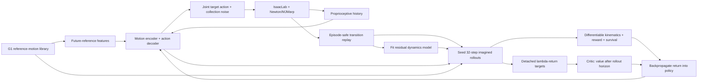
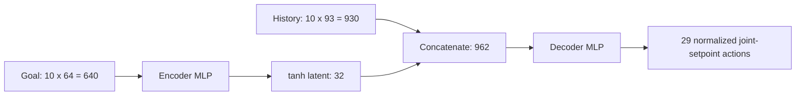

# SuperMimic on IsaacLab: implemented architecture and training procedure

This document describes the code used by the `lafan1_full` experiment on branch
`milad/supermimic`. It documents our implementation choices, rather than asserting
that they reproduce the authors' unpublished implementation exactly.

The system trains a **reference-conditioned G1 motion tracker**. A neural network
learns to predict the simulator's transitions; another network learns to control
the robot by differentiating predicted rewards through that learned dynamics.
The actual simulator supplies data and evaluates behavior. Gradients do not pass
through Newton or MuJoCo Warp.

The current experiment uses 40 G1-retargeted LAFAN1 clips, fixed physics, and
Newton/MJWarp. It does not yet implement BONES-SEED scaling, physical-parameter
randomization, downstream velocity control, a matched PPO benchmark, or DVI.

## 1. Components and information flow

In the diagram, **future-reference features** means a list of numbers extracted
from the desired motion clip: target joint angles, target joint velocities, and
relative root orientation at ten times from now through 0.9 seconds ahead.
They describe what we want the robot to do. The `goal()` function assembles these
640 values from the stored motion and current root orientation.

The **motion encoder** is a neural network that compresses those 640 target
values into 32 learned values. The **action decoder** is another neural network:
it combines those 32 values with 930 values of recent actual robot observations
and produces 29 normalized joint-setpoint commands. Those commands are converted
to position targets and executed by the robot's drives. Encoder and decoder
together form the policy and are trained together from tracking return.
Here, "decoder" means a controller producing actions; it does not reconstruct
the original reference vector. The same two networks serve every motion clip.

For example, the reference might request a knee angle of 0.60 rad now and 0.65 rad
in 0.1 seconds, while the actual knee is currently at 0.50 rad. The policy sees
both desired motion and recent actual observations, then selects coordinated
commands for the whole robot. These example angles are illustrative. The desired
future reference is separate from the world model's prediction of the outcome
of an action.



There are three separate activities:

1. **Collect:** execute the current policy in the physics simulator, with action
   and observation noise, and store actual transitions.
2. **Fit dynamics:** train a world model on short sequences from replay.
3. **Improve control:** run the policy through the learned model and optimize
   the predicted return with backpropagation through time, then fit the critic.

The world model keeps learning throughout training. Its weights are frozen only
while calculating a policy update. The critic's weights are also frozen during
that policy update, while its derivative with respect to its input remains usable.

### Source map

| Responsibility | Implementation |
|---|---|
| Command line, readiness, evaluation, outer training loop | [train.py](projects/supermimic/train.py) |
| Simulator collection and optimizer updates | [learner.py](projects/supermimic/learner.py) |
| Networks and running normalizers | [networks.py](projects/supermimic/networks.py) |
| G1 scene, actuation, reset and stepping | [environment.py](projects/supermimic/environment.py) |
| Differentiable kinematics, observations, rewards, termination | [task.py](projects/supermimic/task.py) |
| Quaternion operations and state representations | [math_utils.py](projects/supermimic/math_utils.py) |
| Motion conversion and reference sampling | [motions.py](projects/supermimic/motions.py) |
| Episode-safe replay and history reconstruction | [replay.py](projects/supermimic/replay.py) |
| Physical sanity checks | [sanity.py](projects/supermimic/sanity.py) |
| CPU contract tests | [test_contracts.py](projects/supermimic/tests/test_contracts.py) |
| Live status and plots | [status.md](status.md), generated by [plot_status.py](projects/supermimic/tools/plot_status.py) |

## 2. Motion data and reference timing

The input is already retargeted to the G1. We are not learning retargeting or
performing human-to-robot inverse kinematics during policy training.

| Property | Current library |
|---|---|
| Dataset | `lvhaidong/LAFAN1_Retargeting_Dataset`, G1 CSV files |
| Pinned revision | `ce1572906efe6157840e8474d5a0d7aa87481e74` |
| Clips | 40 |
| Converted frames | 441,140 |
| Summed clip duration | Approximately 2.4506 hours |
| Original / control sampling rate | 30 Hz / 50 Hz |
| Storage | Concatenated float32 state arrays plus clip starts, lengths and names |
| Provenance | Source-file SHA-256 hashes, dataset revision, joint order and quaternion convention |

Conversion linearly interpolates root position and joint positions, uses quaternion
SLERP for orientation, and makes successive quaternion signs continuous. It
calculates root/joint linear derivatives by finite differences. Root angular
velocity comes from relative rotations, in world coordinates.

Reference lookup clamps at each clip's last frame. Future frames therefore never
come from the next clip in the concatenated array.

At control time `t`, the policy's ten reference samples are taken at:

```text
t, t+5, t+10, ..., t+45 control frames
0, 0.1, 0.2, ..., 0.9 seconds ahead
```

The first sample is the current reference frame. The policy therefore sees a
0.9-second look-ahead, sampled every 100 ms. Its proprioceptive history uses the
last ten control observations, sampled every 20 ms, spanning 180 ms between the
oldest and newest observation.

## 3. Physical state versus policy observations

### Physical state: 71 values

The simulator collector and world model use a physically richer state than the
policy's direct proprioceptive input:

| Slice | Quantity | Size | Frame / convention |
|---|---|---:|---|
| `[0:3]` | Root-link position | 3 | World axes, environment origin subtracted |
| `[3:7]` | Root-link orientation | 4 | Unit quaternion, **XYZW** |
| `[7:10]` | Root-link linear velocity | 3 | World frame, at the link origin |
| `[10:13]` | Root-link angular velocity | 3 | World frame |
| `[13:42]` | Joint positions | 29 | Canonical G1 order |
| `[42:71]` | Joint velocities | 29 | Canonical G1 order |

Root-link velocity is distinguished from center-of-mass velocity. The kinematics
and simulator checks use the same link-origin convention.

Canonical joint order is left leg's six joints, right leg's six, waist yaw/roll/pitch,
left arm's seven, then right arm's seven. Each arm includes shoulder pitch/roll/yaw,
elbow, and wrist roll/pitch/yaw. Simulator ordering is mapped explicitly by name.

### Policy observation: 93 values per frame

| Quantity | Size | Training observation noise |
|---|---:|---|
| Joint position minus default pose | 29 | Uniform ±0.01 rad |
| Joint velocity | 29 | Uniform ±0.5 rad/s |
| Base angular velocity, rotated into base frame | 3 | Uniform ±0.2 rad/s |
| Unit gravity vector, expressed in base frame | 3 | Uniform ±0.05 per component |
| Previous executed normalized action | 29 | No additional observation noise |
| **Total** | **93** | |

Ten frames produce **930 proprioceptive features**. At reset, the first clean
observation is repeated to initialize history. Subsequently each simulator step
appends its newly observed, optionally noisy observation.

### Motion goal: 640 values

For each of the ten reference samples, `goal()` constructs:

| Quantity | Size per reference sample |
|---|---:|
| Reference joint positions | 29 |
| Reference joint velocities | 29 |
| Reference root orientation relative to current robot root orientation | 6 |
| **Total** | **64** |

The six orientation values are the rotated X and Y basis vectors of the relative
rotation, equivalent to a two-column rotation representation. Flattening ten
samples gives **640 features**.

The policy does not directly receive global root position or root linear velocity.
However, the goal constructor uses the simulator's actual root orientation,
including heading. A hardware implementation would need a consistent orientation
estimate and reference-heading alignment; that part has not been deployed here.

## 4. Exact neural-network architecture

Every hidden layer is a fully connected linear layer followed by **ELU**. Output
layers are linear unless the table specifies a final bounding operation. All
networks are feedforward; observation history provides temporal context without
an RNN or transformer.

| Network | Layer widths | Output operation | Trainable parameters |
|---|---|---|---:|
| Dynamics model | `98 → 2048 → 2048 → 2048 → 70` | Denormalize residual and integrate state | 8,738,886 |
| Motion encoder | `640 → 2048 → 1024 → 512 → 256 → 32` | `tanh` on latent | 4,075,296 |
| Action decoder | `962 → 2048 → 1024 → 512 → 256 → 29` | Clamp normalized action to `[-10, 10]` | 4,733,981 |
| Critic | `709 → 256 → 128 → 1` | Clamp value to `[-12, 12]` | 214,785 |
| **Total** | | | **17,762,948** |

Counts include linear weights and biases, and exclude running-statistic buffers,
kinematic constants, optimizer state and replay. Float32 parameters alone occupy
approximately 67.8 MiB; training additionally stores activations, gradients and
Adam moments.



### Running normalizers

The dynamics input, dynamics output residual, proprioception, goal and critic
input each have separate running statistics. Updates combine batch means and
variances using sample counts; they do not use an exponential moving average.
The standard deviation has a floor of `0.01`. Normalized **inputs** are clamped
to `[-20, 20]`; predicted residuals are denormalized without that input clamp.
Statistics update without gradients, but normalization remains differentiable
with respect to its input.

The dynamics model and decoder output weights are initialized with Gaussian
standard deviation `1e-4` and zero biases. The other linear layers retain PyTorch's
default initialization. There is no pretrained expert, behavior-cloning stage,
Gaussian policy distribution head, or policy likelihood-ratio objective.

### Dynamics model: 98 inputs and 70 residual outputs

`features(s)` converts the 71-value state to **69 features**: root height (1),
heading-normalized orientation (4), heading-frame linear/angular velocity (3+3),
and joint positions/velocities (29+29). Absolute root X/Y are omitted. The
29 executed action components bring the dynamics input to **98**. No domain
randomization context is supplied in this fixed-physics experiment.

The output is a **70-value local residual**, rather than an unconstrained next
71-value state:

| Residual | Size |
|---|---:|
| Root position change in the current base frame | 3 |
| Relative root rotation as a rotation vector | 3 |
| Root linear-velocity change in the current base frame | 3 |
| Root angular-velocity change in the current base frame | 3 |
| Joint-position change | 29 |
| Joint-velocity change | 29 |

If `R_t` is the rotation represented by the current base quaternion, integration is:

```text
p_next     = p_t + R_t * delta_position
quat_next  = normalize(quat_t * quaternion_exp(delta_rotation_vector))
v_next     = v_t + R_t * delta_linear_velocity
omega_next = omega_t + R_t * delta_angular_velocity
q_next     = q_t + delta_joint_position
qd_next    = qd_t + delta_joint_velocity
```

This preserves a unit orientation quaternion and reconstructs world motion from
local predictions. Position and velocity are predicted jointly; we do not impose
an additional exact integration constraint such as `p_next = p + dt*v`.

The world model is deterministic. It learns the complete 20 ms controlled
transition, including PD actuation and the consequences of contacts, without
predicting contact forces explicitly. Its derivatives are derivatives of a
learned surrogate, not exact derivatives of the contact solver.

### Critic: 709 inputs

The critic receives the 69 physical-state features concatenated with the
640-value motion goal. It estimates discounted future reward and supplies the
tail value after an imagined rollout. It does not receive the actor's full
observation history. Its `[-12, 12]` output clamp is a numerical stabilization
choice; the negative bound is not a lower bound on possible accumulated penalties.

## 5. Simulator, robot and action execution

| Setting | Current implementation |
|---|---|
| Scene API | IsaacLab `InteractiveScene` and `SimulationContext` |
| Physics | Newton with `MJWarpSolverCfg` |
| Physics step / control step | 5 ms / 20 ms: four simulator steps per action |
| Parallel environments | 256, spaced 4 m apart |
| Solver / line-search iterations | 10 / cap of 50 |
| Integrator | `implicitfast` |
| Contact source | Newton contacts: `use_mujoco_contacts=False` |
| Contact capacity | `nconmax=150`, `njmax=500` per configured world |
| Default contact settings | Margin 0; stiffness 160,000; damping 1,100 |
| Floor and robot friction / restitution | 1.0 / 0.0 |
| Self-collision | Enabled |
| Rendering | Headless; no rendering during training steps |
| DVI solver / simulator automatic differentiation | Neither used |

Training and all recorded videos use `NewtonCfg(solver_cfg=MJWarpSolverCfg(...))`.
No DVI solver was obtained or integrated for this experiment. Newton comes from
the public `newton-physics/newton` dependency pinned in `pyproject.toml` at
`42f7def118c2c4299ce493457bafd4e8a22a696e`.

The shipped `g1_29dof.usd` actually contains 14 finger joints in addition to the
29 modeled joints. Before importing physics, we create an isolated temporary USD
variant that welds the finger joints at zero. Their mass remains attached to the
robot. We then assert that the articulation exposes exactly the modeled 29 joints.
The downloaded source USD is not modified.

Normalized actions become joint position targets:

```text
q_setpoint[j] = q_default[j] + action_scale[j] * action[j]
action_scale[j] = 0.25 * effort_limit[j] / Kp[j]
Kp[j] = armature[j] * (20*pi)^2
Kd[j] = 4 * armature[j] * (20*pi)
```

The gains correspond to a nominal 10 Hz frequency and damping ratio 2, using the
configured effective armatures. IsaacLab's implicit actuator and the backend
execute the position-target drive, subject to configured effort limits. A useful
PD approximation is `tau = Kp*(q_setpoint-q) - Kd*qd`; the network itself outputs
neither torque nor a desired next physical joint angle directly.

Leg effort limits are 88 Nm for hip pitch/yaw, 139 Nm for hip roll/knee, and 50 Nm
for ankles. Waist yaw uses 88 Nm; waist roll/pitch use 50 Nm. Shoulders, elbows
and wrist roll use 25 Nm; wrist pitch/yaw use 5 Nm.

The default pose has hip pitch `-0.312`, knee `0.669`, ankle pitch `-0.363`,
shoulder pitch `0.2`, elbow `0.6`, and shoulder rolls `+0.2` left / `-0.2` right,
in radians. The other defaults are zero. The exact armatures and mappings are
defined in `robot_cfg()`.

During simulator collection, action execution uses:

```text
a_policy   = actor(history, goal)
a_executed = clamp(a_policy + Normal(0, 0.1^2), -10, 10)
```

Replay, action-smoothness penalties and the following observation's previous-action
field all use this **executed** action. Imagined policy rollouts do not add this
exploration noise, although they do add observation noise.

## 6. Replay, resets and episode boundaries

Replay is a GPU ring buffer with 256 time slots for each of the 256 environments:
**65,536 transitions**, retaining up to 5.12 simulated seconds per environment.
Each slot holds:

```text
(state, pre-reset successor, executed action, previous executed action,
 episode ID, motion clip ID, reference frame)
```

The state and successor each contain 71 floats; actions each contain 29 floats.
Episode/clip/frame fields are int64. The replay arrays occupy about 51.5 MiB,
excluding sampled batches.

An eight-step model-fitting window is accepted only when every transition has
the same episode ID. A terminal transition can be the last item of a valid
window; its successor is the actual fallen state, not a reset pose.

Imagined rollouts start from randomly sampled replay states. Their ten-frame
observation histories are reconstructed from clean stored states and previous
actions, with fresh sensor noise. Missing history before an episode or buffer
boundary is padded by repeating the earliest available valid observation.

Training resets choose clips uniformly, then choose starting frames uniformly
from the integer range before the final 33 frames. Root pose and velocities,
joint positions and velocities are set from that reference frame. Joint positions
receive additional uniform ±0.02 rad reset noise. There is no adaptive return-based
reset sampler and no randomized physical context.

The collector captures the transition before explicitly resetting finished worlds.
`failure` and `timeout` remain separate: failures are tracking violations; timeouts
are motion end or 500 control steps (10 simulated seconds). Imagined clip-end
masking prevents returns and reference lookup from continuing into another clip.

## 7. Rewards, kinematics and survival

### Differentiable forward kinematics

The kinematic tree is extracted from the finalized Newton model: joint parents,
axes, parent/child joint-frame transforms and canonical joint names. PyTorch
operations propagate body poses and link-origin velocities through tree levels.
Independent branches at the same depth are batched together.

Fourteen tracked bodies are used: pelvis; left/right hip-roll, knee and ankle-roll
links; torso; and left/right shoulder-roll, elbow and wrist-yaw links. Finger
subtrees are excluded. The same kinematics computes current and reference body
states, so imagined rewards require no simulator call. Reference kinematics for an
imagined batch is precomputed outside the differentiable policy path.

### Tracking reward

Let `mean_b` mean an average over the fourteen tracked bodies. Orientation error
is the norm of the relative rotation's logarithm, in radians. Before multiplying
by the 20 ms control interval, the reward is:

| Term | Expression | Weight |
|---|---|---:|
| Body position | `exp(-mean_b(||p_b - p_ref_b||^2) / 0.3^2)` | 1 |
| Body orientation | `exp(-mean_b(||log(R_b R_ref_b^-1)||^2) / 0.4^2)` | 1 |
| Body linear velocity | `exp(-mean_b(||v_b - v_ref_b||^2) / 1.0^2)` | 1 |
| Body angular velocity | `exp(-mean_b(||w_b - w_ref_b||^2) / 3.14^2)` | 1 |
| Root position | `exp(-||p_root - p_ref_root||^2 / 0.3^2)` | 0.5 |
| Root orientation | `exp(-||log(R_root R_ref_root^-1)||^2 / 0.4^2)` | 0.5 |
| Action changes | `sum_j((a_t[j] - a_previous[j])^2)` | -0.1 |
| Soft joint-limit violation | `sum_j(max(q_j-upper_j,0) + max(lower_j-q_j,0))` | -2 |

The final step reward is `0.02 * weighted_sum`. The positive weights sum to 5,
so its maximum is **0.1 per control step**, attained only with perfect tracking
and zero penalties. Reward may be negative. Body positions use the reference and
robot's world-aligned frames after environment-origin removal; there is no extra
per-step XY/yaw realignment of the reference for this reward.

There is no learned reward head, self-collision penalty, or end-effector failure
condition. Physical self-collision remains enabled in the simulator.

### Hard simulator failures and soft imagined termination

Define height error `h = abs(z_root - z_ref_root)`. Let `g_body` and `g_ref`
be the unit gravity direction expressed in robot and reference base frames, and
define tilt error `e = abs(g_body.z - g_ref.z)`.

The simulator fails an episode if `h > 0.25 m` or `e > 0.8`. Tilt error is not a
direct roll/pitch angle threshold; it is reference-relative, so a roll or inverted
reference is not automatically classified as a failure.

Imagination uses the differentiable approximation:

```text
p_height = sigmoid(100 * (h - 0.25))
p_tilt   = sigmoid(30 * (e - 0.8))
d_soft   = 1 - (1 - p_height) * (1 - p_tilt)
```

This quantity acts as a termination probability in the return calculation; it is
not a learned contact/fall classifier. Survival starts at one and is multiplied
by `(1 - d_soft)` and a hard clip-end mask at every imagined step.

## 8. Exact training updates

### Dynamics fitting: eight-step autoregression

For each dynamics optimizer step, sample 256 valid replay windows, each containing
eight transitions. Initialize the predicted state with the logged first state.
Then repeatedly apply the world model to the **predicted** state and the logged
executed action. Later steps do not reset predictions to ground truth.

```text
s_hat[0] = replay_state
for j in 0..7:
    s_hat[j+1] = world_model(s_hat[j], logged_action[j])
    error[j] = state_delta(logged_successor[j], s_hat[j+1]) / residual_std
model_loss = mean(error^2 over batch, time and 70 residual components)
```

`state_delta` measures local translation/velocity changes, relative rotation in
rotation-vector form, and joint differences. Input/residual normalizers update
from each batch's first transition before the optimizer step. There are ten such
optimizer steps per model-update phase: **2,560 sampled windows**, or 20,480
predicted control transitions. This is not a single 2,560-window gradient step.

### Actor: 32-step backpropagation through the world model

Sample 512 starting states with their histories from replay. Run the current actor
and fixed world model together for **32 steps = 0.64 simulated seconds**. At each
step, advance the reference, compute the goal from the predicted state, execute
the deterministic policy, predict the next state, and calculate analytic reward,
soft termination and the next noisy observation history.

Let `m_t` be one while the reference transition remains inside its clip and zero
afterwards. With `gamma=0.99`:

```text
c_0 = 1
c_(t+1) = c_t * (1 - d_soft_(t+1)) * m_t
J = sum(t=0..31, gamma^t * c_t * r_(t+1) * m_t)
    + gamma^32 * c_32 * V(s_hat_32, goal_32)
actor_loss = -mean_batch(J) / sum(t=0..31, gamma^t)
```

The denominator is approximately 27.5 and keeps the objective's scale stable.
The world model's and critic's **parameters** are frozen for this backward pass;
their **input Jacobians** remain active. Gradients reach the actor through rewards,
survival weights, predicted states, subsequent observations/goals/actions and the
terminal critic value. Earlier actions can therefore receive credit for later
balance and tracking outcomes.

No gradients pass through real physics, reference data, normalizer-statistic
updates or replay sampling. Analytic gradients here mean automatic differentiation
through the surrogate; they do not guarantee correct simulator derivatives.

### Critic: detached lambda returns

Save imagined critic inputs, rewards and continuation factors with gradients
detached. Set `R_H = V_H` at the end of the rollout and recurse backwards:

```text
R_t = r_(t+1)*m_t + gamma*(1-d_soft_(t+1))*m_t
      * ((1-lambda)*V_(t+1) + lambda*R_(t+1))
lambda = 0.95
critic_loss = mean((V(input_t) - stop_gradient(R_t))^2)
```

These are lambda-return targets computed solely from imagination. Targets are
fixed for all five critic epochs. Each epoch shuffles the `512*32 = 16,384`
imagined state/value pairs into four minibatches, giving **20 critic optimizer
steps per actor update**. The critic has no separate target network or EMA copy.

### Optimizers, clipping and outer-loop schedule

| Setting | Dynamics | Actor | Critic |
|---|---|---|---|
| Optimizer | Adam | Adam | Adam |
| Initial learning rate | `2e-4` | `2e-4` | `2e-4` |
| Adam betas | `(0.9, 0.999)` | `(0.9, 0.95)` | `(0.9, 0.999)` |
| Global gradient-norm clip | 1.0 | 1.0 | 1.0 |
| Additional element-wise gradient clip | None | ±0.1, after norm clipping | None |
| Gradient steps per update event | 10 | 1 | 20 |

All three learning rates follow this schedule, indexed by the full-run simulator
iteration `i`, not the number of optimizer steps:

```text
lr(i) = 2e-4 * [0.03 + 0.97 * (1 + cos(pi*min(i/250000,1))) / 2]
```

After 250,000 iterations, the rate stays at `6e-6`.

One outer-loop iteration collects **one control step in each of 256 environments**.
An update-credit counter adds `0.4` per iteration. Once it reaches one, the loop
runs a dynamics phase and actor/critic phase, then subtracts one. Thus, on average,
five simulator iterations produce two update events. The `utd=0.4` setting refers
to this scheduling rule; it is not a literal ratio of individual imagined to real
transitions.

At 320,000 iterations this corresponds to 81,920,000 main-loop simulator
transitions and about 128,000 actor updates, in addition to readiness and replay
warm-up. Each actor update imagines 16,384 control transitions. Model and critic
have the additional optimizer steps described above.

## 9. Readiness, warm start and the launched experiment

The run's authoritative learner settings are recorded in
[config.json](projects/supermimic/runs/lafan1_full/config.json). They select the
full network widths, 256 simulator environments, 512 imagined rollouts, 256-window
dynamics batches, a 256-step replay, seed 42 and PyTorch compilation.

`torch.compile` wraps the autoregressive model loss and one imagined policy/model/
reward step. It does not differentiate or replace the actual physics simulator.
Training remains float32 with PyTorch's high float32-matmul precision setting;
there is no explicit automatic-mixed-precision or gradient-scaler path here.

Before launch, readiness performed independent simulator/FK/reset checks, retained
held-out transitions from a separate collection block, fitted dynamics, ran 200
actor/critic smoke updates, checked real simulator-return improvement, and exercised
checkpoint reload plus a resumed optimizer update. It also checked finite nonzero
gradients, repeatable initial evaluation and GPU memory headroom.

| Readiness measurement | Before | After |
|---|---:|---:|
| Held-out eight-step root-position RMSE | 0.05553 m | 0.01435 m |
| Held-out joint-position RMSE | 0.20082 rad | 0.04703 rad |
| Mean five-second evaluation return | 0.07599 | 0.44876 |
| Failed five-second windows | 40/40 | 15/40 |

The hold-out is for simulator transitions, not unseen motion clips. Its dynamics
check does not prove long-horizon accuracy or correctness of the surrogate's
Jacobians relative to actual contact dynamics.

The readiness report fingerprints the top-level experiment Python sources,
learner settings, motion-file hash, selected clips, PyTorch version and GPU model.
It records a hash of the validated checkpoint. The full run verifies this report
and starts from that checkpoint, including trained model/policy/value weights,
normalizers and optimizer states. Iteration zero is therefore **not an untrained
policy**. The full-run command's unused `--smoke-updates` default is not evidence
of how many updates were used by the earlier readiness run.

The launched run targets 320,000 additional main-loop iterations, writes an atomic
`last.pt` every 500 iterations, and evaluates every 2,000. It refills replay with
64 control steps before continuing optimization. Runtime settings and the command
are retained in [launch.json](projects/supermimic/runs/lafan1_full/launch.json),
along with a source snapshot under the run's `source/` directory. The top-level
Python files were checked against that snapshot when this document was written.

Checkpoints contain networks, optimizer states, normalizers, counters, RNG states
and data provenance. They do not contain the simulator state, solver warm-start
buffers or replay. Resume initializes new simulator episodes and refills replay;
it is a continuation of learning rather than a bit-identical physical replay.
Periodic saves overwrite `last.pt`; there is no automatic `best.pt` or numbered
checkpoint archive. The initial `sanity.pt` remains available separately. A best
historical evaluation in the log therefore does not guarantee that those exact
weights are still retained.

## 10. Evaluation and interpreting the monitoring plots

Periodic evaluation starts every selected motion at its first frame, uses a
deterministic actor, disables action/observation/reset noise, and follows up to
250 control steps, or **five seconds**, per clip. Failed trajectories stop
contributing reward. Return is normalized by `0.1 * min(250, clip_length-1)` and
then averaged equally across motion clips.

The 256 worlds replicate the 40 clips. Return is averaged within each clip's
replicas before averaging over clips; a clip is marked failed if any of its
replicas fails. These replicas are not a deliberately randomized robustness test.

Full-clip evaluation is available separately via `--mode evaluate` and
`--evaluation-steps 0`. It ignores the training-only 500-step truncation. Periodic
and final training-loop evaluations remain five-second windows, so zero failed
windows does not establish that all complete motions succeed.

| Logged quantity | What it means |
|---|---|
| `normalized_return` | Actual simulator tracking quality under the stated evaluation protocol |
| `failed_clips` | Count of failed evaluation windows unless `complete_clips=true` |
| `sim_reward` | Mean instantaneous noisy-collection step reward across environments |
| `sim_failure_fraction` | Fraction of worlds failing on that control step, not an episode failure rate |
| `model_loss` | Online eight-step autoregressive training loss, not a held-out error |
| `actor_loss` | Negative, discounted, survival-weighted, critic-bootstrapped imagined objective |
| `critic_loss` | Fitting loss on detached imagined lambda returns |
| `imagined_reward` | Mean reward across imagined rollout steps, with clip-end masking |
| `imagined_survival` | Mean soft-survival product at the imagined horizon |
| `*_gradient_norm` | Gradient norm before clipping |

The simulator and imagined reward curves sample different state distributions.
Their gap is not, on its own, a model-prediction error. High imagined survival can
coexist with imperfect simulator tracking. Evaluation return and per-motion
coverage remain necessary checks on what the learned policy actually does.

The automatically refreshed [status.md](status.md) is the place for live results.
This architecture document intentionally does not embed a moving claim about the
latest training iteration or best checkpoint.

## 11. What this implementation establishes and what remains

The implemented path demonstrates learning a G1 tracker using a learned,
differentiable surrogate of transitions collected through IsaacLab. It includes
episode-safe data collection, analytic task calculations, BPTT policy optimization,
value bootstrapping, explicit readiness gates and resumable training.

It does not yet establish the paper's full-scale compute claims, generalization
to unseen motions, robustness under randomized physical parameters, or transfer
to hardware. Our robot geometry/inertia configuration, residual representation,
normalization, smoothing, goal features, value clamp and reduced batch sizes are
explicit implementation choices. The original dataset and physical simulator
remain essential; the neural model does not manufacture a motion library or prove
that every retargeted reference is physically feasible.

## Related files and references

- [Run instructions](projects/supermimic/README.md)
- [Implementation plan and validation record](SUPERMIMIC_PLAN.md)
- [Live status](status.md)
- [Exact readiness report](projects/supermimic/runs/lafan1_full/readiness.json)
- [SuperMimic paper](https://arxiv.org/abs/2610.28480) and [project website](https://supermimic.github.io/)
- [BeyondMimic reference robot configuration](https://github.com/HybridRobotics/whole_body_tracking),
  revision `9db9158`; [retained MIT license](projects/supermimic/LICENSE-BeyondMimic.txt)

This document is grounded in the source map above and the saved run configuration.
No training-code changes or training restart were required to produce it.
