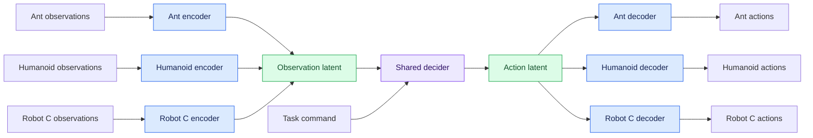
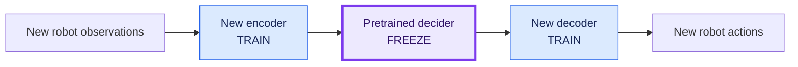
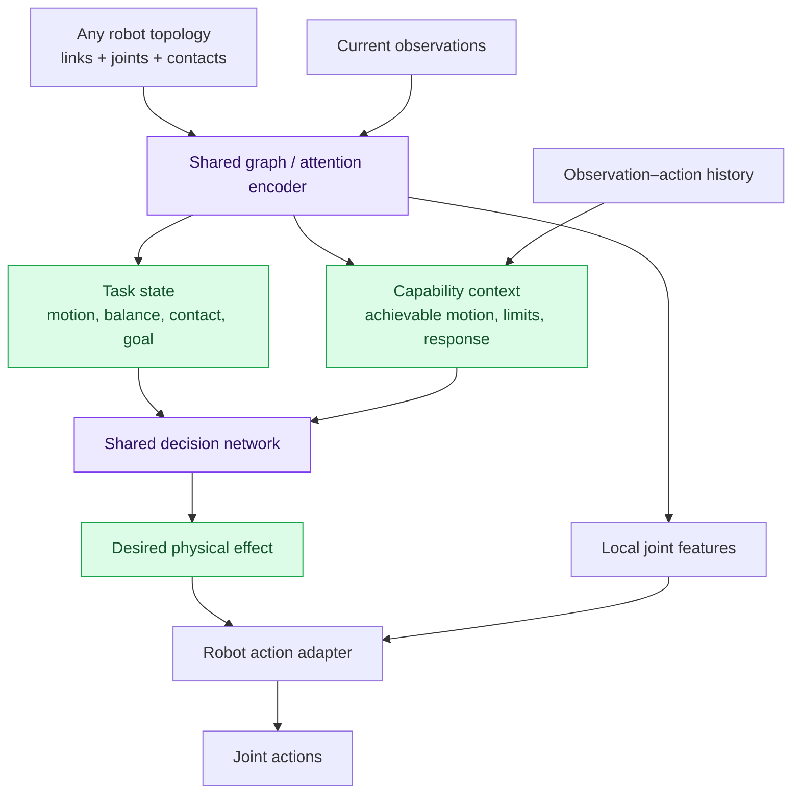
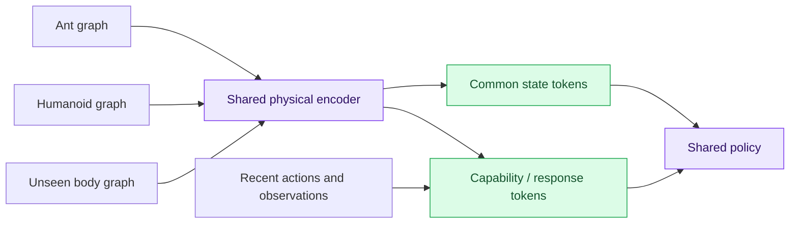
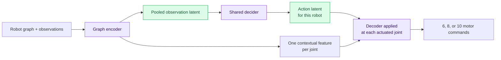

# I want to start a new research project with isaaclab. We sh…

> I want to start a new research project with isaaclab. We should create a plan for things I am describing to you so we can get back to it (gitignored .md file in the isaaclab repo root)
>
> The idea is the following;
> I want to train multiple robots at the same time;
> Use different observation heads, and then map those to a latent space representation, then there is a deciding network which is shared for all robots, and then each robot has its own network to map from a shared latent action space to its action space.
>
> The idea is that we want to train a policy that can be used to play iwth robots that the trianing has never seen, has different topology and obs space, etc.
>
> Do you see where I am going with this? For now I need to understant in high level what we need, what sort of networks we can use, if this is a good idea, if this has been tried before etc.
>
> My idea was for isntance,
>
> Ant >                          ||||||||||||||||||||||||||||||||||||||||||||||||||||||||||
> humanoid >              |||||| Shared obs latent space  |||||||||  >  Decider network
> some other robo > |||||||||||||||||||||||||||||||||||||||||||||||||||||||||
>
>                                      |||||||||||||||||||||||||||||||||||||||||||||||||||||||||||||  >  remap to Ant actios
> Decider network > |||||| Shared action latent space  |||||||||   >  remap to humanoid actios
>                                      ||||||||||||||||||||||||||||||||||||||||||||||||||||||||||||||  >  remap to robot actios
>
> Can you evaluate this idea and draw nice diagrams so we can brainstorm

<details><summary>11 previous messages</summary>

> I’ll evaluate the architecture, look up related research, and save a working plan with diagrams in a gitignored Markdown file at the IsaacLab repo root. A key question is how a new robot gets its observation and action mappings—whether those need training or can be generated from its structure.
>
> <details><summary>Searched the web</summary>
>
> Searched the web for `Shared Modular Policies robot morphology transfer Huang 2020 ...`
>
> </details>
>
> For a robot excluded from training, which target matters most? I’ll include both in the plan, but this determines the main architecture.
> - Zero-shot control using its robot description, with no new training
> - Train only small observation/action adapters while keeping the shared policy frozen
> - Start with adapter training, then work toward zero-shot control
>
> <details><summary>Searched the web</summary>
>
> Searched the web for `site.arxiv.org Shared Modular Policies 2020 Huang ...`
>
> </details>
>
> This is a credible research direction, and there is close prior work—including a paper that learns both shared state and action spaces. The main challenge is that separate robot-specific heads can learn incompatible meanings for the same latent coordinates. Sharing a network does not, by itself, guarantee transfer.
>
> I’m separating two targets in the plan: adapting small heads for a new robot, and controlling an unseen robot directly from its body description. The second needs an architecture that can handle new joints and connectivity without adding trained parameters.
>
> <details><summary>Searched the web</summary>
>
> Searched the web for `https://arxiv.org/abs/2406.01968`
>
> Searched the web for `https://arxiv.org/html/2406.01968v1`
>
> </details>
>
> **For a robot excluded from training, which target matters most? I’ll include both in the plan, but this determines the main architecture.**
>
> Train only small observation/action adapters while keeping the shared policy frozen
>
> That makes the project more focused: train a reusable shared policy, then freeze it and learn only small input/output adapters for each new robot.
>
> The crucial experiment will be whether those adapters learn faster than a policy trained from scratch—and whether they actually use the shared policy. I’ll include controls for that, because a powerful action decoder could otherwise learn the whole task on its own.
>
> <details><summary>Created a file, searched the web</summary>
>
> Searched the web for `'target'`
>
> - Wrote `~/Documents/Repos/IsaacLab/CROSS_EMBODIMENT_RESEARCH_PLAN.md` (+248 -0)
>
> </details>
>
> The plan now centers on adapter-only transfer, with diagrams for joint training, new-robot adaptation, and a possible topology-aware extension. I also checked the local Isaac Lab tasks: Ant and Humanoid provide useful examples of different observation/action sizes, but their reward settings differ, so we’ll need a common evaluation task before comparing transfer.
>
> <details><summary>Edited a file</summary>
>
> - Wrote `~/Documents/Repos/IsaacLab/.git/info/exclude` (+3 -0)
>
> </details>
</details>

Yes—you’re proposing **a reusable decision network with a different sensory and motor interface for each robot**. With your clarification that new robots can train small adapters, this is a plausible, testable research project.

I saved the working plan, diagrams, papers, and experiment checklist in [CROSS_EMBODIMENT_RESEARCH_PLAN.md](~/Documents/Repos/IsaacLab/CROSS_EMBODIMENT_RESEARCH_PLAN.md). It is locally gitignored through `.git/info/exclude`; Git’s working tree remains clean.

**Your architecture looks like this:**



Each robot follows its own path through the shared network. Their observations need not arrive together or have the same dimensions.

For a new robot, the experiment becomes:



The central research question is: **does the pretrained decider make learning those new adapters substantially easier than learning a new policy from scratch?**

**The hardest part is giving the latents compatible meanings.**

Ideally, an action latent might express an intention like “accelerate forward while maintaining balance.” An Ant and humanoid would execute it through different joint motions.

But training does not automatically produce that interpretation. Each encoder could put its robot in a separate region of the latent space, letting the decider memorize unrelated controllers. Or a powerful decoder could learn most of the task itself.

Therefore, we need to demonstrate both:

- Transfer improves learning on robots excluded from pretraining.
- The improvement depends on the **learned shared network**, rather than just the adapters or architecture.

Also, the representation should preserve information about the body’s capabilities. Balance and feasible actions depend on morphology; complete removal of body information is not necessarily desirable.

**What networks should we use?**

| Component | My starting choice | When to make it more complex |
|---|---|---|
| Observation adapters | Small MLPs | Graph networks or joint/sensor tokens when exploiting topology |
| Shared decider | MLP | GRU for memory; Transformer for structured tokens or longer histories |
| Action adapters | Small MLPs | Per-joint or graph decoders to share structure across bodies |
| Training critic | Separate critic per robot | Shared critic after the basic actor transfer works |

I would start with MLPs to test the transfer hypothesis. We can then ask whether graph or Transformer structure improves it. A larger architecture could otherwise obscure why the approach succeeds or fails.

One useful design choice is whether the action decoder receives local joint state in addition to the action latent. That could help it execute reusable intentions, but also makes it easier to ignore the decider. The plan includes both as an explicit comparison.

**Has this been tried? Yes—there is close prior work.**

| Work | Connection to your idea |
|---|---|
| [Latent Space Alignment, 2024](https://arxiv.org/abs/2406.01968) | Closest match: shared state/action latents, a fixed latent policy, and trained target encoders/decoders. Demonstrated for manipulation; target adaptation uses alignment losses without task reward. |
| [Shared Modular Policies, 2020](https://arxiv.org/abs/2007.04976) | Shared actuator modules communicate across different body structures and transfer to unseen variants. |
| [MetaMorph, 2022](https://arxiv.org/abs/2203.11931) | Morphology-conditioned Transformers learn controllers across modular robot bodies. |
| [Latent Action Diffusion, 2025/2026](https://arxiv.org/abs/2506.14608) | Learns aligned action representations across different end-effectors for shared manipulation policies. |

So the broad architecture is established. A potential contribution is **showing that diverse locomotion pretraining produces a frozen controller that supports efficient adaptation across substantially different body topologies**. Whether that is novel enough requires a deeper literature comparison.

**My proposed first experiment:**

1. Choose one task family—flat-ground velocity tracking with proprioception.
2. Establish working specialist policies for several source robots.
3. Jointly train their adapters and shared decider.
4. Freeze the decider and train adapters for held-out robots.
5. Compare learning curves against scratch training, full fine-tuning, and adapters around a **frozen random decider**.

That last control is especially revealing: if a random decider works equally well, we have not demonstrated useful shared decision-making.

I would treat Ant-to-humanoid transfer as a demanding later test, after establishing the mechanism on related bodies. The first milestone should be convincing evidence that a new robot learns faster because of what the shared network learned from other robots.

> okay let's ask a different question then;&#x20;
> How can we encode observation about robots so we can generalize them to other robots with different topoligy ? see for instance here
> [https://arxiv.org/pdf/2508.15755](https://arxiv.org/pdf/2508.15755)
> this is learning from data to predict physics so it isn't exactly what we are looking for.
>
> but I want to see how we can abstract different embodiment and asbtract the dynamics into something something that is topology independent

<details><summary>4 previous messages</summary>

> I’ll read the paper and use it to examine how we could represent a robot’s state and dynamics without tying the representation to a fixed number or arrangement of joints. I’ll add the findings to our research plan.
>
> <details><summary>Searched the web</summary>
>
> Searched the web for `https://arxiv.org/abs/2508.15755`
>
> Searched the web for `site.arxiv.org graph networks learnable physics engines inference control 2018 Sanchez Gonzalez ...`
>
> Searched the web for `centroidal dynamics whole body motion planning contact forces center mass angular momentum paper Orin Goswami Lee 2013`
>
> </details>
>
> NeRD makes an important distinction: its models are robot-specific, while its representation removes dependence on global position and heading. That gives us a useful starting point, but it does not solve transfer across body topologies.
>
> For our project, I’d separate three things: a representation that accepts any body graph, a common description of motion and contact, and a compact description of what that body can actually do. That last part matters—a humanoid and an Ant can have the same velocity while needing very different actions to avoid falling.
>
> <details><summary>Edited a file, searched the web</summary>
>
> Searched the web for `https://ambarish.com/paper/Orin_Goswami_Lee_Centroidal_Dynamics_AURO.pdf`
>
> Searched the web for `https://dspace.mit.edu/entities/publication/eafd7d09-bc5d-4c2f-9ee1-4c5a9334fad7`
>
> - Wrote `~/Documents/Repos/IsaacLab/CROSS_EMBODIMENT_RESEARCH_PLAN.md` (+106 -0)
>
> </details>
</details>

Yes. **I think the useful abstraction is “what is happening to this body, and what changes can this body produce?”** That gives us a common interface across robots while preserving the physical differences needed for control.

Your NeRD reference is relevant: it uses robot-relative state, contact information, applied torques, and history. However, it learns **robot-specific models**; its spatial invariance removes dependence on global position and heading, rather than removing dependence on robot topology. We can borrow its representation principles without building a neural simulator. [NeRD, Sections 3–4](https://arxiv.org/html/2508.15755)

There are three different problems hiding inside “topology independent”:

| Property | What we want |
|---|---|
| Independent of joint ordering | Renumbering the joints should not change the controller’s behavior. |
| Supports different topologies | The same encoder architecture accepts different numbers and arrangements of links. |
| Common behavioral meaning | Similar representations imply similar possibilities for future motion. |

A graph network addresses the first two structurally. **The third requires deciding what physical information the representation should preserve.**

**I would build the representation in three stages.**

First, represent each robot as a collection of physical parts and relationships, rather than a fixed vector whose entries mean “Ant joint 1,” “Ant joint 2,” etc.

| Element | Information to encode |
|---|---|
| Link | Relative pose, velocity, mass, inertia, dimensions |
| Joint | Axis, type, position, velocity, limits, connection between links |
| Actuator | Available effort, speed, control mode, response characteristics |
| Contact | Relative position, normal, separation/contact state, relative velocity |
| Global context | Gravity direction, task command, relevant terrain |
| History | Recent observations and actions |

A shared graph encoder processes the connections; attention can communicate across distant parts. The same learned operations apply to a two-link arm or a many-jointed humanoid. This principle has precedent in [graph networks for physics and control](https://proceedings.mlr.press/v80/sanchez-gonzalez18a.html).

**Topology becomes input data instead of being built into the network’s dimensions.** The encoder still uses topology because connectivity affects what happens.

Second, express geometry consistently. Use a robot-relative frame for positions, velocities, contacts, and goals, while retaining gravity direction and distance to relevant surfaces. Otherwise, the network wastes capacity learning that moving the entire scene ten meters sideways does not change the control problem.

Third—and this is the research opportunity—compress the encoded body into **task state and capability context**:



This is my proposed architecture, not a result established by the cited papers.

The **task-state representation** describes things that have comparable meanings across bodies: center-of-mass motion, orientation relative to gravity, momentum, contact relationships, and progress toward a goal.

The **capability representation** describes how the current body can change those quantities: how strongly it can accelerate, where it can establish contact, which directions it can resist disturbances, and how quickly its actuators respond.

Some capability information comes from the robot description. Other information—payload, friction, actuator delay—may need to be inferred from recent actions and their effects. [RMA](https://arxiv.org/html/2107.04034) provides a useful precedent for estimating dynamics context from history, although it addresses a fixed quadruped embodiment rather than topology transfer.

**There is already a useful physical example of this abstraction: centroidal dynamics.**

For locomotion, the motion of the whole robot’s center of mass obeys:

\[
m\ddot c = mg + \sum_i f_i
\]

The form is the same for an Ant, humanoid, or hexapod. Similarly, external contact forces and moments determine changes in total angular momentum. This motivates describing whole-body motion through common physical quantities. [Centroidal dynamics](https://pure.kaist.ac.kr/en/publications/centroidal-dynamics-of-a-humanoid-robot/)

But the bodies differ in **which contact forces they can actually produce**. Joint limits, posture, available contacts, and motor strength constrain that.

For example, two robots might have the same forward velocity and body tilt. One can recover by shifting force between four planted feet; the other must take a step. An encoder that makes those situations identical has discarded information the policy needs.

So I would aim for:

> **A common description of motion, accompanied by a compact description of the body’s available ways to change it.**

This also explains why center-of-mass state alone is insufficient: internal configuration and contact reachability still matter. Combining centroidal dynamics with full-body constraints is an established approach in [whole-body motion planning](https://dspace.mit.edu/entities/publication/eafd7d09-bc5d-4c2f-9ee1-4c5a9334fad7).

**To abstract dynamics, we also need to abstract actions.**

“Apply this vector of joint torques” has different meanings across robots. A common action could instead request a physical effect:

- Change body velocity over a specified interval.
- Produce a turning response.
- Move a contact point toward a location.
- Execute a learned motor skill with a consistent outcome.

Then the relationship we want is approximately:

\[
z_{t+H} \approx F(z_t,\ b_t,\ u_t)
\]

Here, \(z\) describes task state, \(b\) describes body capabilities, and \(u\) is the abstract action executed through the robot’s adapter.

We should expect a shared *conditional* dynamics model. Removing \(b\) entirely would require the adapters to make different bodies behave equivalently over the chosen actions and operating range—a stronger requirement.

**We can train this representation without trying to predict every detail of physics.**

My proposed first experiment would add an auxiliary objective: given the representation and action, predict future **task-relevant effects**, such as changes in velocity, orientation, and contact state over several horizons.

That predictor teaches the encoder to preserve information useful for control. It can be discarded at deployment.

We could then encourage states from different robots to have similar representations when corresponding feasible actions produce similar outcomes. This resembles the motivation behind [bisimulation-based representation learning](https://arxiv.org/abs/2006.10742), but defining corresponding actions across robots is an additional problem we must solve.

For our project, I would compare:

1. Robot-specific MLP observation adapters.
2. A shared graph/token encoder.
3. That encoder with capability context and future-effect supervision.

The decisive measurement remains how efficiently each representation supports adapter training on a held-out topology.

I added this direction, its assumptions, and the diagram to the [research plan](~/Documents/Repos/IsaacLab/CROSS_EMBODIMENT_RESEARCH_PLAN.md:242). My strongest recommendation is to investigate **shared physical effects and body capabilities** as the abstraction, rather than expecting a generic latent bottleneck to discover compatible dynamics on its own.

> okay let's ask a different question then;&#x20;
> How can we encode observation about robots so we can generalize them to other robots with different topoligy ? see for instance here
> [https://arxiv.org/pdf/2508.15755](https://arxiv.org/pdf/2508.15755)
> this is learning from data to predict physics so it isn't exactly what we are looking for.
>
> but I want to see how we can abstract different embodiment and asbtract the dynamics into something something that is topology independent

Yes. **We can build an interface that works across topologies by representing physical relationships and achievable effects.** The important distinction is that the *interface* can be topology independent while its contents still describe the physical consequences of the topology.

For example, a humanoid and an Ant can both be represented as “moving forward, tilting left, with limited ability to accelerate sideways.” Their joint arrangements differ, but those descriptions have common meanings.

**Your NeRD reference gives us part of the answer.** It represents state in a robot-relative frame and includes contacts, torques, gravity, and history. However, its learned models are robot-specific: removing global position and heading dependence does not establish transfer between topologies. [NeRD](https://arxiv.org/html/2508.15755)

I see three useful levels of abstraction.

**1. Represent a robot as physical parts and relationships.**

Instead of concatenating joint measurements into a robot-specific vector, construct a graph:

| Graph component | Features |
|---|---|
| Links | Pose, velocity, mass, inertia, geometry |
| Joints connecting links | Axis, type, angle, velocity, limits |
| Actuators | Effort limits, control mode, response parameters |
| Environmental interactions | Contact locations, normals, relative motion |
| Global context | Gravity, task command, relevant surroundings |

A shared graph network or Transformer processes this structure. The input can contain different numbers of parts.

This gives us **one encoder architecture for many bodies**. It should also be insensitive to arbitrary link numbering: renumbering parts changes their ordering, not their physical meaning. Graph networks have been used this way for learned physics and control. [Sanchez-Gonzalez et al.](https://proceedings.mlr.press/v80/sanchez-gonzalez18a.html)

However, this alone does not produce a common behavioral representation. It provides the machinery to learn one.

**2. Compress the graph into a common physical interface.**

My proposed interface would have two components:

- **State:** What is happening—motion, momentum, contact relationships, configuration relative to the environment.
- **Response/capability:** How this body can change that state—reachable motions, force limits, actuator response, and available contact transitions.

A fixed set of attention queries could compress an arbitrary number of link tokens into, say, a small collection of latent tokens. The same queries and encoder weights would operate on every robot.



The tokens are learned; names like “balance” or “capability” describe the intended information, not meanings that appear automatically.

**3. Give the representation meaning through predicted consequences.**

This is where dynamics becomes useful, even though we are not building a simulator.

Suppose two robots have different observations but, after corresponding actions, show comparable changes in motion and contact. We want their representations to express that similarity.

We could train an auxiliary model:

\[
\text{future physical effects}
=
F(\text{state representation},\ \text{capability representation},\ \text{abstract action})
\]

The targets could initially be velocity changes, orientation changes, contact transitions, or movement relative to a goal over several time horizons.

The predictor forces the representation to preserve information about **what actions will cause**. It need not predict every joint trajectory or run at deployment.

This is related to behavioral state abstractions such as bisimulation: states are similar when their actions lead to similar rewards and future behavior. Applying that idea across bodies additionally requires defining corresponding actions. [Bisimulation-based representation learning](https://arxiv.org/abs/2006.10742)

**The action correspondence is essential.** “Increase joint 3 torque” is not a common action across robots. “Produce this change in body motion over the next interval” can be, provided each robot has an adapter that can realize it. Some effects will be feasible for one body and unavailable to another; the capability representation must preserve that distinction.

There is a concrete physical precedent: every articulated robot’s center-of-mass acceleration is governed by total external force, regardless of its joint layout. The equation is shared, while the achievable forces depend on posture, contacts, and actuators. That is the kind of separation we want to learn more generally. [Centroidal dynamics](https://pure.kaist.ac.kr/en/publications/centroidal-dynamics-of-a-humanoid-robot/)

**My recommendation is a graph encoder trained to summarize action-conditioned physical effects.** Use the body description for known structure and observation/action history for uncertain dynamics. History-based dynamics inference has precedent in [RMA](https://arxiv.org/html/2107.04034), though its experiments concern a fixed quadruped topology.

The research hypothesis would be:

> Robots with different structures can share a control representation when it describes their current physical situation and their achievable responses in common coordinates.

We should test whether that representation improves transfer beyond a graph encoder trained only through policy reward. This direction is already recorded in the [research plan](~/Documents/Repos/IsaacLab/CROSS_EMBODIMENT_RESEARCH_PLAN.md:242).

> Okay first tell me your impression. Would this work?
> We can start with something simple like adding ant and a modified ant with a three leg instead of 4. and see if we can generalize to 5 leged ant? We would need to build this in isaac lab, basically train with 2 ants per world, ( no interaction between them, no contact or anything) then try with a 5 legged ant?
>
> I want to also understand what happens after shared policy is obtained
> would we have decoded per env then? do they mapp to grpah networks again ?

<details><summary>4 previous messages</summary>

> I’ll assess the three-, four-, and five-legged Ant experiment and check how Isaac Lab’s Ant task could support it. I’ll also clarify which parts of the controller would be shared and which would belong to each robot.
>
> <details><summary>Explored 5 files, searched the web</summary>
>
> <details><summary>Explored 5 files</summary>
>
> - Read `./AGENTS.md`
> - Read `./CROSS_EMBODIMENT_RESEARCH_PLAN.md`
> - Read `./source/isaaclab_tasks/isaaclab_tasks/core/locomotion/ant/ant_direct_env.py`
> - Read `./source/isaaclab_tasks/isaaclab_tasks/core/locomotion/ant/ant_direct_env_cfg.py`
> - Read `./skills/user/create-environments/SKILL.md`
>
> </details>
>
> Searched the web for `https://arxiv.org/abs/2007.04976`
>
> </details>
>
> My impression is that this is a good first experiment. I’m more optimistic about fast adapter training on the five-legged Ant than about immediate zero-shot walking. Training on three and four legs and testing on five asks the policy to handle a larger body graph and a new coordination pattern.
>
> I’m using the repository’s environment-building guide for the proposed layout. One distinction is clear: decoder weights would be shared across all copies of a robot type; each simulated Ant would get its own observations, latent activations, actions, and reset state.
>
> <details><summary>Edited a file, explored 2 files, a search, ran a command</summary>
>
> <details><summary>Explored 2 files, a search</summary>
>
> - Read `./source/isaaclab_tasks/isaaclab_tasks/core/locomotion/locomotion_direct_env.py`
> - Read `./source/isaaclab_assets/isaaclab_assets/robots/ant.py`
> - Searched for `ArticulationCfg|robot_[12]|robot[12]|possible_agents` in `isaaclab_tasks`
>
> </details>
>
> - Wrote `~/Documents/Repos/IsaacLab/CROSS_EMBODIMENT_RESEARCH_PLAN.md` (+58 -0)
>
> - Ran `git check-ignore -v CROSS_EMBODIMENT_RESEARCH_PLAN.md && git status --short && rg -n '^## Candidate first|^## Session log' CROSS_EMBODIMENT_RESEARCH_PLAN.md`
>
> </details>
</details>

**Yes—I think this is a good first experiment.** My expectation is that training three- and four-legged Ants together could produce useful structure for **faster learning on a five-legged Ant**. Immediate walking with no target training is plausible with a shared graph architecture, but I would treat that as an additional experiment.

Related modular policies have demonstrated transfer across body structures, so there is evidence supporting the direction. It does not establish that this particular three/four-to-five experiment will succeed. [Shared Modular Policies](https://arxiv.org/abs/2007.04976)

The attractive part is that we change morphology while keeping the basic mechanism similar: torso, repeated legs, similar joints, and the same locomotion objective.

**Your two-Ants-per-world setup is reasonable.**

We can replicate scenes containing one three-legged and one four-legged Ant:

```text
Scene 1:   Ant-3       Ant-4
Scene 2:   Ant-3       Ant-4
Scene 3:   Ant-3       Ant-4
   ...       ↓           ↓
          Rollouts from both
                  ↓
           One shared learner
```

Each robot needs its own observations, rewards, episode termination, and reset. Their collisions with each other are disabled; ground contact remains enabled. One falling should not terminate the other’s trajectory.

The sharing happens **through network weights and training updates**. They do not need to observe each other or occupy the same scene. Separate rollout pools would serve the same learning purpose.

I checked the existing Ant task: it currently assumes one robot and one episode stream per environment. The paired setup needs some custom integration beyond adding a second asset.

**The decoder belongs to a robot type or shared architecture—not to each environment copy.**

For your original architecture:

| Component | How many sets of weights? |
|---|---|
| Shared decider | One |
| Three-legged encoder/decoder | One pair, reused by every three-legged Ant |
| Four-legged encoder/decoder | One pair, reused by every four-legged Ant |
| Five-legged encoder/decoder | A new pair trained while the decider stays frozen |

Every Ant gets its **own latent activations** from its observations. Shared weights do not mean all Ants receive the same latent action.

For the graph-based version, we can go further and share the encoder and decoder across robot types.

**Yes, the decoder can map the shared latent back onto the robot’s graph. It does not need to generate a new graph.** We already know the body’s structure.



Assuming two actuated joints per leg:

- Three legs → apply the decoder at **six joints**.
- Four legs → apply it at **eight joints**.
- Five legs → apply it at **ten joints**.

At each joint, the decoder receives something like:

```text
joint action = decoder(
    this robot's shared action latent,
    this joint's contextual feature,
    this joint's physical properties
)
```

The **same small network** runs at every joint. Different inputs produce different actions. Joint location, axis, limits, and state distinguish the joints; we should avoid relying on learned identities such as “joint number 7.”

The decoder could be another graph network, but it does not have to be. I would first try a small shared MLP per joint because the encoder has already communicated information across the graph.

One issue to watch: those contextual joint features might let the decoder do most of the control itself. We need experiments that establish whether the shared decider actually contributes.

**What happens when we introduce the five-legged Ant depends on which design we choose:**

| Design | First step on five legs |
|---|---|
| Separate robot-specific adapters | Create and train the five-legged adapters; freeze the decider. |
| Shared graph encoder and joint decoder | Run the existing network directly, then measure whether small adapter training improves it. |

The shared graph version is attractive here because it can produce ten actions without creating a new output layer. **Being able to produce those actions is an architectural property; producing a good gait is the generalization question.**

For this experiment, I would proceed in this order:

1. **Verify that each physical variant can learn to walk independently.** Removing a leg changes support and balance; simply disabling its motors is a different experiment.
2. **Jointly train three and four legs** with balanced contributions.
3. **Evaluate five legs without training**, if using the fully shared graph actor.
4. **Freeze the decider and train small target adapters**, matching your original objective.
5. Compare five-legged learning against training from scratch and using a frozen random decider.

Three/four-to-five is extrapolation to a larger graph. Two source bodies are enough for a useful prototype, but not strong evidence of broad topology generalization. Later, varying attachment positions and limb dimensions would test whether the network learned reusable physical relationships.

I added this experiment and the decoder choices to the [research plan](~/Documents/Repos/IsaacLab/CROSS_EMBODIMENT_RESEARCH_PLAN.md:347). No assets or training code have been created yet.

> okay cool
> let's build the infrustructe we need to be able to parse/load/training multi robots per world in isaaclab first.
> Then have training for those, and make sure they learn if they training together (but without a shared architecture, just their usual network).
> Once we have this we can work on shared architecture  and go with your plan.
> Clearly define what needs to happen in the code, what is missing today, etc. and update this architectureral changes as a document that you keep updating as you go (md file again in the isaaclab root)

<details><summary>24 previous messages</summary>

> I’ll build the baseline around multiple independent robots in each world, with a separate policy for each robot type. I’ll first trace the scene, reset, rollout, and training interfaces, then keep an architecture document in the IsaacLab root updated with the gaps, changes, and validation results.
>
> <details><summary>Ran a command</summary>
>
> - Ran `git status --short && cat AGENTS.md && cat skills/user/create-environments/SKILL.md && cat skills/user/train-rl-agents/SKILL.md && cat skills/developer/coding-style/SKILL.md && rg --files -g 'AGENTS.md' -g '*multi*agent*' -g '*multi*robot*' -g '*multi*asset*' -g '*hetero*' && rg -n '^\[project\]|requires-python|rsl|skrl|rl-games' pyproject.toml`
>
> </details>
>
> I’m using Isaac Lab’s environment-building, RL-training, and coding-style guides. The key baseline requirement is independent episode handling: each robot needs its own rollout, reset state, network, optimizer, and checkpoint, even though the robots share one simulation step.
>
> <details><summary>Explored 19 files, 6 searches, 2 lists, ran 5 commands</summary>
>
> <details><summary>Explored 6 files, a search, a list</summary>
>
> - Read `./docs/source/concepts/reinforcement_learning.rst`
> - Read `./docs/source/how-to/run_rl_training.rst`
> - Read `./docs/source/how-to/configuring_rl_training.rst`
> - Searched for `^Coding Style|^Unit Testing|^Tools|^Contributing Documentation|^Maintaining|^[-~]{5}` in `contributing.rst`
> - Listed files in `isaaclab_rl`
> - Read `./source/isaaclab/envs/direct_marl_env.py`
> - Read `./source/isaaclab_tasks/test/core/test_multi_agent_environments.py`
> - Read `./examples/multi_asset.py`
>
> </details>
>
> - Ran `nvidia-smi && ls .venv/bin/python && git branch --show-current && rg --files source/isaaclab_tasks/isaaclab_tasks | rg 'multi_agent|multiagent|cart_double|multi.*cart|agents/rsl' | head -40 && rg --files source/isaaclab/isaaclab/envs | head`
>
> <details><summary>Explored 4 files</summary>
>
> - Read `./docs/source/refs/contributing.rst`
> - Read `./docs/source/refs/contributing.rst`
> - Read `./docs/source/refs/contributing.rst`
> - Read `./source/isaaclab/isaaclab/envs/direct_marl_env.py`
>
> </details>
>
> - Ran `git branch --show-current && ls -d /home/mrakhsha/.cache/uv /home/mrakhsha/Documents/Repos/IsaacLab* && rg -n 'UV_PROJECT_ENVIRONMENT|venv|uv run' .env* isaaclab.sh pyproject.toml && rg -n 'reset_buf|episode_length_buf|def step|_get_dones|_reset_idx' source/isaaclab/isaaclab/envs/direct_marl_env.py && cat source/isaaclab_rl/isaaclab_rl/entrypoints/backends/train_skrl.py`
>
> <details><summary>Explored 2 files, 2 searches, a list</summary>
>
> - Read `./source/isaaclab_tasks/test/core/test_multi_agent_environments.py`
> - Listed files in `isaaclab_tasks`
> - Searched for `pendulum|handover`
> - Read `./examples/multi_asset.py`
> - Searched for `environment|directory` in `uv.toml`
>
> </details>
>
> - Ran `printenv UV_PROJECT_ENVIRONMENT VIRTUAL_ENV && command -v uv && command -v python`
>
> <details><summary>Explored 4 files</summary>
>
> - Read `./source/isaaclab/isaaclab/envs/direct_marl_env.py`
> - Read `./source/isaaclab/isaaclab/envs/direct_marl_env.py`
> - Read `./source/isaaclab_rl/isaaclab_rl/entrypoints/backends/train_skrl.py`
> - Read `./source/isaaclab_tasks/isaaclab_tasks/core/pendulum/agents/skrl_marl_ippo_cfg.yaml`
>
> </details>
>
> - Ran `ls /home/mrakhsha/.local/share/uv && sed -n '1,190p' source/isaaclab/isaaclab/envs/direct_marl_env_cfg.py && cat source/isaaclab_tasks/isaaclab_tasks/core/pendulum/pendulum_marl_env_cfg.py && sed -n '1,145p' source/isaaclab_rl/isaaclab_rl/skrl.py && git switch -c research/multi-robot-independent-training`
>
> - Ran `command -v uv; command -v python; ls -d /home/mrakhsha/*/ /home/mrakhsha/Documents/Repos/omni_isaac_sim/.venv /opt/*/ 2>/dev/null; du -sh /home/mrakhsha/.cache/uv; sed -n '400,505p' pyproject.toml`
>
> <details><summary>Explored 10 files, 3 searches</summary>
>
> - Read `./skills/developer/test-audit/SKILL.md`
> - Read `./skills/developer/isaaclab-updating-environment-docs/SKILL.md`
> - Read `./skills/developer/changelog-fragments/SKILL.md`
> - Read `./source/isaaclab_tasks/isaaclab_tasks/core/locomotion/ant/ant_common.py`
> - Read `./source/isaaclab_tasks/isaaclab_tasks/core/locomotion/ant/__init__.py`
> - Read `./source/isaaclab/isaaclab/scene/interactive_scene_cfg.py`
> - Searched for `collision_filter|filter_collision|collision_group` in `isaaclab_newton`
> - Searched for `compute_final_obs|independent|reset_mode` in `envs`
> - Read `./docs/source/refs/contributing.rst`
> - Searched for `filteredPairs|FilteredPairs|collision_filter` in `isaaclab_newton`
> - Read `./source/isaaclab/test/envs/test_direct_marl_env_unit.py`
> - Read `./source/isaaclab_tasks/isaaclab_tasks/__init__.py`
> - Read `./source/isaaclab_tasks/isaaclab_tasks/utils/registration.py`
>
> </details>
>
> </details>
>
> The first gap is in episode handling. Isaac Lab already supports multiple articulations and per-agent observation/action dictionaries, but `DirectMARLEnv` currently combines termination flags into a whole-world reset. That would leave an independently fallen robot running until its partner also finishes.
>
> I’ll add an opt-in independent-agent reset mode and preserve the existing behavior for cooperative tasks. The baseline will use IPPO, which gives each robot its own ordinary policy and optimizer through the existing training entrypoint.
>
> <details><summary>Created 5 files, edited 3 files, explored 13 files, 9 searches, a list, ran a command</summary>
>
> - Ran `rg -n 'collision_group|collision_filter|filtered_pairs' source/isaaclab_newton/isaaclab_newton/sim source/isaaclab_newton/isaaclab_newton/physics* source/isaaclab/isaaclab/physics -g '*.py' && sed -n '1,160p' source/isaaclab_newton/isaaclab_newton/sim/schemas/schemas_cfg.py && sed -n '120,260p' source/isaaclab_newton/isaaclab_newton/cloner/replicate.py && cat source/isaaclab_tasks/isaaclab_tasks/core/locomotion/ant/agents/skrl_direct_ppo_cfg.yaml`
>
> <details><summary>Explored 10 files, 9 searches, a list</summary>
>
> - Searched for `robot|independent` in `physics_cfg.py`
> - Listed files in `isaaclab_newton`
> - Searched for `cfg.py|schemas`
> - Searched for `UsdPhysics.*Filtered|FilteredPairs` in `newton`
> - Read `./source/isaaclab_newton/isaaclab_newton/sim/schemas/schemas_cfg.py`
> - Read `./source/isaaclab_newton/isaaclab_newton/cloner/replicate.py`
> - Read `./source/isaaclab_tasks/isaaclab_tasks/core/locomotion/ant/agents/skrl_direct_ppo_cfg.yaml`
> - Searched for `filtered_pairs|FilteredPairs|collision_filter` in `import_usd.py`
> - Searched for `def register_per_world|_per_world_builder_hooks` in `newton_manager.py`
> - Searched for `def .*hook|register_per_world` in `newton_manager.py`
> - Read `./source/isaaclab/isaaclab/scene/interactive_scene.py`
> - Read `./source/isaaclab_tasks/isaaclab_tasks/contrib/dr_legs/hold_pose_env_cfg.py`
> - Searched for `_per_world_builder_hooks|per_world_builder_hooks` in `source`
> - Searched for `collision_filter|filteredPairs|filtered_pairs` in `cloner`
> - Searched for `class NewtonShapeCfg|collision_group` in `newton_manager_cfg.py`
> - Read `./source/isaaclab_newton/isaaclab_newton/cloner/replicate.py`
> - Read `./source/isaaclab_newton/isaaclab_newton/cloner/__init__.pyi`
> - Read `./source/isaaclab_newton/isaaclab_newton/cloner/newton_clone_utils.py`
> - Read `./source/isaaclab_newton/isaaclab_newton/physics/newton_manager_cfg.py`
> - Read `./source/isaaclab_newton/test/cloner/test_newton_builder_world_hook.py`
>
> </details>
>
> - Wrote `~/Documents/Repos/IsaacLab/.git/info/exclude` (+1 -0)
> - Wrote `~/Documents/Repos/IsaacLab/MULTI_ROBOT_TRAINING_ARCHITECTURE.md` (+77 -0)
>
> - Wrote `~/Documents/Repos/IsaacLab/source/isaaclab/isaaclab/envs/direct_marl_env.py` (+52 -3)
> - Wrote `~/Documents/Repos/IsaacLab/source/isaaclab/isaaclab/envs/direct_marl_env_cfg.py` (+9 -0)
>
> <details><summary>Explored 5 files</summary>
>
> - Read `./source/isaaclab_tasks/isaaclab_tasks/core/locomotion/locomotion_direct_env.py`
> - Read `./source/isaaclab_newton/isaaclab_newton/cloner/newton_clone_utils.py`
> - Read `./source/isaaclab_tasks/isaaclab_tasks/core/pendulum/__init__.py`
> - Read `./source/isaaclab/test/envs/test_direct_marl_env.py`
> - Read `./source/isaaclab_tasks/isaaclab_tasks/contrib/__init__.py`
>
> </details>
>
> - Wrote `~/Documents/Repos/IsaacLab/source/isaaclab_tasks/isaaclab_tasks/contrib/multi_robot_locomotion/__init__.py` (+24 -0)
> - Wrote `~/Documents/Repos/IsaacLab/source/isaaclab_tasks/isaaclab_tasks/contrib/multi_robot_locomotion/agents/__init__.py` (+6 -0)
> - Wrote `~/Documents/Repos/IsaacLab/source/isaaclab_tasks/isaaclab_tasks/contrib/multi_robot_locomotion/multi_robot_env.py` (+233 -0)
> - Wrote `~/Documents/Repos/IsaacLab/source/isaaclab_tasks/isaaclab_tasks/contrib/multi_robot_locomotion/multi_robot_env_cfg.py` (+80 -0)
>
> </details>
>
> The initial changes are in place: an opt-in independent reset lifecycle, a manifest for multiple locomotion robots, and task registrations for Ant+Ant and Ant+Humanoid. Ant+Humanoid will check that the data path handles unequal observation and action sizes.
>
> I’m also adding focused tests for the easy-to-miss failures: one robot resetting its partner, terminal observations being lost during autoreset, and robot–robot contact remaining enabled inside a shared world. These changes have not passed runtime validation yet.
>
> <details><summary>Created 9 files, edited 5 files, explored 8 files, 11 searches, a list, ran 4 commands</summary>
>
> - Wrote `~/Documents/Repos/IsaacLab/source/isaaclab/changelog.d/independent-marl-resets.added.rst` (+2 -0)
> - Wrote `~/Documents/Repos/IsaacLab/source/isaaclab/changelog.d/independent-marl-resets.minor` (+0 -0)
> - Wrote `~/Documents/Repos/IsaacLab/source/isaaclab_tasks/changelog.d/multi-robot-locomotion.added.rst` (+2 -0)
> - Wrote `~/Documents/Repos/IsaacLab/source/isaaclab_tasks/changelog.d/multi-robot-locomotion.minor` (+0 -0)
> - Wrote `~/Documents/Repos/IsaacLab/source/isaaclab_tasks/isaaclab_tasks/contrib/multi_robot_locomotion/agents/skrl_ippo_cfg.yaml` (+75 -0)
>
> - Ran `git status --short && rg -n 'def launch_test_simulation' source/isaaclab/isaaclab/test/utils/*.py && sed -n '1,120p' source/isaaclab_tasks/test/core/test_velocity_newton_cfg.py && sed -n '1,90p' source/isaaclab_newton/isaaclab_newton/physics/newton_manager_cfg.py`
>
> <details><summary>Explored 3 files, 2 searches, a list</summary>
>
> - Read `./source/isaaclab/isaaclab/test/utils/simulation.py`
> - Read `./source/isaaclab_newton/test/sim/test_cable_usd_import.py`
> - Searched for `rigid_contact_shape|contacts` in `newton_manager.py`
> - Read `./.pre-commit-config.yaml`
> - Listed files in `archive-v0`
> - Searched for `/skrl/(multi_agents/torch/ippo/ippo.py|envs/wrappers/torch/isaaclab_envs.py|utils/runner/torch/runner.py)$`
>
> </details>
>
> - Wrote `~/Documents/Repos/IsaacLab/source/isaaclab_tasks/test/contrib/test_multi_robot_locomotion.py` (+96 -0)
>
> <details><summary>Explored 8 files, 9 searches</summary>
>
> - Searched for `time_limit_bootstrap|final_obs|terminated|infos` in `ippo.py`
> - Read `~/.cache/uv/archive-v0/to6gYHr95gXD-WgZ/skrl/envs/wrappers/torch/isaaclab_envs.py`
> - Searched for `observation_preprocessor|state_preprocessor|__version__|models\[|memories` in `runner.py`
> - Read `~/.cache/uv/archive-v0/to6gYHr95gXD-WgZ/skrl/__init__.py`
> - Read `~/.cache/uv/archive-v0/to6gYHr95gXD-WgZ/skrl/envs/wrappers/torch/isaaclab_envs.py`
> - Read `~/.cache/uv/archive-v0/to6gYHr95gXD-WgZ/skrl/multi_agents/torch/ippo/ippo.py`
> - Searched for `final_observation|final_obs|time_out` in `isaaclab_rl`
> - Searched for `root_pose_w` in `articulation_data.py`
> - Read `~/.cache/uv/archive-v0/to6gYHr95gXD-WgZ/skrl/utils/runner/torch/runner.py`
> - Read `~/.cache/uv/archive-v0/to6gYHr95gXD-WgZ/skrl/utils/runner/torch/runner.py`
> - Searched for `record_transition|next_observations|observations =` in `sequential.py`
> - Searched for `root_.*pose` in `articulation_data.py`
> - Read `~/.cache/uv/archive-v0/to6gYHr95gXD-WgZ/skrl/utils/runner/torch/runner.py`
> - Searched for `import_skrl_runner|runner_cls|algorithm =` in `play_skrl.py`
> - Read `./source/isaaclab_rl/isaaclab_rl/entrypoints/backends/play_skrl.py`
> - Searched for `root_pose_w|root_link_pose_w` in `assets`
> - Searched for `state_spaces|def possible_agents` in `base.py`
>
> </details>
>
> - Wrote `~/Documents/Repos/IsaacLab/source/isaaclab_rl/changelog.d/independent-ippo.added.rst` (+2 -0)
> - Wrote `~/Documents/Repos/IsaacLab/source/isaaclab_rl/changelog.d/independent-ippo.minor` (+0 -0)
> - Wrote `~/Documents/Repos/IsaacLab/source/isaaclab_rl/isaaclab_rl/entrypoints/backends/play_skrl.py` (+4 -1)
> - Wrote `~/Documents/Repos/IsaacLab/source/isaaclab_rl/isaaclab_rl/entrypoints/backends/train_skrl.py` (+4 -1)
> - Wrote `~/Documents/Repos/IsaacLab/source/isaaclab_rl/isaaclab_rl/skrl.py` (+8 -1)
> - Wrote `~/Documents/Repos/IsaacLab/source/isaaclab_rl/isaaclab_rl/skrl_independent.py` (+56 -0)
> - Wrote `~/Documents/Repos/IsaacLab/source/isaaclab_tasks/isaaclab_tasks/contrib/multi_robot_locomotion/agents/skrl_ippo_cfg.yaml` (+1 -1)
> - Wrote `~/Documents/Repos/IsaacLab/source/isaaclab_tasks/test/contrib/test_multi_robot_locomotion.py` (+2 -4)
>
> - Ran `uv sync --extra skrl`
>
> - Ran `du -sh .venv; rg --files /home/mrakhsha/.cache/uv/archive-v0 | rg '/skrl-.*dist-info/METADATA$' | head -5; git diff --check`
>
> - Ran `uv run --extra skrl --with ruff ruff check --fix source/isaaclab/isaaclab/envs/direct_marl_env.py source/isaaclab/isaaclab/envs/direct_marl_env_cfg.py source/isaaclab_tasks/isaaclab_tasks/contrib/multi_robot_locomotion source/isaaclab_tasks/test/contrib/test_multi_robot_locomotion.py source/isaaclab_rl/isaaclab_rl/skrl_independent.py source/isaaclab_rl/isaaclab_rl/skrl.py source/isaaclab_rl/isaaclab_rl/entrypoints/backends/train_skrl.py source/isaaclab_rl/isaaclab_rl/entrypoints/backends/play_skrl.py`
>
> </details>
>
> I found another integration issue in skrl’s timeout handling: under Isaac Lab’s same-step autoreset, the returned observation is already from the next episode. Using it for a timeout value estimate would mix episodes.
>
> I’ve added a small IPPO adapter that uses the captured pre-reset observation for that estimate while leaving skrl’s networks and optimizer unchanged. The Python environment is ready, and simulator tests are starting.
>
> <details><summary>Created a file, edited a file, ran 5 commands</summary>
>
> - Ran `tail -35 /tmp/multi_robot_tests.log; sed -n '220,265p' .venv/lib/python3.12/site-packages/skrl/multi_agents/torch/ippo/ippo.py; rg -n 'def init|\.init\(|mean_actions|def act' .venv/lib/python3.12/site-packages/skrl/trainers/torch/base.py .venv/lib/python3.12/site-packages/skrl/multi_agents/torch/base.py | head -30; sed -n '160,230p' source/isaaclab_rl/isaaclab_rl/entrypoints/backends/play_skrl.py`
> - Ran `tail -50 /tmp/multi_robot_tests.log; uv run --extra skrl --with ruff ruff format source/isaaclab/isaaclab/envs/direct_marl_env.py source/isaaclab/isaaclab/envs/direct_marl_env_cfg.py source/isaaclab_tasks/isaaclab_tasks/contrib/multi_robot_locomotion source/isaaclab_tasks/test/contrib/test_multi_robot_locomotion.py source/isaaclab_rl/isaaclab_rl/skrl_independent.py source/isaaclab_rl/isaaclab_rl/skrl.py source/isaaclab_rl/isaaclab_rl/entrypoints/backends/train_skrl.py source/isaaclab_rl/isaaclab_rl/entrypoints/backends/play_skrl.py`
> - Ran `ISAACSIM_ASSET_ROOT=omniverse://isaac-dev.ov.nvidia.com uv run --extra skrl --with pytest python -m pytest source/isaaclab_tasks/test/contrib/test_multi_robot_locomotion.py -x -q -s > /tmp/multi_robot_tests.log 2>&1`
> - Wrote `~/Documents/Repos/IsaacLab/scripts/tools/evaluate_multi_robot.py` (+106 -0)
> - Ran `tail -30 /tmp/multi_robot_tests.log; ps -eo pid,etime,pcpu,pmem,args | rg 'pytest|multi_robot|uv run' | head -10`
> - Wrote `~/Documents/Repos/IsaacLab/source/isaaclab_tasks/test/contrib/test_multi_robot_locomotion.py` (+38 -0)
> - Ran `ISAACSIM_ASSET_ROOT=omniverse://isaac-dev.ov.nvidia.com uv run --extra skrl --with pytest python -u -m pytest source/isaaclab_tasks/test/contrib/test_multi_robot_locomotion.py -x -q -s > /tmp/multi_robot_tests.log 2>&1`
>
> </details>
>
> The first simulator tests passed: Ant and Humanoid produced their different observation sizes, one robot timed out or fell without resetting its partner, and IPPO updated both policies with separate parameter sets. Checkpoint save/load also passed.
>
> I’m now testing collision isolation by overlapping the robots and comparing their motion against separated copies. Then I’ll run the learning baseline and evaluate each Ant’s progress and survival separately.
>
> <details><summary>Edited 6 files, ran 12 commands</summary>
>
> - Ran `tail -20 /tmp/multi_robot_tests.log; cat /tmp/multi_robot_docs.log; git diff --stat; sed -n '1,90p' source/isaaclab_rl/test/test_skrl_config.py; rg --files source/isaaclab_rl/test | rg 'skrl'`
> - Wrote `~/Documents/Repos/IsaacLab/MULTI_ROBOT_TRAINING_ARCHITECTURE.md` (+10 -6)
> - Ran `uv run --extra skrl python -u scripts/tools/evaluate_multi_robot.py --num_envs 64 --steps 1200 --report logs/multi_robot_validation/untrained.json > /tmp/multi_robot_eval_before.log 2>&1 && uv run --extra skrl isaaclab train --task IsaacContrib-Multi-Ant-Direct --num_envs 256 --max_iterations 5 --seed 42 agent.trainer.disable_progressbar=true > /tmp/multi_robot_smoke.log 2>&1`
> - Ran `rg --files source/isaaclab_rl/test | head -35; tail -6 /tmp/multi_robot_docs.log; git status --short`
> - Ran `ISAACSIM_ASSET_ROOT=omniverse://isaac-dev.ov.nvidia.com uv run --extra skrl --with pytest python -m pytest source/isaaclab/test/envs/test_direct_marl_env_unit.py source/isaaclab/test/envs/test_marl_utils.py -q > /tmp/multi_robot_core_tests.log 2>&1`
> - Ran `uv run --extra skrl --with ruff ruff check --fix scripts/tools/evaluate_multi_robot.py source/isaaclab_tasks/isaaclab_tasks/contrib/multi_robot_locomotion source/isaaclab_tasks/test/contrib/test_multi_robot_locomotion.py source/isaaclab_rl/isaaclab_rl/skrl_independent.py; uv run --extra skrl --with ruff ruff format scripts/tools/evaluate_multi_robot.py source/isaaclab_tasks/test/contrib/test_multi_robot_locomotion.py; uv run --extra skrl python tools/update_environments_rst.py > /tmp/multi_robot_docs.log 2>&1`
> - Ran `tail -25 /tmp/multi_robot_eval_before.log; tail -12 /tmp/multi_robot_core_tests.log; tail -8 /tmp/multi_robot_smoke.log 2>/dev/null; rg -n 'memory_index|def get_tensor' .venv/lib/python3.12/site-packages/skrl/memories/torch/base.py | head -12; rg -n 'def import_skrl_runner|import_skrl_runner|train_skrl|skrl' source/isaaclab_rl/test/test_entrypoints.py | head -30; ps -eo pid,etime,pcpu,args | rg 'update_environments|evaluate_multi_robot' | head -6`
> - Ran `rg -n -A 42 '^def resolve_task_config|^def set_hydra_args' source/isaaclab_tasks/isaaclab_tasks/utils/*.py source/isaaclab_rl/isaaclab_rl/entrypoints/common.py; rg -n '^Traceback|Error|error|Segmentation' /tmp/multi_robot_docs.log | tail -6; sed -n '1,90p' tools/update_environments_rst.py`
> - Wrote `~/Documents/Repos/IsaacLab/scripts/tools/evaluate_multi_robot.py` (+2 -0)
> - Wrote `~/Documents/Repos/IsaacLab/source/isaaclab_tasks/isaaclab_tasks/contrib/multi_robot_locomotion/agents/skrl_ippo_cfg.yaml` (+2 -2)
> - Ran `rg -n 'SystemExit|except|load_cfg_from_registry' tools/environ_docs.py; ls /opt/ros; rg -n 'sys.exit|exit\(|quit\(' source/isaaclab_tasks/isaaclab_tasks/contrib/deploy source/isaaclab/isaaclab/devices/ros* -g '*.py' | head -15; rg -n 'Multi-Ant|Ant-Humanoid' docs/source/_static/css/environment-browser.js`
> - Wrote `~/Documents/Repos/IsaacLab/source/isaaclab_tasks/isaaclab_tasks/contrib/multi_robot_locomotion/multi_robot_env_cfg.py` (+5 -0)
> - Ran `tail -18 /tmp/multi_robot_eval_before.log; tail -12 /tmp/multi_robot_smoke.log 2>/dev/null; uv run --extra skrl python tools/update_environments_rst.py > /tmp/multi_robot_docs.log 2>&1`
> - Ran `uv run --extra skrl python -u scripts/tools/evaluate_multi_robot.py --num_envs 64 --steps 1200 --report logs/multi_robot_validation/untrained.json > /tmp/multi_robot_eval_before.log 2>&1 && uv run --extra skrl isaaclab train --task IsaacContrib-Multi-Ant-Direct --num_envs 256 --max_iterations 5 --seed 42 agent.trainer.disable_progressbar=true > /tmp/multi_robot_smoke.log 2>&1`
> - Wrote `~/Documents/Repos/IsaacLab/source/isaaclab_tasks/isaaclab_tasks/contrib/multi_robot_locomotion/multi_robot_env.py` (+1 -1)
> - Wrote `~/Documents/Repos/IsaacLab/source/isaaclab_tasks/test/contrib/test_multi_robot_locomotion.py` (+25 -1)
> - Ran `tail -22 /tmp/multi_robot_eval_before.log; tail -18 /tmp/multi_robot_smoke.log 2>/dev/null; git diff --stat; uv run --extra skrl --with ruff ruff format source/isaaclab_tasks/test/contrib/test_multi_robot_locomotion.py`
> - Ran `uv run --extra skrl python tools/update_environments_rst.py --check > /tmp/multi_robot_docs_check.log 2>&1; uv run --extra skrl python tools/changelog/cli.py check develop; uv run --extra skrl --with ruff ruff check scripts/tools/evaluate_multi_robot.py source/isaaclab_tasks/isaaclab_tasks/contrib/multi_robot_locomotion source/isaaclab_tasks/test/contrib/test_multi_robot_locomotion.py source/isaaclab_rl/isaaclab_rl/skrl_independent.py source/isaaclab_rl/isaaclab_rl/skrl.py source/isaaclab/isaaclab/envs/direct_marl_env.py source/isaaclab/isaaclab/envs/direct_marl_env_cfg.py`
>
> </details>
>
> Collision isolation passed: overlapping Ant and Humanoid robots followed the same motion as separated copies, while still contacting the ground. The existing core MARL tests also passed.
>
> The untrained Ant policies survive but make essentially no forward progress, which gives us a useful baseline. A five-iteration training smoke run completed and saved a checkpoint. I’ve now started the longer run with 1,024 worlds—2,048 Ants total—and independent networks for the two robot slots.
>
> <details><summary>Explored 2 files, 3 searches, ran 3 commands</summary>
>
> - Ran `ISAACSIM_ASSET_ROOT=omniverse://isaac-dev.ov.nvidia.com uv run --extra skrl --with pytest python -u -m pytest source/isaaclab_tasks/test/contrib/test_multi_robot_locomotion.py -x -q -s > /tmp/multi_robot_tests.log 2>&1`
>
> - Ran `rg -n 'pre-commit|pre_commit|def.*format' tools/isaaclab* source/isaaclab/isaaclab/cli -g '*.py'; tail -12 /tmp/multi_robot_tests.log; tail -14 /tmp/multi_robot_train.log; rg -n 'Multi-Ant|Ant-Humanoid' docs/source/_static/css/environment-browser.js; rg -n 'def _reset_idx|manual_reset|not_yet_reset' source/isaaclab/isaaclab/envs/direct_marl_env.py; rg --files logs/skrl/multi_robot_locomotion/ant_pair_baseline_seed42_ippo_torch | head -12`
>
> <details><summary>Explored 2 files, 3 searches</summary>
>
> - Searched for `optimizer|memories` in `ippo.py`
> - Searched for `pre-commit|pre_commit|def.*format` in `cli`
> - Read `./source/isaaclab/isaaclab/envs/direct_marl_env.py`
> - Searched for `screenshot|capture|--video` in `common.py`
> - Read `./source/isaaclab_tasks/test/contrib/test_multi_robot_locomotion.py`
>
> </details>
>
> - Ran `uv run --extra skrl isaaclab train --task IsaacContrib-Multi-Ant-Direct --num_envs 1024 --max_iterations 500 --seed 42 --run_timestamp ant_pair_baseline_seed42 agent.trainer.disable_progressbar=true > /tmp/multi_robot_train.log 2>&1`
>
> </details>
>
> Context compaction
>
> Source: automatic
> Status: completed
>
> <details><summary>Explored 5 files, a search, a list, ran a command</summary>
>
> <details><summary>Explored a file</summary>
>
> - Read `/tmp/multi_robot_train.log`
>
> </details>
>
> - Ran `git status --short`
>
> <details><summary>Explored 4 files, a search, a list</summary>
>
> - Read `./MULTI_ROBOT_TRAINING_ARCHITECTURE.md`
> - Read `./source/isaaclab_tasks/test/contrib/test_multi_robot_locomotion.py`
> - Listed files in `checkpoints`
> - Searched for `manual_reset|final_obs_mask` in `direct_marl_env.py`
> - Read `./source/isaaclab_rl/isaaclab_rl/skrl_independent.py`
> - Read `./scripts/tools/evaluate_multi_robot.py`
>
> </details>
>
> </details>
>
> The longer training run finished and saved checkpoints for both policies. I’m evaluating the final checkpoint against the untrained baseline using fresh resets, and checking that checkpoint reloads preserve each policy’s parameters.
>
> <details><summary>Edited a file, explored 8 files, 2 searches, ran 2 commands</summary>
>
> - Ran `uv run --extra skrl python scripts/tools/evaluate_multi_robot.py --task IsaacContrib-Multi-Ant-Direct --checkpoint logs/skrl/multi_robot_locomotion/ant_pair_baseline_seed42_ippo_torch/checkpoints/agent_16000.pt --report logs/multi_robot_validation/trained.json --num_envs 64 --steps 1200 --seed 123 > /tmp/multi_robot_eval_after.log 2>&1`
>
> <details><summary>Explored 6 files, 2 searches</summary>
>
> - Read `./source/isaaclab_tasks/isaaclab_tasks/contrib/multi_robot_locomotion/multi_robot_env.py`
> - Searched for `optimizer|memories` in `ippo.py`
> - Read `./AGENTS.md`
> - Read `./logs/multi_robot_validation/trained.json`
> - Read `/tmp/multi_robot_format.log`
> - Read `./source/isaaclab_tasks/isaaclab_tasks/contrib/multi_robot_locomotion/multi_robot_env_cfg.py`
> - Read `./source/isaaclab_tasks/isaaclab_tasks/contrib/multi_robot_locomotion/agents/skrl_ippo_cfg.yaml`
> - Searched for `max_steps|num_steps|steps|headless` in `play_skrl.py`
>
> </details>
>
> - Ran `uv run --extra skrl --with pre-commit isaaclab --format > /tmp/multi_robot_format.log 2>&1`
>
> <details><summary>Explored 3 files</summary>
>
> - Read `/tmp/multi_robot_format.log`
> - Read `./tools/changelog/cli.py`
> - Read `./CROSS_EMBODIMENT_RESEARCH_PLAN.md`
>
> </details>
>
> - Wrote `~/Documents/Repos/IsaacLab/source/isaaclab_tasks/test/contrib/test_multi_robot_locomotion.py` (+15 -0)
>
> </details>
>
> Both Ant policies learned forward locomotion: average progress speed increased from approximately zero to **5.30 m/s** and **5.48 m/s** in the evaluation.
>
> I’m also running Ant and Humanoid together to check learning with different observation and action dimensions. The remaining checks cover policy isolation, selective resets, timeout handling, and checkpoint restoration.
>
> <details><summary>Edited 2 files, explored 6 files, 2 searches, ran 7 commands</summary>
>
> - Wrote `~/Documents/Repos/IsaacLab/source/isaaclab/isaaclab/envs/direct_marl_env.py` (+10 -3)
> - Wrote `~/Documents/Repos/IsaacLab/source/isaaclab_tasks/test/contrib/test_multi_robot_locomotion.py` (+10 -1)
>
> <details><summary>Explored a file, a search</summary>
>
> - Searched for `def check|--staged|--base|git diff|untracked` in `cli.py`
> - Read `./.pre-commit-config.yaml`
>
> </details>
>
> - Ran `uv run --extra skrl python scripts/tools/evaluate_multi_robot.py --task IsaacContrib-Ant-Humanoid-Direct --report logs/multi_robot_validation/ant_humanoid_untrained.json --num_envs 64 --steps 1200 --seed 123 > /tmp/multi_robot_heterogeneous_before.log 2>&1`
>
> <details><summary>Explored 3 files</summary>
>
> - Read `./source/isaaclab/isaaclab/envs/direct_marl_env.py`
> - Read `/tmp/multi_robot_heterogeneous_train.log`
> - Read `./logs/multi_robot_validation/ant_humanoid_untrained.json`
>
> </details>
>
> - Ran `git diff --stat
> rg -n 'total|rollout|compute_final_obs|independent' source/isaaclab_rl/isaaclab_rl/entrypoints/backends/train_skrl.py source/isaaclab_rl/isaaclab_rl/entrypoints/backends/play_skrl.py
> rg -n 'viz|play' source/isaaclab_rl/test/test_entrypoints.py`
>
> <details><summary>Explored 2 files, a search</summary>
>
> - Read `/tmp/multi_robot_final_tests.log`
> - Searched for `class|training|mean_actions` in `play_skrl.py`
> - Read `./source/isaaclab_rl/isaaclab_rl/entrypoints/common.py`
>
> </details>
>
> - Ran `uv run --extra skrl --with pre-commit python - <<'PY'
> import os
> from pathlib import Path
> import shutil
> import subprocess
> import tempfile
>
> with tempfile.TemporaryDirectory(prefix='multi_robot_validation_') as directory:
>     index = str(Path(directory) / 'index')
>     shutil.copy2(subprocess.check_output(['git', 'rev-parse', '--git-path', 'index'], text=True).strip(), index)
>     validation_env = dict(os.environ, GIT_INDEX_FILE=index)
>     new_files = subprocess.check_output(['git', 'ls-files', '--others', '--exclude-standard', '-z']).decode().split('\0')
>     subprocess.run(['git', 'add', '--intent-to-add', '--', *filter(None, new_files)], env=validation_env, check=True)
>     result = subprocess.run(['isaaclab', '--format'], env=validation_env)
>     raise SystemExit(result.returncode)
> PY`
>
> - Ran `tail -n 12 /tmp/multi_robot_heterogeneous_train.log
> tail -n 20 /tmp/multi_robot_final_tests.log
> nvidia-smi --query-gpu=utilization.gpu,memory.used --format=csv,noheader`
>
> - Ran `ISAACSIM_ASSET_ROOT=omniverse://isaac-dev.ov.nvidia.com uv run --extra skrl --with pytest python -u -m pytest source/isaaclab_tasks/test/contrib/test_multi_robot_locomotion.py source/isaaclab/test/envs/test_direct_marl_env_unit.py source/isaaclab/test/envs/test_marl_utils.py source/isaaclab_rl/test/test_entrypoints.py -x -q > /tmp/multi_robot_final_tests.log 2>&1`
>
> - Ran `uv run --extra skrl python - <<'PY'
> from tensorboard.backend.event_processing.event_accumulator import EventAccumulator
> path='logs/skrl/multi_robot_locomotion/ant_humanoid_baseline_seed42_ippo_torch'
> acc=EventAccumulator(path).Reload()
> for tag in acc.Tags()['scalars']:
>     if any(key in tag for key in ('Episode/progress_m', 'Episode/survival', 'Episode/length_s')):
>         item=acc.Scalars(tag)[-1]
>         print(tag, item.step, round(item.value, 3))
> PY`
>
> - Ran `git check-ignore CROSS_EMBODIMENT_RESEARCH_PLAN.md MULTI_ROBOT_TRAINING_ARCHITECTURE.md
> rg --files logs/skrl/multi_robot_locomotion/ant_humanoid_baseline_seed42_ippo_torch/checkpoints
> tail -n 6 /tmp/multi_robot_final_tests.log`
>
> </details>
>
> The updated simulator and training checks passed: **58 tests**. They cover unequal robot spaces, independent resets, collision isolation, timeout bootstrapping, separate policies and optimizers, and checkpoint restoration. Formatting and changelog checks also pass.
>
> The architecture document will distinguish the working infrastructure from the next research phase: modified Ant assets and shared policies remain to be built.
>
> <details><summary>Edited 3 files, explored 5 files, a list, ran 5 commands</summary>
>
> - Ran `uv run --extra skrl isaaclab train --task IsaacContrib-Ant-Humanoid-Direct --num_envs 1024 --max_iterations 500 --seed 42 --run_timestamp ant_humanoid_baseline_seed42 agent.trainer.disable_progressbar=true > /tmp/multi_robot_heterogeneous_train.log 2>&1`
>
> - Wrote `~/Documents/Repos/IsaacLab/CROSS_EMBODIMENT_RESEARCH_PLAN.md` (+2 -0)
> - Wrote `~/Documents/Repos/IsaacLab/MULTI_ROBOT_TRAINING_ARCHITECTURE.md` (+93 -4)
>
> <details><summary>Explored 2 files, a list</summary>
>
> - Read `/tmp/multi_robot_heterogeneous_train.log`
> - Listed files in `ant_humanoid_baseline_seed42_ippo_torch`
> - Read `./source/isaaclab_rl/isaaclab_rl/entrypoints/backends/play_skrl.py`
>
> </details>
>
> - Ran `git diff --check
> uv run --extra skrl python tools/update_environments_rst.py --check > /tmp/multi_robot_final_docs.log 2>&1`
>
> - Ran `git diff -- source/isaaclab/isaaclab/envs/direct_marl_env.py source/isaaclab/isaaclab/envs/direct_marl_env_cfg.py source/isaaclab_rl/isaaclab_rl/skrl.py
> cat source/isaaclab_tasks/isaaclab_tasks/contrib/multi_robot_locomotion/__init__.py`
>
> - Ran `uv run --extra skrl python scripts/tools/evaluate_multi_robot.py --task IsaacContrib-Ant-Humanoid-Direct --checkpoint logs/skrl/multi_robot_locomotion/ant_humanoid_baseline_seed42_ippo_torch/checkpoints/agent_16000.pt --report logs/multi_robot_validation/ant_humanoid_trained.json --num_envs 64 --steps 1200 --seed 123 > /tmp/multi_robot_heterogeneous_after.log 2>&1`
>
> - Ran `timeout --preserve-status --signal=INT --kill-after=10s 25s uv run --extra skrl isaaclab play --task IsaacContrib-Multi-Ant-Direct --num_envs 4 --checkpoint logs/skrl/multi_robot_locomotion/ant_pair_baseline_seed42_ippo_torch/checkpoints/agent_16000.pt > /tmp/multi_robot_play.log 2>&1`
>
> <details><summary>Explored 3 files</summary>
>
> - Read `./logs/multi_robot_validation/ant_humanoid_trained.json`
> - Read `/tmp/multi_robot_play.log`
> - Read `/tmp/multi_robot_final_docs.log`
>
> </details>
>
> - Wrote `~/Documents/Repos/IsaacLab/source/isaaclab_tasks/isaaclab_tasks/contrib/multi_robot_locomotion/multi_robot_env.py` (+8 -1)
>
> </details>
>
> The Ant/Humanoid run also learned successfully. In fresh evaluation episodes, Ant reached **5.24 m/s** average progress speed; Humanoid reached **2.21 m/s**, with average episode duration improving from **0.56 seconds** to **14.51 seconds**.
>
> The saved Ant-pair checkpoint also loaded and ran through the normal `isaaclab play` command. I’m recording the results, commands, and remaining limitations in the root architecture document.
>
> <details><summary>Edited 2 files, explored a file, a search, ran 4 commands</summary>
>
> - Wrote `~/Documents/Repos/IsaacLab/CROSS_EMBODIMENT_RESEARCH_PLAN.md` (+1 -1)
> - Wrote `~/Documents/Repos/IsaacLab/MULTI_ROBOT_TRAINING_ARCHITECTURE.md` (+45 -3)
>
> - Ran `uv run --extra skrl --with ruff ruff check source/isaaclab_tasks/isaaclab_tasks/contrib/multi_robot_locomotion source/isaaclab_tasks/test/contrib/test_multi_robot_locomotion.py scripts/tools/evaluate_multi_robot.py source/isaaclab_rl/isaaclab_rl/skrl_independent.py
> uv run --extra skrl --with ruff ruff format --check source/isaaclab_tasks/isaaclab_tasks/contrib/multi_robot_locomotion source/isaaclab_tasks/test/contrib/test_multi_robot_locomotion.py scripts/tools/evaluate_multi_robot.py source/isaaclab_rl/isaaclab_rl/skrl_independent.py`
>
> - Ran `git status --short
> git diff --check
> git diff --cached --name-only
> tail -n 6 /tmp/multi_robot_manifest_tests.log`
>
> <details><summary>Explored a search</summary>
>
> - Searched for `robot|policy|log` in `env.yaml`
>
> </details>
>
> - Ran `tail -n 8 /tmp/multi_robot_manifest_tests.log
> rg -n 'in progress|not.*yet|\[ \]' MULTI_ROBOT_TRAINING_ARCHITECTURE.md
> git branch --show-current`
>
> - Ran `ISAACSIM_ASSET_ROOT=omniverse://isaac-dev.ov.nvidia.com uv run --extra skrl --with pytest python -m pytest source/isaaclab_tasks/test/contrib/test_multi_robot_locomotion.py -q > /tmp/multi_robot_manifest_tests.log 2>&1`
>
> <details><summary>Explored a file</summary>
>
> - Read `/tmp/multi_robot_manifest_tests.log`
>
> </details>
>
> </details>
</details>

Implemented on `research/multi-robot-independent-training`.

The infrastructure now supports:

- Multiple named robots per world, including different observation/action dimensions.
- Independent rewards, episode counters, resets, and terminal observations.
- Robot–robot collision exclusion while preserving ground contact.
- Separate MLP policies, critics, optimizers, and rollout buffers.
- Training, checkpoint playback, and reproducible evaluation.

**Both configurations learned successfully**, trained across 1,024 worlds:

| Configuration | Policy | Progress speed before → after |
|---|---|---:|
| Ant + Ant | Ant A | −0.013 → **5.30 m/s** |
| Ant + Ant | Ant B | −0.005 → **5.48 m/s** |
| Ant + Humanoid | Ant | −0.013 → **5.24 m/s** |
| Ant + Humanoid | Humanoid | 0.037 → **2.21 m/s** |

These are single-seed baseline results. **58 tests passed**, formatting checks passed, and checkpoint playback worked.

The gitignored [architecture document](~/Documents/Repos/IsaacLab/MULTI_ROBOT_TRAINING_ARCHITECTURE.md) contains the code map, architecture diagram, commands, checkpoints, results, and remaining work.

Currently validated with **Newton MJWarp + PyTorch/skrl IPPO**. Three-/five-legged Ant assets and the shared architecture remain the next phase.

> hmm okay is this with skrl only? can't we use rsl_rl ?
> what is the next step?

<details><summary>2 previous messages</summary>

> I’ll check how RSL-RL handles observations and rollouts in this checkout, then explain what it would take to support the same independent-robot setup.
>
> <details><summary>Edited a file, explored 5 files, 4 searches, a list</summary>
>
> <details><summary>Explored 5 files, 4 searches, a list</summary>
>
> - Searched for `DirectMARL|multi.agent|convert_marl|observation_space|num_actions|num_obs` in `train_rsl_rl.py`
> - Read `./source/isaaclab_rl/isaaclab_rl/entrypoints/backends/train_rsl_rl.py`
> - Read `./source/isaaclab_rl/isaaclab_rl/rsl_rl/vecenv_wrapper.py`
> - Searched for `concatenate|cat\(|sum\(|prod\(|terminated|reward|action` in `marl.py`
> - Searched for `rsl-rl|rsl_rl` in `pyproject.toml`
> - Listed files in `rsl_rl`
> - Read `./MULTI_ROBOT_TRAINING_ARCHITECTURE.md`
> - Searched for `def learn|def act|def process_env_step|def compute_returns|def update|time_outs|init_storage|self.alg` in `on_policy_runner.py`
> - Read `./source/isaaclab/isaaclab/envs/utils/marl.py`
> - Read `./.venv/lib/python3.12/site-packages/rsl_rl/runners/on_policy_runner.py`
>
> </details>
>
> - Wrote `~/Documents/Repos/IsaacLab/MULTI_ROBOT_TRAINING_ARCHITECTURE.md` (+18 -0)
>
> </details>
</details>

**The current training integration is skrl-only, but we can use RSL-RL.** The robot loading, collision isolation, observations, rewards, and independent resets are reusable.

I chose skrl initially because its IPPO runner already manages separate policies and rollout buffers. In this checkout, the RSL-RL entrypoint converts multi-agent environments into one agent: concatenated observations/actions, summed rewards, and combined episode endings. That doesn’t preserve our independent-policy experiment.

For RSL-RL, we need a coordinating runner:

```text
Ant observations ──────→ Ant PPO ──────→ Ant actions
Humanoid observations → Humanoid PPO → Humanoid actions
                                            │
                              ONE shared simulation step
                                            │
                          Separate rewards, dones, observations
                                            │
                              Each PPO stores its transition
```

Each PPO keeps its own actor, critic, normalizers, optimizer, and rollout storage. We can reuse RSL-RL’s PPO implementation; the new work is coordinating collection, handling independent timeouts correctly, and saving/loading both policies.

**My recommended next steps:**

1. **Add RSL-RL support now**, if that’s the backend we want for this research. Repeat the Ant+Ant and Ant+Humanoid learning checks.
2. **Build the three- and five-legged Ant assets.** Establish that each morphology can learn with an ordinary specialist policy.
3. **Introduce graph observations and the shared architecture.** Train the shared core on three/four legs, then freeze it and train adapters for five legs. Keep five-legged specialist training separate as a comparison baseline.

The shared architecture does not require RSL-RL, but establishing our preferred training backend first makes later experiments easier to compare.

I added the integration design and proposed sequence to the [architecture document](~/Documents/Repos/IsaacLab/MULTI_ROBOT_TRAINING_ARCHITECTURE.md).

> Go ahead
> You got interuped

<details><summary>14 previous messages</summary>

> I’ll continue with the RSL-RL integration, reuse the existing multi-robot environment, and verify that both policies learn independently. I’ll keep the architecture document updated with the implementation and results.
>
> <details><summary>Explored 6 files, 3 searches, a list, ran 2 commands</summary>
>
> - Ran `git status --short
> cat skills/developer/test-audit/SKILL.md
> cat source/isaaclab_rl/isaaclab_rl/rsl_rl/runner.py`
>
> <details><summary>Explored 5 files, a search</summary>
>
> - Read `./.venv/lib/python3.12/site-packages/rsl_rl/runners/on_policy_runner.py`
> - Read `./.venv/lib/python3.12/site-packages/rsl_rl/algorithms/ppo.py`
> - Read `./source/isaaclab_rl/isaaclab_rl/entrypoints/backends/play_rsl_rl.py`
> - Read `./.venv/lib/python3.12/site-packages/rsl_rl/algorithms/ppo.py`
> - Searched for `def process_env_step|def log\(` in `logger.py`
> - Read `./source/isaaclab_rl/isaaclab_rl/rsl_rl/rl_cfg.py`
>
> </details>
>
> - Ran `rg --files source/isaaclab_rl/isaaclab_rl/rsl_rl
> cat source/isaaclab_rl/isaaclab_rl/rsl_rl/__init__.py
> rg -n -A 80 'def create_rsl_rl_runner' source/isaaclab_rl/isaaclab_rl/rsl_rl/*.py
> cat source/isaaclab_tasks/isaaclab_tasks/core/locomotion/ant/agents/rsl_rl_ppo_cfg.py`
>
> <details><summary>Explored 2 files, 2 searches, a list</summary>
>
> - Searched for `class RslRlBaseRunnerCfg|class RslRlOnPolicyRunnerCfg` in `rl_cfg.py`
> - Searched for `normalization|normalizer|def forward` in `mlp_model.py`
> - Read `./source/isaaclab_rl/isaaclab_rl/rsl_rl/utils.py`
> - Read `./source/isaaclab_rl/isaaclab_rl/rsl_rl/__init__.pyi`
> - Listed files in `source`
>
> </details>
>
> </details>
>
> The main integration point is the rollout loop: it must collect every robot’s action, then advance the world once. I’ll use separate RSL-RL PPO instances under that loop. Timeout handling also needs an adapter so each critic evaluates its robot’s terminal observation before the reset.
>
> <details><summary>Created 5 files, edited 7 files, explored 8 files, 6 searches, a list, ran 3 commands</summary>
>
> <details><summary>Explored 2 files, a search</summary>
>
> - Searched for `update_normalization|def save|def load` in `ppo.py`
> - Read `./source/isaaclab_rl/changelog.d/independent-ippo.added.rst`
> - Read `./source/isaaclab_tasks/changelog.d/multi-robot-locomotion.added.rst`
>
> </details>
>
> - Wrote `~/Documents/Repos/IsaacLab/source/isaaclab_rl/isaaclab_rl/rsl_rl/independent.py` (+228 -0)
>
> <details><summary>Explored a file, 2 searches</summary>
>
> - Searched for `def stop_logging_writer` in `logger.py`
> - Read `./.venv/lib/python3.12/site-packages/rsl_rl/algorithms/ppo.py`
> - Searched for `library|backend` in `train.py`
>
> </details>
>
> - Wrote `~/Documents/Repos/IsaacLab/source/isaaclab_rl/changelog.d/independent-rsl-rl.added.rst` (+2 -0)
> - Wrote `~/Documents/Repos/IsaacLab/source/isaaclab_rl/changelog.d/independent-rsl-rl.minor` (+0 -0)
> - Wrote `~/Documents/Repos/IsaacLab/source/isaaclab_rl/isaaclab_rl/entrypoints/backends/play_rsl_rl.py` (+5 -2)
> - Wrote `~/Documents/Repos/IsaacLab/source/isaaclab_rl/isaaclab_rl/entrypoints/backends/train_rsl_rl.py` (+5 -2)
> - Wrote `~/Documents/Repos/IsaacLab/source/isaaclab_rl/isaaclab_rl/rsl_rl/utils.py` (+4 -0)
> - Wrote `~/Documents/Repos/IsaacLab/source/isaaclab_tasks/changelog.d/multi-robot-rsl-rl.added.rst` (+1 -0)
> - Wrote `~/Documents/Repos/IsaacLab/source/isaaclab_tasks/isaaclab_tasks/contrib/multi_robot_locomotion/__init__.py` (+1 -0)
> - Wrote `~/Documents/Repos/IsaacLab/source/isaaclab_tasks/isaaclab_tasks/contrib/multi_robot_locomotion/agents/rsl_rl_ppo_cfg.py` (+30 -0)
>
> <details><summary>Explored a file, a search</summary>
>
> - Searched for `source/isaaclab_rl/isaaclab_rl/entrypoints` in `cli`
> - Read `./scripts/tools/evaluate_multi_robot.py`
>
> </details>
>
> - Wrote `~/Documents/Repos/IsaacLab/source/isaaclab_tasks/test/contrib/test_multi_robot_locomotion.py` (+73 -0)
>
> - Wrote `~/Documents/Repos/IsaacLab/scripts/tools/evaluate_multi_robot.py` (+38 -18)
>
> - Ran `uv run --extra skrl --with ruff ruff check --fix source/isaaclab_rl/isaaclab_rl/rsl_rl/independent.py source/isaaclab_rl/isaaclab_rl/entrypoints/backends/train_rsl_rl.py source/isaaclab_rl/isaaclab_rl/entrypoints/backends/play_rsl_rl.py source/isaaclab_tasks/isaaclab_tasks/contrib/multi_robot_locomotion/agents/rsl_rl_ppo_cfg.py scripts/tools/evaluate_multi_robot.py source/isaaclab_tasks/test/contrib/test_multi_robot_locomotion.py
> uv run --extra skrl --with ruff ruff format source/isaaclab_rl/isaaclab_rl/rsl_rl/independent.py source/isaaclab_rl/isaaclab_rl/entrypoints/backends/train_rsl_rl.py source/isaaclab_rl/isaaclab_rl/entrypoints/backends/play_rsl_rl.py source/isaaclab_tasks/isaaclab_tasks/contrib/multi_robot_locomotion/agents/rsl_rl_ppo_cfg.py scripts/tools/evaluate_multi_robot.py source/isaaclab_tasks/test/contrib/test_multi_robot_locomotion.py`
>
> - Wrote `~/Documents/Repos/IsaacLab/MULTI_ROBOT_TRAINING_ARCHITECTURE.md` (+7 -3)
>
> <details><summary>Explored 2 files, a search, a list</summary>
>
> - Read `/tmp/multi_robot_rsl_tests.log`
> - Read `./source/isaaclab_rl/isaaclab_rl/entrypoints/backends/play_rsl_rl.py`
> - Listed files in `test`
> - Searched for `rsl|entr`
>
> </details>
>
> - Ran `ISAACSIM_ASSET_ROOT=omniverse://isaac-dev.ov.nvidia.com uv run --extra skrl --with pytest python -m pytest source/isaaclab_tasks/test/contrib/test_multi_robot_locomotion.py -k rsl_rl -x -q > /tmp/multi_robot_rsl_tests.log 2>&1`
>
> - Ran `uv run --extra skrl isaaclab train --rl_library rsl_rl --task IsaacContrib-Multi-Ant-Direct --num_envs 256 --max_iterations 3 --seed 42 --run_timestamp rsl_independent_smoke > /tmp/multi_robot_rsl_smoke.log 2>&1`
>
> <details><summary>Explored 5 files, a search</summary>
>
> - Read `/tmp/multi_robot_rsl_tests.log`
> - Read `/tmp/multi_robot_rsl_smoke.log`
> - Read `./.venv/lib/python3.12/site-packages/rsl_rl/algorithms/ppo.py`
> - Read `/tmp/multi_robot_rsl_tests.log`
> - Searched for `def to_dict` in `dict.py`
> - Read `./.venv/lib/python3.12/site-packages/rsl_rl/models/mlp_model.py`
>
> </details>
>
> - Wrote `~/Documents/Repos/IsaacLab/scripts/tools/evaluate_multi_robot.py` (+2 -1)
> - Wrote `~/Documents/Repos/IsaacLab/source/isaaclab_rl/isaaclab_rl/entrypoints/backends/play_rsl_rl.py` (+1 -2)
> - Wrote `~/Documents/Repos/IsaacLab/source/isaaclab_rl/isaaclab_rl/rsl_rl/utils.py` (+4 -2)
> - Wrote `~/Documents/Repos/IsaacLab/source/isaaclab_tasks/test/contrib/test_multi_robot_locomotion.py` (+5 -1)
>
> </details>
>
> The RSL-RL training command completed a short Ant-pair smoke run and saved a combined checkpoint. The longer run is now underway. I’m checking checkpoint restoration—including normalizers and optimizer state—and testing that a timeout or fall affects only the corresponding robot’s rollout.
>
> <details><summary>Created a file, edited 3 files, explored 4 files, 3 searches, a list, ran 7 commands</summary>
>
> - Ran `ISAACSIM_ASSET_ROOT=omniverse://isaac-dev.ov.nvidia.com uv run --extra skrl --with pytest python -m pytest source/isaaclab_tasks/test/contrib/test_multi_robot_locomotion.py -k rsl_rl -x -q > /tmp/multi_robot_rsl_tests.log 2>&1`
>
> <details><summary>Explored a file, a search, a list</summary>
>
> - Read `/tmp/multi_robot_rsl_tests.log`
> - Searched for `Error|FAILED` in `multi_robot_rsl_tests.log`
> - Listed files in `rsl_independent_smoke`
>
> </details>
>
> - Ran `ISAACSIM_ASSET_ROOT=omniverse://isaac-dev.ov.nvidia.com uv run --extra skrl --with pytest python -m pytest source/isaaclab_rl/test/test_entrypoints.py source/isaaclab_rl/test/test_rsl_rl_cfg_deprecation.py -x -q > /tmp/multi_robot_rsl_regression.log 2>&1`
>
> - Ran `uv run --extra skrl python scripts/tools/evaluate_multi_robot.py --rl_library rsl_rl --task IsaacContrib-Multi-Ant-Direct --report logs/multi_robot_validation/rsl_ant_pair_untrained.json --num_envs 64 --steps 1200 --seed 123 > /tmp/multi_robot_rsl_ant_before.log 2>&1`
>
> <details><summary>Explored 3 files</summary>
>
> - Read `/tmp/multi_robot_rsl_tests.log`
> - Read `/tmp/multi_robot_rsl_ant_train.log`
> - Read `/tmp/multi_robot_rsl_regression.log`
>
> </details>
>
> - Wrote `~/Documents/Repos/IsaacLab/source/isaaclab_tasks/test/contrib/test_multi_robot_locomotion.py` (+1 -1)
>
> - Ran `ISAACSIM_ASSET_ROOT=omniverse://isaac-dev.ov.nvidia.com uv run --extra skrl --with pytest python -m pytest source/isaaclab_tasks/test/contrib/test_multi_robot_locomotion.py -x -q > /tmp/multi_robot_rsl_tests.log 2>&1`
>
> <details><summary>Explored 3 files, 2 searches</summary>
>
> - Read `/tmp/multi_robot_rsl_tests.log`
> - Read `./logs/multi_robot_validation/rsl_ant_pair_untrained.json`
> - Searched for `Learning iteration` in `multi_robot_rsl_ant_train.log`
> - Searched for `Learning iteration` in `multi_robot_rsl_heterogeneous_train.log`
> - Read `/tmp/multi_robot_rsl_tests.log`
>
> </details>
>
> - Ran `uv run --extra skrl python tools/update_environments_rst.py > /tmp/multi_robot_rsl_docs.log 2>&1`
>
> - Ran `uv run --extra skrl python scripts/tools/evaluate_multi_robot.py --rl_library rsl_rl --task IsaacContrib-Ant-Humanoid-Direct --report logs/multi_robot_validation/rsl_ant_humanoid_untrained.json --num_envs 64 --steps 1200 --seed 123 > /tmp/multi_robot_rsl_heterogeneous_before.log 2>&1`
>
> - Wrote `~/Documents/Repos/IsaacLab/source/isaaclab_tasks/changelog.d/multi-robot-rsl-rl.added.rst` (+0 -0)
> - Wrote `~/Documents/Repos/IsaacLab/source/isaaclab_tasks/changelog.d/multi-robot-rsl-rl.fixed.rst` (+2 -0)
> - Wrote `~/Documents/Repos/IsaacLab/source/isaaclab_tasks/isaaclab_tasks/contrib/multi_robot_locomotion/multi_robot_env.py` (+1 -1)
>
> - Ran `uv run --extra skrl --with ruff ruff check --fix source/isaaclab_rl/isaaclab_rl/rsl_rl/independent.py source/isaaclab_rl/isaaclab_rl/rsl_rl/utils.py source/isaaclab_rl/isaaclab_rl/entrypoints/backends/train_rsl_rl.py source/isaaclab_rl/isaaclab_rl/entrypoints/backends/play_rsl_rl.py source/isaaclab_tasks/isaaclab_tasks/contrib/multi_robot_locomotion scripts/tools/evaluate_multi_robot.py source/isaaclab_tasks/test/contrib/test_multi_robot_locomotion.py
> uv run --extra skrl --with ruff ruff format source/isaaclab_rl/isaaclab_rl/rsl_rl/independent.py source/isaaclab_rl/isaaclab_rl/rsl_rl/utils.py source/isaaclab_rl/isaaclab_rl/entrypoints/backends/train_rsl_rl.py source/isaaclab_rl/isaaclab_rl/entrypoints/backends/play_rsl_rl.py source/isaaclab_tasks/isaaclab_tasks/contrib/multi_robot_locomotion scripts/tools/evaluate_multi_robot.py source/isaaclab_tasks/test/contrib/test_multi_robot_locomotion.py`
>
> </details>
>
> The existing RSL-RL entrypoint and configuration tests passed: **74 tests**. The new integration test also caught a task-buffer issue when resetting after inference-mode training; I’ve fixed it and am rerunning the simulator tests.
>
> Both training experiments are underway. Playback is being checked too, including a separate exported policy for each robot.
>
> <details><summary>Edited a file, explored 7 files, 3 searches, a list, ran 6 commands</summary>
>
> <details><summary>Explored 5 files</summary>
>
> - Read `/tmp/multi_robot_rsl_ant_train.log`
> - Read `/tmp/multi_robot_rsl_heterogeneous_train.log`
> - Read `/tmp/multi_robot_rsl_play.log`
> - Read `/tmp/multi_robot_rsl_tests.log`
> - Read `/tmp/multi_robot_rsl_docs.log`
>
> </details>
>
> - Ran `git diff --stat
> cat source/isaaclab_rl/isaaclab_rl/rsl_rl/independent.py`
>
> - Ran `ISAACSIM_ASSET_ROOT=omniverse://isaac-dev.ov.nvidia.com uv run --extra skrl --with pytest python -m pytest source/isaaclab_tasks/test/contrib/test_multi_robot_locomotion.py -x -q > /tmp/multi_robot_rsl_tests.log 2>&1`
>
> - Ran `timeout --preserve-status --signal=INT --kill-after=10s 35s uv run --extra skrl isaaclab play --rl_library rsl_rl --task IsaacContrib-Multi-Ant-Direct --num_envs 4 --checkpoint logs/rsl_rl/multi_robot_locomotion/rsl_independent_smoke/model_3.pt > /tmp/multi_robot_rsl_play.log 2>&1`
>
> <details><summary>Explored 2 files, 2 searches</summary>
>
> - Read `/tmp/multi_robot_rsl_tests.log`
> - Read `/tmp/multi_robot_rsl_play.log`
> - Searched for `Learning iteration` in `multi_robot_rsl_ant_train.log`
> - Searched for `Learning iteration` in `multi_robot_rsl_heterogeneous_train.log`
>
> </details>
>
> - Ran `uv run --extra skrl --with pre-commit python - <<'PY' > /tmp/multi_robot_rsl_format.log 2>&1
> import os
> from pathlib import Path
> import shutil
> import subprocess
> import tempfile
>
> with tempfile.TemporaryDirectory(prefix='multi_robot_rsl_validation_') as directory:
>     index = str(Path(directory) / 'index')
>     shutil.copy2(subprocess.check_output(['git', 'rev-parse', '--git-path', 'index'], text=True).strip(), index)
>     validation_env = dict(os.environ, GIT_INDEX_FILE=index)
>     new_files = subprocess.check_output(['git', 'ls-files', '--others', '--exclude-standard', '-z']).decode().split('\0')
>     subprocess.run(['git', 'add', '--intent-to-add', '--', *filter(None, new_files)], env=validation_env, check=True)
>     result = subprocess.run(['isaaclab', '--format'], env=validation_env)
>     raise SystemExit(result.returncode)
> PY`
>
> <details><summary>Explored 2 files, a search, a list</summary>
>
> - Read `/tmp/multi_robot_rsl_format.log`
> - Read `./logs/multi_robot_validation/rsl_ant_humanoid_untrained.json`
> - Listed files in `exported`
> - Searched for `Mean reward|Mean episode length` in `multi_robot_rsl_heterogeneous_train.log`
>
> </details>
>
> - Ran `uv run --extra skrl isaaclab train --rl_library rsl_rl --task IsaacContrib-Multi-Ant-Direct --num_envs 1024 --max_iterations 500 --seed 42 --run_timestamp ant_pair_rsl_seed42 > /tmp/multi_robot_rsl_ant_train.log 2>&1`
>
> - Ran `uv run --extra skrl python tools/update_environments_rst.py --check > /tmp/multi_robot_rsl_docs_check.log 2>&1
> git diff --check`
>
> - Wrote `~/Documents/Repos/IsaacLab/MULTI_ROBOT_TRAINING_ARCHITECTURE.md` (+24 -1)
>
> </details>
>
> All four multi-robot simulator tests now pass. They confirm one physics step per collection cycle, separate policy state, correct timeout handling, and successful restoration followed by further training. RSL-RL playback and per-robot JIT/ONNX exports also worked.
>
> The Ant-pair training run has finished. I’m evaluating it against the untrained baseline while Ant/Humanoid training finishes.
>
> <details><summary>Explored 3 files, ran 5 commands</summary>
>
> - Ran `tail -n 2 /tmp/multi_robot_rsl_ant_train.log
> rg -n 'Learning iteration' /tmp/multi_robot_rsl_heterogeneous_train.log | tail -n 1
> uv run --extra skrl python scripts/tools/evaluate_multi_robot.py --rl_library skrl --task IsaacContrib-Multi-Ant-Direct --checkpoint logs/skrl/multi_robot_locomotion/ant_pair_baseline_seed42_ippo_torch/checkpoints/agent_16000.pt --report logs/multi_robot_validation/skrl_after_rsl_integration.json --num_envs 64 --steps 1200 --seed 123 > /tmp/multi_robot_skrl_compat.log 2>&1`
>
> - Ran `git diff -- source/isaaclab_rl/isaaclab_rl/entrypoints/backends/train_rsl_rl.py source/isaaclab_rl/isaaclab_rl/entrypoints/backends/play_rsl_rl.py source/isaaclab_rl/isaaclab_rl/rsl_rl/utils.py
> cat source/isaaclab_tasks/isaaclab_tasks/contrib/multi_robot_locomotion/agents/rsl_rl_ppo_cfg.py
> tail -n 1 /tmp/multi_robot_rsl_docs_check.log`
>
> - Ran `uv run --extra skrl python scripts/tools/evaluate_multi_robot.py --rl_library rsl_rl --task IsaacContrib-Multi-Ant-Direct --checkpoint logs/rsl_rl/multi_robot_locomotion/ant_pair_rsl_seed42/model_500.pt --report logs/multi_robot_validation/rsl_ant_pair_trained.json --num_envs 64 --steps 1200 --seed 123 > /tmp/multi_robot_rsl_ant_after.log 2>&1`
>
> <details><summary>Explored 3 files</summary>
>
> - Read `./logs/multi_robot_validation/rsl_ant_pair_trained.json`
> - Read `/tmp/multi_robot_rsl_heterogeneous_train.log`
> - Read `./logs/multi_robot_validation/skrl_after_rsl_integration.json`
>
> </details>
>
> - Ran `uv run --extra skrl isaaclab train --rl_library rsl_rl --task IsaacContrib-Ant-Humanoid-Direct --num_envs 1024 --max_iterations 500 --seed 42 --run_timestamp ant_humanoid_rsl_seed42 > /tmp/multi_robot_rsl_heterogeneous_train.log 2>&1`
>
> - Ran `tail -n 4 /tmp/multi_robot_rsl_heterogeneous_train.log
> git check-ignore MULTI_ROBOT_TRAINING_ARCHITECTURE.md CROSS_EMBODIMENT_RESEARCH_PLAN.md
> git diff --cached --name-only
> git diff --numstat`
>
> </details>
>
> Both Ant policies learned with RSL-RL: average progress speed increased from near zero to **4.85 m/s** and **5.31 m/s**. The existing skrl checkpoint still evaluates successfully through the updated tool.
>
> Ant/Humanoid training has now finished. I’m evaluating that checkpoint and checking a command-line training resume before recording the final results.
>
> <details><summary>Edited a file, explored 3 files, a search, a list, ran 4 commands</summary>
>
> - Ran `uv run --extra skrl isaaclab train --rl_library rsl_rl --task IsaacContrib-Multi-Ant-Direct --num_envs 64 --max_iterations 1 --seed 42 --run_timestamp ant_pair_rsl_resume_smoke --checkpoint logs/rsl_rl/multi_robot_locomotion/ant_pair_rsl_seed42/model_500.pt > /tmp/multi_robot_rsl_resume.log 2>&1`
>
> <details><summary>Explored a file, a search, a list</summary>
>
> - Read `/tmp/multi_robot_rsl_resume.log`
> - Listed files in `ant_pair_rsl_resume_smoke`
> - Searched for `skrl|RSL|in progress|next|proposed|Proposed` in `MULTI_ROBOT_TRAINING_ARCHITECTURE.md`
>
> </details>
>
> - Ran `uv run --extra skrl python scripts/tools/evaluate_multi_robot.py --rl_library rsl_rl --task IsaacContrib-Ant-Humanoid-Direct --checkpoint logs/rsl_rl/multi_robot_locomotion/ant_humanoid_rsl_seed42/model_500.pt --report logs/multi_robot_validation/rsl_ant_humanoid_trained.json --num_envs 64 --steps 1200 --seed 123 > /tmp/multi_robot_rsl_heterogeneous_after.log 2>&1`
>
> - Ran `timeout --preserve-status --signal=INT --kill-after=10s 30s uv run --extra skrl isaaclab play --rl_library rsl_rl --task IsaacContrib-Ant-Humanoid-Direct --num_envs 4 --checkpoint logs/rsl_rl/multi_robot_locomotion/ant_humanoid_rsl_seed42/model_500.pt > /tmp/multi_robot_rsl_heterogeneous_play.log 2>&1`
>
> <details><summary>Explored 2 files</summary>
>
> - Read `/tmp/multi_robot_rsl_heterogeneous_after.log`
> - Read `/tmp/multi_robot_rsl_heterogeneous_play.log`
>
> </details>
>
> - Wrote `~/Documents/Repos/IsaacLab/MULTI_ROBOT_TRAINING_ARCHITECTURE.md` (+15 -12)
>
> - Ran `cat logs/multi_robot_validation/rsl_ant_humanoid_trained.json
> rg --files logs/rsl_rl/multi_robot_locomotion/ant_humanoid_rsl_seed42/exported
> git status --short`
>
> </details>
>
> RSL-RL passed the heterogeneous learning check too: Ant reached **5.51 m/s** average progress speed and Humanoid **2.05 m/s**. Humanoid’s average episode duration improved from **0.67 seconds** to **14.15 seconds**.
>
> Training resume, checkpoint playback, and separate policy exports all worked. I’m finishing the architecture record with the results and reproducible commands.
>
> <details><summary>Edited 2 files, ran a command</summary>
>
> - Wrote `~/Documents/Repos/IsaacLab/CROSS_EMBODIMENT_RESEARCH_PLAN.md` (+2 -0)
> - Wrote `~/Documents/Repos/IsaacLab/MULTI_ROBOT_TRAINING_ARCHITECTURE.md` (+25 -3)
> - Ran `git diff --check
> rg -n 'in progress|no RSL-RL learning claim|pending choice' MULTI_ROBOT_TRAINING_ARCHITECTURE.md
> wc -l source/isaaclab_rl/isaaclab_rl/rsl_rl/independent.py source/isaaclab_tasks/isaaclab_tasks/contrib/multi_robot_locomotion/agents/rsl_rl_ppo_cfg.py source/isaaclab_tasks/test/contrib/test_multi_robot_locomotion.py`
>
> </details>
</details>

RSL-RL support is implemented and validated. Each robot has its own PPO policy, critic, optimizer, normalization, and rollout buffer; the world advances once per collection step.

Both configurations learned after 500 updates:

| Configuration | Trained progress speed |
|---|---|
| Ant + Ant | **4.85 / 5.31 m/s** |
| Ant + Humanoid | **5.51 / 2.05 m/s** |

**78 tests passed**, plus formatting checks. Checkpoint resume, playback, and per-robot JIT/ONNX exports worked. These are single-seed learning checks.

Run it with:

```bash
uv run isaaclab train --rl_library rsl_rl \
  --task IsaacContrib-Ant-Humanoid-Direct \
  --num_envs 1024 --max_iterations 500
```

The gitignored [architecture document](~/Documents/Repos/IsaacLab/MULTI_ROBOT_TRAINING_ARCHITECTURE.md) now includes implementation details, results, checkpoints, and commands.

Next: build the three-/five-legged Ant assets and verify specialist learning before introducing the shared architecture.

> okay go ahead

<details><summary>16 previous messages</summary>

> I’ll build the three- and five-legged Ant assets, connect them to the multi-robot task, and test whether each can learn with an ordinary independent policy. I’ll document the body layouts and results before we move to shared networks.
>
> <details><summary>Explored a file, 2 searches, 2 lists, ran a command</summary>
>
> <details><summary>Explored a file, 2 searches, 2 lists</summary>
>
> - Listed files in `skills`
> - Searched for `asset|robot|import|create-environment`
> - Searched for `ANT_CFG|Ant/ant|ant.xml` in `isaaclab_assets`
> - Read `./source/isaaclab_tasks/isaaclab_tasks/contrib/multi_robot_locomotion/multi_robot_env_cfg.py`
> - Listed files in `source`
>
> </details>
>
> - Ran `git status --short
> cat skills/SKILLS.md
> cat source/isaaclab_tasks/isaaclab_tasks/core/locomotion/ant/ant_direct_env_cfg.py
> cat source/isaaclab_assets/isaaclab_assets/robots/ant.py`
>
> </details>
>
> For the first morphology experiment, how should we arrange the Ant’s legs?
> - Keep the four-legged body unchanged: remove one leg for three legs, add one for five (recommended for the original experiment).
> - Use evenly spaced legs around the body for three, four, and five legs.
>
> <details><summary>Explored 3 files, a search, a list, ran a command</summary>
>
> <details><summary>Explored 3 files, a search, a list</summary>
>
> - Read `./skills/user/prepare-assets-for-newton/SKILL.md`
> - Read `./skills/user/prepare-assets-for-newton/reference.md`
> - Read `./source/isaaclab_tasks/isaaclab_tasks/core/locomotion/ant/ant_common.py`
> - Listed files in `scripts`
> - Searched for `convert|inspect|asset`
>
> </details>
>
> - Ran `rg --files /tmp --hidden --no-ignore -g '*ant*.usd*' -g '!pytest*' 2>/dev/null | head -n 25
> rg -n 'usd_path|cache' source/isaaclab/utils/assets.py source/isaaclab/isaaclab/utils/assets.py | head -n 15`
>
> </details>
>
> I’m using the repository’s Newton asset-preparation skill to check the modified robots’ joints, inertia, collisions, and reset poses. I’ll preserve the stock Ant’s mechanics where possible and keep the five-legged specialist’s training data and checkpoints separate from the three-/four-legged source experiment.
>
> <details><summary>Explored 5 files, 3 searches, a list, ran 3 commands</summary>
>
> <details><summary>Explored 3 files, a list</summary>
>
> - Read `./docs/source/how-to/prepare_asset_for_newton.rst`
> - Listed files in `isaaclab_assets`
> - Read `./.gitattributes`
> - Read `./source/isaaclab_assets/pyproject.toml`
>
> </details>
>
> - Ran `uv run --extra skrl python - <<'PY'
> from pxr import Usd, UsdPhysics, UsdGeom
> p='/tmp/https/omniverse-content-production.s3-us-west-2.amazonaws.com/Assets/Isaac/6.1/Isaac/Robots/IsaacSim/Ant/ant_instanceable.usd'
> s=Usd.Stage.Open(p)
> print('root', s.GetDefaultPrim().GetPath(), 'units', UsdGeom.GetStageMetersPerUnit(s))
> print(s.GetRootLayer().ExportToString()[:5000])
> for prim in s.Traverse():
>     if prim.HasAPI(UsdPhysics.RigidBodyAPI):
>         m=UsdPhysics.MassAPI(prim)
>         print('BODY',prim.GetPath(), 'mass', m.GetMassAttr().Get(), 'inertia', m.GetDiagonalInertiaAttr().Get(), 'xform',UsdGeom.Xformable(prim).GetLocalTransformation())
>     if prim.IsA(UsdPhysics.Joint):
>         j=UsdPhysics.Joint(prim)
>         print('JOINT',prim.GetPath(),j.GetBody0Rel().GetTargets(),j.GetBody1Rel().GetTargets(),[(a.GetName(),a.Get()) for a in prim.GetAttributes() if a.HasAuthoredValueOpinion()])
> s.Flatten().Export('/tmp/ant_inspect.usda')
> PY`
>
> <details><summary>Explored 2 files, 3 searches</summary>
>
> - Searched for `def spawn_from_usd|retrieve_file|resolve|usd_path` in `from_files.py`
> - Read `./source/isaaclab/isaaclab/sim/spawners/from_files/from_files.py`
> - Searched for `^def .*asset|^def .*path` in `assets.py`
> - Read `/tmp/ant_inspect.usda`
> - Searched for `def .*torso|def .*aux_4|def .*right_back|references|density` in `ant_inspect.usda`
>
> </details>
>
> - Ran `sed -n '610,735p' source/isaaclab/isaaclab/utils/assets.py
> rg -n 'retrieve_file_path|local.*usd|copy.*usd' source/isaaclab/isaaclab/sim/utils/prim.py source/isaaclab/isaaclab/sim/utils/*.py | head -n 40
> sed -n '480,550p' /tmp/ant_inspect.usda
> cat source/isaaclab_assets/test/test_valid_configs.py | head -n 110`
>
> - Ran `uv run --extra skrl python - <<'PY'
> from pxr import Usd, UsdPhysics, UsdGeom
> s=Usd.Stage.Open('/tmp/https/omniverse-content-production.s3-us-west-2.amazonaws.com/Assets/Isaac/6.1/Isaac/Robots/IsaacSim/Ant/ant_instanceable.usd')
> s.SetEditTarget(s.GetSessionLayer())
> for p in list(s.Traverse()):
>     if p.IsInstance(): p.SetInstanceable(False)
> f=s.Flatten(False); f.customLayerData={}; f.documentation=''
> s=Usd.Stage.Open(f)
> print('root relations',[(r.GetName(),str(r.GetTargets())) for r in s.GetDefaultPrim().GetRelationships()])
> print('root children', [p.GetName() for p in s.GetPseudoRoot().GetChildren()])
> print('external assets', f.GetExternalReferences())
> print('size',len(f.ExportToString()))
> for name in ('front_left_leg','front_left_foot'):
>     prim=s.GetPrimAtPath('/ant/'+name)
>     print(name)
>     for p in Usd.PrimRange(prim):
>         if p.IsA(UsdGeom.Capsule): print(p.GetPath(), UsdGeom.Capsule(p).GetHeightAttr().Get(), UsdGeom.Capsule(p).GetRadiusAttr().Get())
> f.Export('/tmp/ant_expanded.usda')
> PY`
>
> </details>
>
> I’ll proceed with the minimal-change layout: remove the stock right-back leg for the three-legged Ant, and add a cloned leg facing forward between the existing front pair for the five-legged Ant. The remaining joints keep their stock limits and actuator settings. Mass will change with the added or removed geometry at the stock density.
>
> I’ll make asset generation reproducible and keep it separate from policy training.
>
> <details><summary>Created 6 files, edited 2 files, explored a file, 2 searches, ran 6 commands</summary>
>
> - Wrote `~/Documents/Repos/IsaacLab/scripts/tools/build_ant_variants.py` (+29 -0)
> - Wrote `~/Documents/Repos/IsaacLab/source/isaaclab_assets/isaaclab_assets/robots/ant_variants.py` (+137 -0)
>
> - Wrote `~/Documents/Repos/IsaacLab/source/isaaclab_assets/changelog.d/ant-morphology-variants.added.rst` (+2 -0)
> - Wrote `~/Documents/Repos/IsaacLab/source/isaaclab_assets/changelog.d/ant-morphology-variants.minor` (+0 -0)
> - Wrote `~/Documents/Repos/IsaacLab/source/isaaclab_tasks/changelog.d/ant-morphology-specialists.added.rst` (+2 -0)
> - Wrote `~/Documents/Repos/IsaacLab/source/isaaclab_tasks/isaaclab_tasks/contrib/multi_robot_locomotion/__init__.py` (+2 -0)
> - Wrote `~/Documents/Repos/IsaacLab/source/isaaclab_tasks/isaaclab_tasks/contrib/multi_robot_locomotion/multi_robot_env_cfg.py` (+36 -0)
>
> - Ran `uv run --extra skrl python scripts/tools/build_ant_variants.py > /tmp/ant_variants_build.log 2>&1`
>
> - Ran `tail -n 15 /tmp/ant_variants_build.log
> uv run --extra skrl python - <<'PY'
> from isaaclab_tasks.contrib.multi_robot_locomotion.multi_robot_env_cfg import AntThreeFourEnvCfg, AntFiveSpecialistEnvCfg
> for cfg in (AntThreeFourEnvCfg(),AntFiveSpecialistEnvCfg()):
>     print([(name, robot.task.action_space, robot.task.observation_space) for name, robot in cfg.robots.items()])
> PY`
>
> - Ran `tail -n 20 /tmp/ant_variants_build.log
> rg -n 'sourceFingerprint|numLegs' logs/ant_variants/*.usda`
>
> <details><summary>Explored 2 searches</summary>
>
> - Searched for `def test_|body_mass|body_inertia|joint_axis|joint_limit` in `test_multi_robot_locomotion.py`
> - Searched for `mass|inertia` in `articulation_data.py`
>
> </details>
>
> - Ran `head -n 85 source/isaaclab/isaaclab/assets/articulation/articulation_data.py
> rg -n 'body_mass|body_inertia|mass' source/isaaclab/isaaclab/assets/articulation/backends/newton/*.py | head -n 30
> rg -n 'body_mass|body_inertia' source/isaaclab_newton -g '*.py' | head -n 20`
>
> - Wrote `~/Documents/Repos/IsaacLab/source/isaaclab_tasks/isaaclab_tasks/contrib/multi_robot_locomotion/multi_robot_env_cfg.py` (+3 -0)
>
> - Ran `uv run --extra skrl isaaclab train --rl_library rsl_rl --task IsaacContrib-Ant-Three-Four-Direct --num_envs 64 --max_iterations 3 --seed 42 --run_timestamp ant_3_4_smoke > /tmp/ant_3_4_smoke.log 2>&1`
>
> - Wrote `~/Documents/Repos/IsaacLab/source/isaaclab_tasks/test/contrib/test_ant_morphologies.py` (+105 -0)
>
> <details><summary>Explored a file</summary>
>
> - Read `/tmp/ant_3_4_smoke.log`
>
> </details>
>
> - Ran `ISAACSIM_ASSET_ROOT=omniverse://isaac-dev.ov.nvidia.com uv run --extra skrl --with pytest python -m pytest source/isaaclab_tasks/test/contrib/test_ant_morphologies.py -x -q -s > /tmp/ant_morphology_tests.log 2>&1`
>
> </details>
>
> The three-legged asset loaded and completed a training smoke run. The new tasks expose the expected sizes: **6 actions / 48 observations** for three legs and **10 / 72** for five legs.
>
> I’ve also raised the reset height to 0.6 m for all three morphology baselines, including four legs, to keep the randomized feet clear of the ground. The remaining checks cover joint-frame alignment, imported mass and inertia, and repeated resets.
>
> <details><summary>Edited 3 files, explored 6 files, a search, ran 6 commands</summary>
>
> <details><summary>Explored a file</summary>
>
> - Read `/tmp/ant_morphology_tests.log`
>
> </details>
>
> - Wrote `~/Documents/Repos/IsaacLab/MULTI_ROBOT_TRAINING_ARCHITECTURE.md` (+21 -0)
>
> - Ran `uv run --extra skrl python scripts/tools/evaluate_multi_robot.py --rl_library rsl_rl --task IsaacContrib-Ant-Three-Four-Direct --report logs/multi_robot_validation/ant_3_4_untrained.json --num_envs 64 --steps 1200 --seed 123 > /tmp/ant_3_4_before.log 2>&1`
>
> - Wrote `~/Documents/Repos/IsaacLab/source/isaaclab_assets/isaaclab_assets/robots/ant_variants.py` (+9 -1)
>
> - Ran `uv run --extra skrl --with ruff ruff check --fix source/isaaclab_assets/isaaclab_assets/robots/ant_variants.py source/isaaclab_tasks/isaaclab_tasks/contrib/multi_robot_locomotion/multi_robot_env_cfg.py source/isaaclab_tasks/test/contrib/test_ant_morphologies.py scripts/tools/build_ant_variants.py
> uv run --extra skrl --with ruff ruff format source/isaaclab_assets/isaaclab_assets/robots/ant_variants.py source/isaaclab_tasks/isaaclab_tasks/contrib/multi_robot_locomotion/multi_robot_env_cfg.py source/isaaclab_tasks/test/contrib/test_ant_morphologies.py scripts/tools/build_ant_variants.py`
>
> - Ran `uv run --extra skrl python scripts/tools/evaluate_multi_robot.py --rl_library rsl_rl --task IsaacContrib-Ant-Five-Specialist-Direct --report logs/multi_robot_validation/ant_5_untrained.json --num_envs 64 --steps 1200 --seed 123 > /tmp/ant_5_before.log 2>&1`
>
> - Wrote `~/Documents/Repos/IsaacLab/scripts/tools/build_ant_variants.py` (+91 -1)
>
> - Ran `uv run --extra skrl isaaclab train --rl_library rsl_rl --task IsaacContrib-Ant-Five-Specialist-Direct --num_envs 1024 --max_iterations 500 --seed 42 --run_timestamp ant_5_specialist_seed42 > /tmp/ant_5_train.log 2>&1`
>
> <details><summary>Explored 3 files</summary>
>
> - Read `/tmp/ant_3_4_train.log`
> - Read `/tmp/ant_5_train.log`
> - Read `./logs/multi_robot_validation/ant_3_4_untrained.json`
>
> </details>
>
> - Ran `uv run --extra skrl python scripts/tools/build_ant_variants.py --preview > /tmp/ant_preview.log 2>&1`
>
> <details><summary>Explored 2 files, a search</summary>
>
> - Read `/tmp/ant_preview.log`
> - Read `./logs/multi_robot_validation/ant_5_untrained.json`
> - Searched for `Mean reward|Mean episode length` in `ant_3_4_train.log`
>
> </details>
>
> - Ran `uv run --extra skrl --with ruff ruff check --fix scripts/tools/build_ant_variants.py source/isaaclab_assets/isaaclab_assets/robots/ant_variants.py source/isaaclab_tasks/test/contrib/test_ant_morphologies.py source/isaaclab_tasks/isaaclab_tasks/contrib/multi_robot_locomotion
> uv run --extra skrl --with ruff ruff format scripts/tools/build_ant_variants.py source/isaaclab_assets/isaaclab_assets/robots/ant_variants.py source/isaaclab_tasks/test/contrib/test_ant_morphologies.py source/isaaclab_tasks/isaaclab_tasks/contrib/multi_robot_locomotion`
>
> </details>
>
> Viewed an image
>
> <details><summary>Ran a command</summary>
>
> - Ran `uv run --extra skrl python scripts/tools/evaluate_multi_robot.py --rl_library rsl_rl --task IsaacContrib-Ant-Five-Specialist-Direct --checkpoint logs/rsl_rl/multi_robot_locomotion/ant_5_specialist_seed42/model_500.pt --report logs/multi_robot_validation/ant_5_trained.json --num_envs 64 --steps 1200 --seed 123 > /tmp/ant_5_after.log 2>&1`
>
> </details>
>
> The mechanical checks passed. The imported masses are **0.765, 0.911, and 1.057 kg** for three, four, and five legs; all bodies have positive mass and inertia. The zero/random-action tests also passed through repeated resets.
>
> The five-legged specialist has finished training, and the three-/four-legged run is still progressing. I’ve generated a preview from the actual USD collision geometry to make the removed and added branches easy to inspect.
>
> <details><summary>Edited 3 files, explored 6 files, a search, ran 7 commands</summary>
>
> - Ran `uv run --extra skrl isaaclab train --rl_library rsl_rl --task IsaacContrib-Ant-Three-Four-Direct --num_envs 1024 --max_iterations 500 --seed 42 --run_timestamp ant_3_4_specialists_seed42 > /tmp/ant_3_4_train.log 2>&1`
>
> <details><summary>Explored 2 files, a search</summary>
>
> - Read `/tmp/ant_3_4_train.log`
> - Read `./logs/multi_robot_validation/ant_5_trained.json`
> - Searched for `Mean reward|Mean episode length` in `ant_3_4_train.log`
>
> </details>
>
> - Ran `uv run --extra skrl python tools/update_environments_rst.py > /tmp/ant_morphology_docs.log 2>&1`
>
> - Ran `uv run --extra skrl --with ruff ruff check source/isaaclab_assets/isaaclab_assets/robots/ant_variants.py source/isaaclab_tasks/test/contrib/test_ant_morphologies.py scripts/tools/build_ant_variants.py source/isaaclab_tasks/isaaclab_tasks/contrib/multi_robot_locomotion
> ISAACSIM_ASSET_ROOT=omniverse://isaac-dev.ov.nvidia.com uv run --extra skrl --with pytest python -m pytest source/isaaclab_tasks/test/contrib/test_multi_robot_locomotion.py -x -q > /tmp/ant_morphology_regression.log 2>&1`
>
> - Ran `uv run --extra skrl python scripts/tools/evaluate_multi_robot.py --rl_library rsl_rl --task IsaacContrib-Ant-Three-Four-Direct --checkpoint logs/rsl_rl/multi_robot_locomotion/ant_3_4_specialists_seed42/model_500.pt --report logs/multi_robot_validation/ant_3_4_trained.json --num_envs 64 --steps 1200 --seed 123 > /tmp/ant_3_4_after.log 2>&1`
>
> - Ran `timeout --preserve-status --signal=INT --kill-after=10s 30s uv run --extra skrl isaaclab play --rl_library rsl_rl --task IsaacContrib-Ant-Five-Specialist-Direct --num_envs 4 --checkpoint logs/rsl_rl/multi_robot_locomotion/ant_5_specialist_seed42/model_500.pt > /tmp/ant_5_play.log 2>&1`
>
> - Ran `timeout --preserve-status --signal=INT --kill-after=10s 30s uv run --extra skrl isaaclab play --rl_library rsl_rl --task IsaacContrib-Ant-Three-Four-Direct --num_envs 4 --checkpoint logs/rsl_rl/multi_robot_locomotion/ant_3_4_specialists_seed42/model_500.pt > /tmp/ant_3_4_play.log 2>&1`
>
> - Wrote `~/Documents/Repos/IsaacLab/scripts/tools/build_ant_variants.py` (+1 -1)
> - Wrote `~/Documents/Repos/IsaacLab/source/isaaclab_assets/isaaclab_assets/robots/ant_variants.py` (+6 -2)
> - Wrote `~/Documents/Repos/IsaacLab/source/isaaclab_tasks/test/contrib/test_ant_morphologies.py` (+2 -2)
>
> <details><summary>Explored 4 files</summary>
>
> - Read `./logs/multi_robot_validation/ant_3_4_trained.json`
> - Read `/tmp/ant_morphology_regression.log`
> - Read `/tmp/ant_3_4_play.log`
> - Read `/tmp/ant_5_play.log`
>
> </details>
>
> - Ran `ISAACSIM_ASSET_ROOT=omniverse://isaac-dev.ov.nvidia.com uv run --extra skrl --with pytest python -m pytest source/isaaclab_tasks/test/contrib/test_ant_morphologies.py -x -q > /tmp/ant_morphology_final_tests.log 2>&1`
>
> </details>
>
> All three specialists learned locomotion. In fresh evaluation episodes, the three-legged Ant reached **5.71 m/s**, the four-legged control **5.19 m/s**, and the separately trained five-legged Ant **5.60 m/s**.
>
> The three-legged policy’s average episode duration improved from **0.61 seconds** to **15.97 seconds**. That establishes a useful learnability baseline before shared-policy transfer. I’m finishing the saved previews, validation checks, and architecture record.
>
> <details><summary>Edited 2 files, explored a file, a search, ran 4 commands</summary>
>
> - Ran `tail -n 4 /tmp/ant_morphology_final_tests.log
> uv run --extra skrl python scripts/tools/build_ant_variants.py --preview > /tmp/ant_preview_final.log 2>&1`
>
> - Ran `uv run --extra skrl --with pre-commit python - <<'PY' > /tmp/ant_morphology_format.log 2>&1
> import os
> from pathlib import Path
> import shutil
> import subprocess
> import tempfile
> with tempfile.TemporaryDirectory(prefix='ant_morphology_validation_') as directory:
>     index = str(Path(directory) / 'index')
>     shutil.copy2(subprocess.check_output(['git', 'rev-parse', '--git-path', 'index'], text=True).strip(), index)
>     validation_env = dict(os.environ, GIT_INDEX_FILE=index)
>     new_files = subprocess.check_output(['git', 'ls-files', '--others', '--exclude-standard', '-z']).decode().split('\0')
>     subprocess.run(['git', 'add', '--intent-to-add', '--', *filter(None, new_files)], env=validation_env, check=True)
>     result = subprocess.run(['isaaclab', '--format'], env=validation_env)
>     raise SystemExit(result.returncode)
> PY`
>
> - Wrote `~/Documents/Repos/IsaacLab/CROSS_EMBODIMENT_RESEARCH_PLAN.md` (+2 -0)
> - Wrote `~/Documents/Repos/IsaacLab/MULTI_ROBOT_TRAINING_ARCHITECTURE.md` (+59 -7)
>
> - Ran `tail -n 8 /tmp/ant_morphology_format.log
> tail -n 3 /tmp/ant_preview_final.log
> uv run --extra skrl python tools/update_environments_rst.py --check > /tmp/ant_morphology_docs_check.log 2>&1
> git diff --check`
>
> - Ran `uv run python scripts/tools/build_ant_variants.py --preview > /tmp/ant_preview_default_env.log 2>&1
> git diff --check
> git check-ignore MULTI_ROBOT_TRAINING_ARCHITECTURE.md CROSS_EMBODIMENT_RESEARCH_PLAN.md logs/ant_variants/morphologies.png
> git diff --cached --name-only
> tail -n 1 /tmp/ant_morphology_docs_check.log`
>
> <details><summary>Explored a file, a search</summary>
>
> - Searched for `warning|overflow|non.finite|nan|invalid|failed` in `ant_3_4_train.log`
> - Read `/tmp/ant_preview_default_env.log`
>
> </details>
>
> </details>
</details>

Implemented the three- and five-legged Ant assets and verified specialist learning with RSL-RL.

- **Three legs:** removed the stock right-back branch.
- **Five legs:** added a forward-facing cloned branch.
- Three-/four-legged policies trained together; five-legged training ran separately.

After 500 updates, fresh evaluation produced:

| Morphology | Progress speed | Full-episode survival |
|---|---:|---:|
| Three legs | **5.71 m/s** | **98.44%** |
| Four legs | **5.19 m/s** | **100%** |
| Five legs | **5.60 m/s** | **100%** |

Six asset/simulator tests passed, along with formatting checks. Checkpoint playback and policy exports worked.

[View the morphology preview](~/Documents/Repos/IsaacLab/logs/ant_variants/morphologies.png). The [architecture document](~/Documents/Repos/IsaacLab/MULTI_ROBOT_TRAINING_ARCHITECTURE.md) contains geometry decisions, commands, checkpoints, and results.

These are single-seed specialist baselines. Next comes graph observations and shared-policy training on three/four legs, followed by frozen-core adapter training for five legs.

> can you record a video of each env play with 64 envs before proceeding? These are still using the conventional architecture we had before right? nothing still specific to our research project? is this just currently infrustructure work?

<details><summary>29 previous messages</summary>

> Yes. These still use ordinary, separate MLP actor/critic networks—no graph encoder, shared latent space, shared decision network, or transfer learning yet. The custom morphology assets and multi-robot plumbing prepare the experiments; the learning results are specialist baselines.
>
> I’ll record both morphology tasks with 64 worlds: three-/four-legged Ants together, and the five-legged specialist separately. I’ll finish those videos before proceeding.
>
> <details><summary>Explored 5 files, 4 searches, a list, ran 2 commands</summary>
>
> <details><summary>Explored 2 files, 3 searches, a list</summary>
>
> - Read `./skills/user/train-rl-agents/SKILL.md`
> - Searched for `video|viz|record` in `examples.md`
> - Read `./source/isaaclab_rl/isaaclab_rl/entrypoints/common.py`
> - Listed files in `skills`
> - Searched for `visual|video|render`
> - Searched for `record|video|headless` in `visualizers`
>
> </details>
>
> - Ran `rg -n 'video|visualizer|viz' source/isaaclab/isaaclab/sim/simulation_cfg.py
> rg --files source | rg '(viser|newton|rerun|ov).*visualizer.*(cfg|\.py$)' | head -n 45
> rg -n 'video|record' source/isaaclab/isaaclab/envs/utils/video_recorder_cfg.py
> uv pip list | rg 'isaacsim|ovphysx|rerun|viser|mujoco|imageio|av |opencv'`
>
> <details><summary>Explored 4 files, a search</summary>
>
> - Read `./source/isaaclab_visualizers/isaaclab_visualizers/newton/newton_visualizer_cfg.py`
> - Searched for `headless|capture|record|frame|camera|follow` in `newton_visualizer.py`
> - Read `./source/isaaclab/isaaclab/visualizers/visualizer_cfg.py`
> - Read `./source/isaaclab_rl/isaaclab_rl/entrypoints/common.py`
> - Read `./source/isaaclab/isaaclab/envs/utils/video_recorder_cfg.py`
>
> </details>
>
> - Ran `rg -n 'headless|record|capture|frame|render|camera' .venv/lib/python3.12/site-packages/newton/_src/viewer/viewer_gl.py | head -n 80
> rg -n 'newton|viser' source/isaaclab_visualizers/pyproject.toml
> printenv DISPLAY
> command -v Xvfb
> command -v ffmpeg`
>
> </details>
>
> Context compaction
>
> Source: automatic
> Status: completed
>
> <details><summary>Explored 5 files, a search, ran a command</summary>
>
> - Ran `pwd; git status --short; rg -n 'class VisualizerCfg|eye:|lookat:|origin_type|env_indices|num_envs|class VideoRecorderCfg|frame_stride' source/isaaclab/isaaclab/sim/visualizers source/isaaclab/isaaclab/envs/utils/video_recorder* source/isaaclab_visualizers/isaaclab_visualizers -g '*.py'`
>
> <details><summary>Explored 5 files, a search</summary>
>
> - Read `./AGENTS.md`
> - Read `./scripts/tools/evaluate_multi_robot.py`
> - Read `./source/isaaclab_visualizers/isaaclab_visualizers/visualizer_cfg.py`
> - Read `./source/isaaclab_visualizers/isaaclab_visualizers/newton/newton_visualizer_cfg.py`
> - Read `./source/isaaclab/isaaclab/envs/utils/video_recorder_cfg.py`
> - Searched for `launch_simulation|visualizer_cfg|set_camera_view` in `build_ant_variants.py`
>
> </details>
>
> </details>
>
> I’ll include the earlier Ant+Ant and Ant+Humanoid tasks too, so we have videos for all four baselines. Each will run 64 worlds—128 robots for paired tasks, and 64 for the five-legged specialist.
>
> <details><summary>Explored 5 files, 4 searches, ran 3 commands</summary>
>
> <details><summary>Explored 5 files, 4 searches</summary>
>
> - Read `./source/isaaclab/isaaclab/visualizers/visualizer_cfg.py`
> - Searched for `camera|streaming|record|rgb_array` in `newton_visualizer.py`
> - Searched for `video|playback` in `MULTI_ROBOT_TRAINING_ARCHITECTURE.md`
> - Read `./skills/user/train-rl-agents/SKILL.md`
> - Read `./source/isaaclab_visualizers/isaaclab_visualizers/newton/newton_visualizer.py`
> - Read `./source/isaaclab/isaaclab/envs/utils/video_recorder.py`
> - Read `./source/isaaclab_rl/isaaclab_rl/entrypoints/backends/play_rsl_rl.py`
> - Searched for `robots|articulations` in `multi_robot_env.py`
> - Searched for `render_rgb_array|visualizers` in `simulation_context.py`
>
> </details>
>
> - Ran `mkdir -p logs/multi_robot_videos_64; sed -n '1215,1275p' source/isaaclab_visualizers/isaaclab_visualizers/newton/newton_visualizer.py; rg -n '_render_headless_frame' source/isaaclab_visualizers/isaaclab_visualizers/newton/newton_visualizer.py; rg -n 'root_pos_w' source/isaaclab_tasks/isaaclab_tasks/contrib/multi_robot_locomotion/multi_robot_env.py; ls logs/rsl_rl/multi_robot_locomotion/*/model_500.pt`
>
> - Ran `cat > logs/multi_robot_videos_64/record.py <<'PY'
> """Reproduce 64-world specialist playback videos; run from the IsaacLab root."""
> import argparse
> import json
> from pathlib import Path
>
> import gymnasium as gym
> import imageio.v2 as imageio
> import numpy as np
> import torch
> from PIL import Image, ImageDraw, ImageFont
>
> from isaaclab.app import launch_simulation
> from isaaclab_rl.entrypoints.common import set_hydra_args
> from isaaclab_rl.rsl_rl import check_rsl_rl_version, create_rsl_rl_runner, handle_deprecated_rsl_rl_cfg
> from isaaclab_rl.rsl_rl.independent import RslRlIndependentVecEnvWrapper
> from isaaclab_visualizers.newton import NewtonGLVisualizerCfg
> import isaaclab_tasks
> from isaaclab_tasks.utils import resolve_task_config
>
> parser = argparse.ArgumentParser(description=__doc__)
> parser.add_argument('--task', required=True)
> parser.add_argument('--checkpoint', required=True, type=Path)
> parser.add_argument('--output', required=True, type=Path)
> parser.add_argument('--steps', type=int, default=1200)
> args = parser.parse_args()
> set_hydra_args([])
> cfg, agent_cfg = resolve_task_config(args.task, 'rsl_rl_cfg_entry_point', play_mode=True)
> cfg.scene.num_envs = 64
> cfg.seed = 123
> agent_cfg.seed = 123
> cfg.sim.visualizer_cfgs = [NewtonGLVisualizerCfg(headless=True, streaming_view=False,
>     window_width=1280, window_height=720, enable_live_plots=False, max_visible_envs=64,
>     randomly_sample_visible_envs=False, focal_length=18.0)]
> args.output.parent.mkdir(parents=True, exist_ok=True)
> font_path = '/usr/share/fonts/truetype/dejavu/DejaVuSans.ttf'
> font = ImageFont.truetype(font_path, 30)
> small = ImageFont.truetype(font_path, 23)
> title = ImageFont.truetype(font_path, 38)
> with launch_simulation(cfg):
>     raw = gym.make(args.task, cfg=cfg)
>     try:
>         env = RslRlIndependentVecEnvWrapper(raw, clip_actions=agent_cfg.clip_actions)
>         agent_cfg = handle_deprecated_rsl_rl_cfg(agent_cfg, check_rsl_rl_version())
>         runner = create_rsl_rl_runner(env, agent_cfg)
>         runner.load(str(args.checkpoint.resolve()))
>         policy = runner.get_inference_policy(env.device)
>         obs, _ = env.reset()
>         sim = raw.unwrapped.sim
>         viz = sim.visualizers[0]
>         robots = raw.unwrapped.robots
>         dt = raw.unwrapped.step_dt
>         writer = imageio.get_writer(str(args.output), fps=round(1 / dt / 2), codec='libx264',
>             quality=8, macro_block_size=1, ffmpeg_params=['-pix_fmt', 'yuv420p', '-movflags', '+faststart'])
>         def capture(target, offset):
>             sim.set_camera_view(tuple(target + np.array(offset)), tuple(target))
>             return Image.fromarray(viz.render_rgb_array())
>         try:
>             with torch.inference_mode():
>                 for step in range(args.steps):
>                     obs, _, dones, _ = env.step(policy(obs))
>                     policy.reset(dones)
>                     if step % 2:
>                         continue
>                     poses = {name: robot.data.root_pos_w.cpu().numpy() for name, robot in robots.items()}
>                     all_pos = np.concatenate(list(poses.values()))
>                     low, high = all_pos.min(axis=0), all_pos.max(axis=0)
>                     center = (low + high) / 2
>                     center[2] = 0.0
>                     span = max(float(high[0] - low[0]), float(high[1] - low[1]), 45.0)
>                     canvas = Image.new('RGB', (1920, 1080), '#101b2b')
>                     canvas.paste(capture(center, (0, -0.95 * span, 1.25 * span)), (0, 120))
>                     draw = ImageDraw.Draw(canvas)
>                     draw.text((32, 20), args.task.removeprefix('IsaacContrib-').removesuffix('-Direct'), font=title, fill='white')
>                     draw.text((32, 76), f'64 worlds  |  {len(robots) * 64} robots  |  RSL-RL PPO  |  seed 123  |  t={(step+1)*dt:05.2f}s', font=small, fill='#a9cce7')
>                     draw.text((32, 856), 'All 64 worlds: camera follows the fleet', font=font, fill='white')
>                     for idx, (name, pos) in enumerate(poses.items()):
>                         y = 120 + idx * 420
>                         detail = capture(pos[0], (3.2, -4.4, 2.6)).resize((640, 360))
>                         canvas.paste(detail, (1280, y))
>                         draw.text((1300, y + 365), f'{name} | world 0 close-up', font=small, fill='white')
>                     draw.text((32, 934), 'Independent conventional MLP actor / critic per robot type', font=font, fill='#80dfb4')
>                     draw.text((32, 983), '500 training updates | deterministic playback | independent resets | no inter-robot contact', font=small, fill='#a9cce7')
>                     writer.append_data(np.asarray(canvas))
>                     if step % 120 == 0:
>                         print(f'Recorded {step}/{args.steps} steps', flush=True)
>         finally:
>             writer.close()
>         report = dict(task=args.task, checkpoint=str(args.checkpoint.resolve()), worlds=64,
>             robots_per_world=len(robots), agents=list(robots), seed=123, steps=args.steps,
>             step_dt=dt, fps=round(1 / dt / 2), deterministic=True,
>             architecture='Separate conventional MLP actor/critic and normalizers per robot slot',
>             output=str(args.output.resolve()))
>         args.output.with_suffix('.json').write_text(json.dumps(report, indent=2) + '\n')
>         print(json.dumps(report, indent=2), flush=True)
>     finally:
>         raw.close()
> PY
> uv run python logs/multi_robot_videos_64/record.py --task IsaacContrib-Ant-Five-Specialist-Direct --checkpoint logs/rsl_rl/multi_robot_locomotion/ant_5_specialist_seed42/model_500.pt --output logs/multi_robot_videos_64/smoke.mp4 --steps 60 > logs/multi_robot_videos_64/smoke.log 2>&1`
>
> - Ran `tail -60 logs/multi_robot_videos_64/smoke.log; command -v uv; ls -ld .venv`
>
> </details>
>
> I’m setting up an overview of all 64 worlds alongside close-ups, so the videos show both the batch behavior and each robot’s gait. I’ll check a short render first, then record the trained checkpoints.
>
> <details><summary>Ran 5 commands</summary>
>
> - Ran `tail -25 logs/multi_robot_videos_64/smoke.log; tail -100 MULTI_ROBOT_TRAINING_ARCHITECTURE.md`
> - Ran `tail -35 logs/multi_robot_videos_64/smoke.log; rg -n 'def _render_headless_frame' -A30 source/isaaclab_visualizers/isaaclab_visualizers/newton/newton_visualizer.py; rg -n 'play_mode' source/isaaclab_tasks/isaaclab_tasks/contrib/multi_robot_locomotion/multi_robot_env_cfg.py`
> - Ran `sed -i 's/robot.data.root_pos_w.cpu()/robot.data.root_pos_w.torch.cpu()/' logs/multi_robot_videos_64/record.py
> uv run --with imageio --with imageio-ffmpeg --with pillow python logs/multi_robot_videos_64/record.py --task IsaacContrib-Ant-Five-Specialist-Direct --checkpoint logs/rsl_rl/multi_robot_locomotion/ant_5_specialist_seed42/model_500.pt --output logs/multi_robot_videos_64/smoke.mp4 --steps 60 > logs/multi_robot_videos_64/smoke.log 2>&1`
> - Ran `tail -35 logs/multi_robot_videos_64/smoke.log`
> - Ran `ffmpeg -y -loglevel error -ss 0.5 -i logs/multi_robot_videos_64/smoke.mp4 -frames:v 1 logs/multi_robot_videos_64/smoke.png`
>
> </details>
>
> Viewed an image
>
> <details><summary>Explored a file, 2 searches, ran a command</summary>
>
> - Ran `rg -n -i 'visualizer|error|warning|shapes|body|camera|headless' logs/multi_robot_videos_64/smoke.log; sed -n '1080,1187p' source/isaaclab_visualizers/isaaclab_visualizers/newton/newton_visualizer.py; rg -n 'def look_at|def get_frame|def end_frame' /home/mrakhsha/Documents/Repos/newton/newton/_src/viewer/{viewer_gl.py,gl/camera.py}`
>
> <details><summary>Explored a file, 2 searches</summary>
>
> - Read `~/Documents/Repos/newton/newton/_src/viewer/viewer_gl.py`
> - Searched for `def look_at` in `viewer`
> - Searched for `show_visual|show_collision|draw_enabled` in `newton_visualizer.py`
>
> </details>
>
> </details>
>
> The checkpoint loads and steps correctly, but the first render showed only the background. I’m checking the headless renderer setup before recording the full clips.
>
> <details><summary>Ran 3 commands</summary>
>
> - Ran `env -u DISPLAY uv run --with imageio --with imageio-ffmpeg --with pillow python logs/multi_robot_videos_64/record.py --task IsaacContrib-Ant-Five-Specialist-Direct --checkpoint logs/rsl_rl/multi_robot_locomotion/ant_5_specialist_seed42/model_500.pt --output logs/multi_robot_videos_64/smoke_egl.mp4 --steps 60 > logs/multi_robot_videos_64/smoke_egl.log 2>&1`
> - Ran `tail -20 logs/multi_robot_videos_64/smoke_egl.log; sed -n '129,154p' /home/mrakhsha/Documents/Repos/newton/newton/_src/viewer/camera.py; rg -n 'show_visual|show_collision|shape_flags' /home/mrakhsha/Documents/Repos/newton/newton/_src/viewer/viewer_gl.py | head -30`
> - Ran `ffmpeg -y -loglevel error -ss 0.5 -i logs/multi_robot_videos_64/smoke_egl.mp4 -frames:v 1 logs/multi_robot_videos_64/smoke_egl.png`
>
> </details>
>
> Viewed an image
>
> <details><summary>Explored 4 files, 2 searches, ran 2 commands</summary>
>
> <details><summary>Explored 6 files, 2 searches</summary>
>
> - Read `~/Documents/Repos/newton/newton/_src/viewer/viewer_gl.py`
> - Searched for `show_visual|show_collision` in `viewer.py`
> - Read `~/Documents/Repos/newton/newton/_src/viewer/viewer_gl.py`
> - Read `./source/isaaclab_visualizers/isaaclab_visualizers/newton/newton_visualizer.py`
> - Searched for `MODEL|BODY|VIEW|Traceback|Error` in `debug.log`
> - Read `~/Documents/Repos/newton/newton/_src/viewer/viewer.py`
> - Read `./source/isaaclab_tasks/isaaclab_tasks/contrib/multi_robot_locomotion/multi_robot_env.py`
> - Read `./source/isaaclab_visualizers/isaaclab_visualizers/newton/newton_visualizer.py`
>
> </details>
>
> - Ran `cp logs/multi_robot_videos_64/record.py logs/multi_robot_videos_64/debug.py
> sed -i '/viz = sim.visualizers\[0\]/a\        print("MODEL", viz.backend.model.body_count, viz.backend.model.shape_count, "FLAGS", np.unique(viz.backend.model.shape_flags.numpy(), return_counts=True), "OBJECTS", len(viz._viewer.objects), "VISIBLE", viz._resolved_visible_env_ids, flush=True)\n        viz._viewer.show_collision = True\n        print("BODY", viz.backend.state_0.body_q.numpy()[:4], "VIEW", viz._viewer.camera, flush=True)' logs/multi_robot_videos_64/debug.py
> env -u DISPLAY uv run --with imageio --with imageio-ffmpeg --with pillow python logs/multi_robot_videos_64/debug.py --task IsaacContrib-Ant-Five-Specialist-Direct --checkpoint logs/rsl_rl/multi_robot_locomotion/ant_5_specialist_seed42/model_500.pt --output logs/multi_robot_videos_64/debug.mp4 --steps 10 > logs/multi_robot_videos_64/debug.log 2>&1`
>
> - Ran `ffmpeg -y -loglevel error -i logs/multi_robot_videos_64/debug.mp4 -frames:v 1 logs/multi_robot_videos_64/debug.png`
>
> </details>
>
> Viewed an image
>
> The blank render came from the viewer hiding collision geometry; these assets use that geometry for their visible bodies. The preview now shows all 64 worlds and the five-legged Ant clearly. I’m recording 20-second clips with fleet views and close-ups, using the existing trained policies.
>
> <details><summary>Ran 4 commands</summary>
>
> - Ran `tail -8 logs/multi_robot_videos_64/ant_3_4.log; git check-ignore MULTI_ROBOT_TRAINING_ARCHITECTURE.md logs/multi_robot_videos_64/record.py; sed -n '1,85p' MULTI_ROBOT_TRAINING_ARCHITECTURE.md`
> - Ran `tail -5 logs/multi_robot_videos_64/ant_3_4.log; du -h logs/multi_robot_videos_64/ant_3_4.mp4`
> - Ran `ls -lh logs/multi_robot_videos_64/*.mp4; tail -8 logs/multi_robot_videos_64/ant_3_4.log`
> - Ran `ffmpeg -y -loglevel error -ss 10 -i logs/multi_robot_videos_64/ant_3_4.mp4 -frames:v 1 logs/multi_robot_videos_64/ant_3_4_preview.png
> ffprobe -v error -show_entries stream=codec_name,width,height,r_frame_rate,nb_frames:format=duration -of json logs/multi_robot_videos_64/ant_3_4.mp4`
>
> </details>
>
> Viewed an image
>
> <details><summary>Ran a command</summary>
>
> - Ran `tail -4 logs/multi_robot_videos_64/ant_5.log; du -h logs/multi_robot_videos_64/ant_5.mp4`
>
> </details>
>
> The three-/four-legged and five-legged clips are recorded. The Ant pair and Ant+Humanoid clips are next. With contacts disabled, robots can pass through one another when their paths cross; that is expected in this setup.
>
> The five-legged policy is still a separately trained specialist baseline—it has not received a policy transferred from the other Ants.
>
> <details><summary>Ran a command</summary>
>
> - Ran `ffmpeg -y -loglevel error -ss 10 -i logs/multi_robot_videos_64/ant_5.mp4 -frames:v 1 logs/multi_robot_videos_64/ant_5_preview.png
> ffmpeg -y -loglevel error -i logs/multi_robot_videos_64/ant_3_4.mp4 -vf 'fps=1/5,scale=768:432,tile=2x2' -frames:v 1 logs/multi_robot_videos_64/ant_3_4_contact_sheet.png`
>
> </details>
>
> Viewed 2 images
>
> <details><summary>Ran 2 commands</summary>
>
> - Ran `tail -6 logs/multi_robot_videos_64/ant_pair.log; rg -n 'Independent.*MLP|hidden_dims' source/isaaclab_tasks/isaaclab_tasks/contrib/multi_robot_locomotion/agents/rsl_rl_ppo_cfg.py`
> - Ran `ffmpeg -y -loglevel error -ss 10 -i logs/multi_robot_videos_64/ant_pair.mp4 -frames:v 1 logs/multi_robot_videos_64/ant_pair_preview.png
> ffmpeg -y -loglevel error -i logs/multi_robot_videos_64/ant_5.mp4 -vf 'fps=1/5,scale=768:432,tile=2x2' -frames:v 1 logs/multi_robot_videos_64/ant_5_contact_sheet.png`
>
> </details>
>
> Viewed 2 images
>
> <details><summary>Ran 2 commands</summary>
>
> - Ran `tail -5 logs/multi_robot_videos_64/ant_humanoid.log`
> - Ran `uv run --no-project python - <<'PY'
> from pathlib import Path
> p = Path('logs/multi_robot_videos_64/record.py')
> s = p.read_text().replace('headless=True, streaming_view=False,', 'headless=True, streaming_view=False, show_collision=True,').replace("ffmpeg_params=['-pix_fmt', 'yuv420p', '-movflags', '+faststart']", "ffmpeg_params=['-movflags', '+faststart']").replace('per robot type', 'per robot slot')
> s = s.replace("                    draw.text((32, 934)", "                    if len(poses) == 1:\n                        name, pos = next(iter(poses.items()))\n                        canvas.paste(capture(pos[0], (0.0, -4.5, 1.0)).resize((640, 360)), (1280, 540))\n                        draw.text((1300, 905), f'{name} | world 0 side view', font=small, fill='white')\n                    draw.text((32, 934)")
> p.write_text(s)
> PY
> cat > logs/multi_robot_videos_64/run_all.py <<'PY'
> """Run from the IsaacLab root: uv run --no-project python logs/multi_robot_videos_64/run_all.py."""
> import os
> import subprocess
> from pathlib import Path
>
> root = Path('logs/multi_robot_videos_64')
> tasks = [
>     ('Ant-Three-Four', 'ant_3_4_specialists_seed42', 'ant_3_4'),
>     ('Ant-Five-Specialist', 'ant_5_specialist_seed42', 'ant_5'),
>     ('Multi-Ant', 'ant_pair_rsl_seed42', 'ant_pair'),
>     ('Ant-Humanoid', 'ant_humanoid_rsl_seed42', 'ant_humanoid'),
> ]
> env = os.environ.copy()
> env.pop('DISPLAY', None)
> for task, run, name in tasks:
>     cmd = ['uv', 'run', '--with', 'imageio', '--with', 'imageio-ffmpeg', '--with', 'pillow',
>            'python', str(root / 'record.py'), '--task', f'IsaacContrib-{task}-Direct',
>            '--checkpoint', f'logs/rsl_rl/multi_robot_locomotion/{run}/model_500.pt',
>            '--output', str(root / f'{name}.mp4')]
>     print('Recording', name, flush=True)
>     with (root / f'{name}.log').open('w') as log:
>         subprocess.run(cmd, env=env, stdout=log, stderr=subprocess.STDOUT, check=True)
>     print('Finished', name, flush=True)
> PY
> uv run --no-project python logs/multi_robot_videos_64/run_all.py`
>
> </details>
>
> Three clips are complete, and the Ant+Humanoid recording is nearly finished. The completed clips show the fleet view and close-ups correctly. I’m checking the video files and adding the recording commands to the architecture document; no policy architecture changes are being made.
>
> <details><summary>Ran 3 commands</summary>
>
> - Ran `tail -6 logs/multi_robot_videos_64/ant_humanoid.log`
> - Ran `uv run --no-project python - <<'PY'
> import json
> import subprocess
> from pathlib import Path
> root = Path('logs/multi_robot_videos_64')
> results = []
> for name in ('ant_3_4', 'ant_5', 'ant_pair', 'ant_humanoid'):
>     video = root / f'{name}.mp4'
>     info = json.loads(subprocess.check_output(['ffprobe', '-v', 'error', '-show_entries', 'stream=codec_name,width,height,r_frame_rate,nb_frames:format=duration', '-of', 'json', str(video)]))
>     stream = info['streams'][0]
>     assert (stream['width'], stream['height'], stream['r_frame_rate'], stream['nb_frames']) == (1920, 1080, '30/1', '600')
>     assert float(info['format']['duration']) == 20.0
>     report = json.loads(video.with_suffix('.json').read_text())
>     assert report['worlds'] == 64 and report['steps'] == 1200
>     decoded = subprocess.run(['ffmpeg', '-v', 'error', '-i', str(video), '-f', 'null', '-'], capture_output=True, text=True, check=True)
>     assert not decoded.stderr, decoded.stderr
>     subprocess.run(['ffmpeg', '-y', '-loglevel', 'error', '-ss', '10', '-i', str(video), '-frames:v', '1', str(root / f'{name}_preview.png')], check=True)
>     subprocess.run(['ffmpeg', '-y', '-loglevel', 'error', '-i', str(video), '-vf', 'fps=1/5,scale=768:432,tile=2x2', '-frames:v', '1', str(root / f'{name}_contact_sheet.png')], check=True)
>     results.append({'video':str(video), 'worlds':64, 'duration':20.0, 'frames':600, 'full_decode':'passed', 'bytes':video.stat().st_size})
> (root / 'validation.json').write_text(json.dumps(results, indent=2) + '\n')
> print(json.dumps(results, indent=2))
> PY`
> - Ran ````cat >> MULTI_ROBOT_TRAINING_ARCHITECTURE.md <<'MD'
>
> ## 64-world playback videos (2026-10-01)
>
> At the user's request, shared-architecture work remains deferred until these baseline videos are reviewed. These are ordinary, independently trained RSL-RL PPO policies: separate `[256, 128, 64]` MLP actor/critic networks and observation normalizers for each robot slot. All 64 copies of a slot use the same slot-specific policy. There is no parameter sharing between slots, graph encoder, common observation/action latent, shared decision network, adapter training, or morphology transfer. The project-specific work so far is environment/runner infrastructure, morphology asset preparation, and specialist baseline validation. The five-legged policy was trained from scratch separately; its performance is not a generalization result.
>
> Each recording runs **64 actual simulation worlds** for 1,200 control steps (20 seconds), with deterministic checkpoint inference and seed 123. Every paired task contains 128 robots; the five-legged task contains 64. Output is H.264 MP4, 1920×1080, 30 fps, 600 frames, capturing every second 60 Hz control step at real-time playback speed. The large view follows the bounds of the complete fleet; the right panels follow each robot slot in world 0. The singleton five-legged task adds a second side view. Multiple camera renders use the same simulated state, without additional physics steps. All checkpoints are the existing `model_500.pt` files; no retraining occurred.
>
> | Task | Checkpoint run under `logs/rsl_rl/multi_robot_locomotion/` | Video |
> |---|---|---|
> | `IsaacContrib-Multi-Ant-Direct` | `ant_pair_rsl_seed42` | [Ant + Ant](logs/multi_robot_videos_64/ant_pair.mp4) |
> | `IsaacContrib-Ant-Humanoid-Direct` | `ant_humanoid_rsl_seed42` | [Ant + Humanoid](logs/multi_robot_videos_64/ant_humanoid.mp4) |
> | `IsaacContrib-Ant-Three-Four-Direct` | `ant_3_4_specialists_seed42` | [Three- + four-legged Ant](logs/multi_robot_videos_64/ant_3_4.mp4) |
> | `IsaacContrib-Ant-Five-Specialist-Direct` | `ant_5_specialist_seed42` | [Five-legged Ant specialist](logs/multi_robot_videos_64/ant_5.mp4) |
>
> The clips use headless Newton GL and render the actual collision geometry with `show_collision=True`. In this capture configuration the imported model's shapes carry collision flags without the visual flag; the default visual-only view produced a blank background. Enabling collision visualization fixes the recording without changing physics or policy inputs. `DISPLAY` is unset before launch to select EGL explicitly. Robots can visually overlap/pass through each other because robot–robot contact is disabled; ground contact remains active. Resets, including the normal 16-second episode limit, remain enabled and visible.
>
> Reproduce all four clips from the repository root:
>
> ```bash
> uv run --no-project python logs/multi_robot_videos_64/run_all.py
> ```
>
> Or one task:
>
> ```bash
> env -u DISPLAY uv run --with imageio --with imageio-ffmpeg --with pillow \
>   python logs/multi_robot_videos_64/record.py \
>   --task IsaacContrib-Ant-Three-Four-Direct \
>   --checkpoint logs/rsl_rl/multi_robot_locomotion/ant_3_4_specialists_seed42/model_500.pt \
>   --output logs/multi_robot_videos_64/ant_3_4.mp4 --steps 1200
> ```
>
> The recording helpers, logs, JSON manifests, midpoint previews and four-time-point contact sheets live beside the clips in the ignored `logs/multi_robot_videos_64/` directory. They reuse the existing environment, wrapper, runner and inference policy APIs, with presentation-only camera/compositing code. The optional video dependencies are provided by `uv run --with`; repository dependencies and source packages were not changed for this recording task. Re-running these helpers overwrites their named output clips.
> MD````
>
> </details>
>
> Viewed 3 images
>
> <details><summary>Ran a command</summary>
>
> - Ran ``uv run --no-project python - <<'PY'
> from pathlib import Path
> p = Path('MULTI_ROBOT_TRAINING_ARCHITECTURE.md')
> s = p.read_text()
> s = s.replace('GUI rendering/video has not been validated.', 'Video was not validated at that stage; see the later 64-world playback section for completed headless rendering validation.')
> s = s.replace('GUI rendering remains unvalidated.', 'Video was not validated at that stage; see the later 64-world playback section. Interactive GUI playback remains untested.')
> s = s.replace('No GUI rendering or video has been validated.', 'Video was not validated at that stage; see the later 64-world playback section for the completed recordings.')
> s += '\nValidation: all four processes completed successfully with 64 worlds and the intended robot slots. `ffprobe` confirmed 600 frames, 20.000 seconds, 1920×1080 and 30 fps for every clip; full FFmpeg decoding completed without errors. Midpoint frames and four-time-point contact sheets were visually inspected for visible articulated robots, changing poses, camera framing and reset behavior. Machine-readable results are in `logs/multi_robot_videos_64/validation.json`. This validates headless video capture; interactive GUI playback remains untested.\n'
> p.write_text(s)
> root = Path('logs/multi_robot_videos_64')
> for stem in ('smoke', 'smoke_egl', 'debug'):
>     for suffix in ('.mp4', '.json', '.log', '.png', '.py'):
>         path = root / (stem + suffix)
>         if path.exists():
>             path.unlink()
> PY
> git check-ignore MULTI_ROBOT_TRAINING_ARCHITECTURE.md logs/multi_robot_videos_64/run_all.py
> ls -lh logs/multi_robot_videos_64/*.mp4``
>
> </details>
</details>

Recorded all four with **64 worlds**, each **20 seconds at 1080p/30 fps**, including fleet views and robot close-ups:

- [Ant + Ant](~/Documents/Repos/IsaacLab/logs/multi_robot_videos_64/ant_pair.mp4)
- [Ant + Humanoid](~/Documents/Repos/IsaacLab/logs/multi_robot_videos_64/ant_humanoid.mp4)
- [Three- + four-legged Ant](~/Documents/Repos/IsaacLab/logs/multi_robot_videos_64/ant_3_4.mp4)
- [Five-legged Ant](~/Documents/Repos/IsaacLab/logs/multi_robot_videos_64/ant_5.mp4)

Verified rendering and video decoding. Paired tasks contain 128 robots.

**Yes—these still use conventional, independent MLP actor/critic networks with PPO.** Current work covers infrastructure, custom morphology assets, and specialist baselines. No graph networks, shared latent spaces, shared policy, or transfer learning yet. The five-legged policy was trained separately from scratch.

Updated the [architecture document](~/Documents/Repos/IsaacLab/MULTI_ROBOT_TRAINING_ARCHITECTURE.md) with videos and reproduction commands. Shared-architecture work remains deferred for your review.

> okay two problems:
>
> With ant_3 legged: the position of the legs w\.r.t the body is not symmetric; you just removed one leg but didn't re-organized the other legs to get symmetry;
>
> same with 5 legged ant; it has a leg someehre between two other legs but that is not symmetric as well. All 5 legs should be placed in symmetric way;&#x20;
>
> - more importantly I see from the 5 legged robot that the 5th leg doesn't do anything in the plocy; it is just fixed there not sure what was wrong there, likey joint targets or stiffness/damping isn't right? or actions are not properly sized for those? not sure you investiagte it yourself
>
> So let's address these two issues first, once fixed recreate the videos and send me then go ahead with the next phase

<details><summary>25 previous messages</summary>

> I’ll rebuild the three- and five-legged Ants with evenly spaced legs, then trace the fifth leg’s joints, actuators, and policy actions to find why it appeared fixed. After validating the fixes, I’ll retrain the affected baselines, recreate their videos, and continue with the next phase in the plan.
>
> <details><summary>Explored 12 files, a search, a list, ran a command</summary>
>
> <details><summary>Explored 15 files, a search, a list</summary>
>
> - Read `./AGENTS.md`
> - Read `./skills/user/prepare-assets-for-newton/SKILL.md`
> - Read `./skills/user/train-rl-agents/SKILL.md`
> - Read `./source/isaaclab_assets/isaaclab_assets/robots/ant_variants.py`
> - Read `./source/isaaclab_tasks/test/contrib/test_ant_morphologies.py`
> - Read `./source/isaaclab_tasks/isaaclab_tasks/contrib/multi_robot_locomotion/multi_robot_env_cfg.py`
> - Read `./CROSS_EMBODIMENT_RESEARCH_PLAN.md`
> - Read `./source/isaaclab_assets/isaaclab_assets/robots/ant_variants.py`
> - Read `./source/isaaclab_tasks/test/contrib/test_ant_morphologies.py`
> - Read `./source/isaaclab_tasks/isaaclab_tasks/contrib/multi_robot_locomotion/multi_robot_env_cfg.py`
> - Read `./skills/developer/test-audit/SKILL.md`
> - Read `./source/isaaclab_assets/isaaclab_assets/robots/ant.py`
> - Read `./skills/developer/coding-style/SKILL.md`
> - Read `./scripts/tools/build_ant_variants.py`
> - Searched for `^Coding Style|^Unit Testing|^Contributing Documentation|^Tools|^Maintaining` in `contributing.rst`
> - Read `./docs/source/how-to/prepare_asset_for_newton.rst`
> - Listed files in `source`
>
> </details>
>
> - Ran `tail -35 source/isaaclab_assets/isaaclab_assets/robots/ant_variants.py; cat source/isaaclab_tasks/isaaclab_tasks/core/locomotion/ant/ant_direct_env_cfg.py; cat source/isaaclab_tasks/isaaclab_tasks/core/locomotion/ant/ant_common.py; sed -n '115,140p' source/isaaclab_tasks/isaaclab_tasks/contrib/multi_robot_locomotion/multi_robot_env.py; sed -n '225,300p' docs/source/refs/contributing.rst; sed -n '702,790p' docs/source/refs/contributing.rst; cat source/isaaclab_assets/changelog.d/ant-morphology-variants.added.rst`
>
> </details>
>
> I’m using the repository’s asset-validation and test-audit workflows for this correction. The current configuration does include ten actions for the five-legged Ant, and its actuator settings match all joint names. I’ll measure the old policy’s actual actions and joint motion to distinguish a wiring problem from a learned choice to hold that leg near a limit.
>
> For the geometry, I’ll use equal angular spacing: 120° for three legs and 72° for five, with one leg pointing forward.
>
> <details><summary>Explored 2 files, 3 searches, ran 7 commands</summary>
>
> <details><summary>Explored 2 searches</summary>
>
> - Searched for `def "(front|left|right)|aux_[1-4]_geom|localPos0|localRot0|lowerLimit|upperLimit` in `ant_5.usda`
> - Searched for `joint_.*(stiff|damp|effort)|write_root_pose|write_joint_state` in `articulation_data.py`
>
> </details>
>
> - Ran `mkdir -p logs/ant_symmetry_audit/legacy
> cp logs/ant_variants/ant_3.usda logs/ant_variants/ant_5.usda logs/ant_variants/morphologies.png logs/ant_symmetry_audit/legacy/
> cat > logs/ant_symmetry_audit/audit.py <<'PY'
> import argparse, json
> from pathlib import Path
> import torch
> import gymnasium as gym
> from isaaclab.app import launch_simulation
> import isaaclab.sim as sim_utils
> from isaaclab.utils import replace
> from isaaclab_rl.entrypoints.common import set_hydra_args
> from isaaclab_rl.rsl_rl import check_rsl_rl_version, create_rsl_rl_runner, handle_deprecated_rsl_rl_cfg
> from isaaclab_rl.rsl_rl.independent import RslRlIndependentVecEnvWrapper
> import isaaclab_tasks
> from isaaclab_tasks.utils import resolve_task_config
> p=argparse.ArgumentParser()
> p.add_argument('--checkpoint',required=True)
> p.add_argument('--asset')
> p.add_argument('--output',required=True)
> a=p.parse_args()
> set_hydra_args([])
> cfg, acfg=resolve_task_config('IsaacContrib-Ant-Five-Specialist-Direct','rsl_rl_cfg_entry_point')
> cfg.scene.num_envs=64
> cfg.seed=123
> if a.asset:
>     cfg.robots['ant_5'].task.scene.robot.spawn=replace(cfg.robots['ant_5'].task.scene.robot.spawn,func=sim_utils.spawn_from_usd,usd_path=str(Path(a.asset).resolve()))
> with launch_simulation(cfg):
>     raw=gym.make('IsaacContrib-Ant-Five-Specialist-Direct',cfg=cfg)
>     try:
>         env=RslRlIndependentVecEnvWrapper(raw,clip_actions=acfg.clip_actions)
>         runner=create_rsl_rl_runner(env,handle_deprecated_rsl_rl_cfg(acfg,check_rsl_rl_version()))
>         runner.load(a.checkpoint)
>         policy=runner.get_inference_policy(env.device)
>         obs,_=env.reset()
>         robot=raw.unwrapped.robots['ant_5']
>         positions=[]; velocities=[]; actions=[]
>         with torch.inference_mode():
>             for step in range(900):
>                 act=policy(obs)
>                 obs,_,dones,_=env.step(act)
>                 policy.reset(dones)
>                 if step>=120:
>                     positions.append(robot.data.joint_pos.torch.clone())
>                     velocities.append(robot.data.joint_vel.torch.clone())
>                     actions.append(act['ant_5'].clone())
>         q=torch.stack(positions); v=torch.stack(velocities); act=torch.stack(actions)
>         limits=robot.data.soft_joint_pos_limits.torch[0]
>         report={'joint_names':robot.joint_names,'action_shape':list(act.shape), 'gear':raw.unwrapped.joint_gears['ant_5'].tolist(),'actuators':str(cfg.robots['ant_5'].task.scene.robot.actuators),'joints':{}}
>         for j,name in enumerate(robot.joint_names):
>             report['joints'][name]={'q_min':float(q[:,:,j].min()),'q_max':float(q[:,:,j].max()),'mean_temporal_range':float((q[:,:,j].amax(0)-q[:,:,j].amin(0)).mean()),'velocity_rms':float(v[:,:,j].square().mean().sqrt()),'action_mean':float(act[:,:,j].mean()),'action_std':float(act[:,:,j].std()),'clipped_fraction':float((act[:,:,j].abs()>=1).float().mean()),'limits':limits[j].tolist(),'near_limit_fraction':float(((q[:,:,j]-limits[j,0]).abs()<.05).logical_or((q[:,:,j]-limits[j,1]).abs()<.05).float().mean())}
>         Path(a.output).write_text(json.dumps(report,indent=2)+'\n')
>         print(json.dumps(report,indent=2))
>     finally: raw.close()
> PY
> uv run python logs/ant_symmetry_audit/audit.py --asset logs/ant_symmetry_audit/legacy/ant_5.usda --checkpoint logs/rsl_rl/multi_robot_locomotion/ant_5_specialist_seed42/model_500.pt --output logs/ant_symmetry_audit/legacy_policy.json > logs/ant_symmetry_audit/legacy_policy.log 2>&1`
>
> - Ran `uv run --no-project python - <<'PY'
> from pathlib import Path
> p=Path('source/isaaclab_tasks/test/contrib/test_ant_morphologies.py')
> s=p.read_text().replace('import pytest', 'import math\n\nimport pytest')
> s=s.replace('        assert len(children) == len(bodies) - 1', '''        # Equal hip radii and azimuth gaps are the physical radial-symmetry contract.
>         hips = [j.GetLocalPos0Attr().Get() for j in joints if str(j.GetBody0Rel().GetTargets()[0]) == "/ant/torso"]
>         angles = sorted(math.atan2(p[1], p[0]) % math.tau for p in hips)
>         gaps = [(angles[(i + 1) % legs] - angles[i]) % math.tau for i in range(legs)]
>         assert gaps == pytest.approx([math.tau / legs] * legs, abs=1e-6)
>         radii = [math.hypot(p[0], p[1]) for p in hips]
>         assert radii == pytest.approx([radii[0]] * legs, abs=1e-6)
>         assert len(children) == len(bodies) - 1''')
> p.write_text(s)
> PY
> ISAACSIM_ASSET_ROOT=omniverse://isaac-dev.ov.nvidia.com uv run python -m pytest source/isaaclab_tasks/test/contrib/test_ant_morphologies.py::test_generated_ant_joint_frames_and_topology -q > logs/ant_symmetry_audit/symmetry_before.log 2>&1`
>
> - Ran `tail -10 logs/ant_symmetry_audit/legacy_policy.log; cat logs/ant_symmetry_audit/legacy_policy.json`
>
> <details><summary>Explored 2 files, a search</summary>
>
> - Read `./logs/ant_symmetry_audit/symmetry_before.log`
> - Searched for `pytest|test =` in `pyproject.toml`
> - Read `./source/isaaclab_tasks/test/contrib/test_multi_robot_locomotion.py`
>
> </details>
>
> - Ran `ISAACSIM_ASSET_ROOT=omniverse://isaac-dev.ov.nvidia.com uv run --with pytest python -m pytest source/isaaclab_tasks/test/contrib/test_ant_morphologies.py::test_generated_ant_joint_frames_and_topology -q > logs/ant_symmetry_audit/symmetry_before.log 2>&1`
>
> - Ran `tail -14 logs/ant_symmetry_audit/symmetry_before.log`
>
> - Ran `uv run --no-project python - <<'PY'
> from pathlib import Path
> p=Path('source/isaaclab_assets/isaaclab_assets/robots/ant_variants.py')
> s=p.read_text().replace('Three legs: remove the right-back branch at (+X, -Y), including its fixed hip capsule.\nFive legs: clone the front-left branch, rotated -45 degrees about the torso into +X.\nAll other link geometry, density, joint limits and actuator settings are inherited.', 'Identical stock front-left branches are distributed uniformly around the torso: 120 degrees\nfor three legs and 72 degrees for five, starting at +X. Link geometry, density, joint limits\nand actuator settings are inherited; all ankle coordinates use the same bend convention.')
> a=s.index('        if num_legs == 3:')
> b=s.index('        # Refresh stock semantic inventories',a)
> s=s[:a]+'''        # Keep an immutable branch template while replacing every stock attachment. A single
>         # template gives every radial leg identical local axes, ankle signs, limits and mechanics.
>         template = Sdf.Layer.CreateAnonymous()
>         Sdf.CopySpec(layer, "/ant", template, "/ant")
>         for prefix in ("front_left", "front_right", "left_back", "right_back"):
>             for suffix in ("leg", "foot"):
>                 stage.RemovePrim(f"/ant/{prefix}_{suffix}")
>                 stage.RemovePrim(f"/ant/joints/{prefix}_{suffix}")
>         for group in ("collisions", "visuals"):
>             for index in range(1, 5):
>                 stage.RemovePrim(f"/ant/torso/{group}/aux_{index}_geom")
>         for index in range(num_legs):
>             rotation = Gf.Rotation(Gf.Vec3d(0, 0, 1), 360.0 * index / num_legs - 45.0)
>             transform = Gf.Matrix4d().SetRotate(rotation)
>             for suffix in ("leg", "foot"):
>                 old, new = f"front_left_{suffix}", f"radial_{index}_{suffix}"
>                 Sdf.CopySpec(template, f"/ant/{old}", layer, f"/ant/{new}")
>                 body = UsdGeom.Xformable(stage.GetPrimAtPath(f"/ant/{new}"))
>                 matrix = body.GetLocalTransformation()
>                 body.MakeMatrixXform().Set(matrix * transform)
>                 Sdf.CopySpec(template, f"/ant/joints/{old}", layer, f"/ant/joints/{new}")
>                 joint = UsdPhysics.Joint(stage.GetPrimAtPath(f"/ant/joints/{new}"))
>                 parent = "torso" if suffix == "leg" else f"radial_{index}_leg"
>                 joint.GetBody0Rel().SetTargets([f"/ant/{parent}"])
>                 joint.GetBody1Rel().SetTargets([f"/ant/{new}"])
>                 if suffix == "leg":
>                     # Only the hip's torso frame changes; child-local joint frames stay fixed.
>                     position = joint.GetLocalPos0Attr().Get()
>                     joint.GetLocalPos0Attr().Set(Gf.Vec3f(rotation.TransformDir(Gf.Vec3d(position))))
>                     joint.GetLocalRot0Attr().Set(Gf.Quatf(rotation.GetQuat()) * joint.GetLocalRot0Attr().Get())
>             for group in ("collisions", "visuals"):
>                 old = f"/ant/torso/{group}/aux_1_geom"
>                 new = f"/ant/torso/{group}/aux_{index + 1}_geom"
>                 Sdf.CopySpec(template, old, layer, new)
>                 shape = UsdGeom.Xformable(stage.GetPrimAtPath(new))
>                 matrix = shape.GetLocalTransformation()
>                 shape.MakeMatrixXform().Set(matrix * transform)
> ''' +s[b:]
> s=s.replace('isaaclab_assets.robots.ant_variants:v1', 'isaaclab_assets.robots.ant_variants:v2-radial')
> a=s.index('    if num_legs == 3:',s.index('def ant_variant_cfg'))
> s=s[:a]+'''    cfg.init_state.joint_pos = {".*_leg": 0.0, ".*_foot": 0.785398}
>     return cfg
> '''
> p.write_text(s)
> p=Path('source/isaaclab_tasks/isaaclab_tasks/contrib/multi_robot_locomotion/multi_robot_env_cfg.py')
> s=p.read_text(); a=s.index('    feet = list(task.feet_body_names)'); b=s.index('    task.action_space',a)
> s=s[:a]+'    task.feet_body_names = [f"radial_{index}_foot" for index in range(num_legs)]\n'+s[b:];p.write_text(s)
> p=Path('scripts/tools/build_ant_variants.py');s=p.read_text().replace('"forward_extra" in body_path','"radial_4" in body_path').replace('added branch in red','radial spacing: 120° / 72°; fifth branch in red');p.write_text(s)
> PY
> ISAACSIM_ASSET_ROOT=omniverse://isaac-dev.ov.nvidia.com uv run --extra test python -m pytest source/isaaclab_tasks/test/contrib/test_ant_morphologies.py -q > logs/ant_symmetry_audit/symmetry_after.log 2>&1`
>
> - Ran `tail -7 logs/ant_symmetry_audit/symmetry_after.log; rg -n -A8 'E +assert|Obtained|Expected' logs/ant_symmetry_audit/symmetry_before.log; cat source/isaaclab_tasks/isaaclab_tasks/contrib/multi_robot_locomotion/agents/rsl_rl_ppo_cfg.py`
>
> </details>
>
> The old fifth leg was underused, but it was not fixed: across 64 rollouts, its hip moved through about 0.31 radians and its ankle through 0.18 radians on average, with nonzero policy commands. Both joints received the same effort scale, stiffness, and damping as the other joints.
>
> The new assets use identical leg branches at equal angles. The symmetry test fails on the old geometry and passes on the new one. I’m now checking that every action coordinate produces a physical joint response before retraining.
>
> <details><summary>Ran 4 commands</summary>
>
> - Ran `uv run --no-project python - <<'PY'
> from pathlib import Path
> p=Path('source/isaaclab_tasks/test/contrib/test_ant_morphologies.py')
> s=p.read_text().replace('cfg.scene.num_envs = 4','cfg.scene.num_envs = 20').replace('== (4, 12 + 12 * legs)','== (cfg.scene.num_envs, 12 + 12 * legs)').replace('reshape(4, robot.num_bodies, 3, 3)','reshape(cfg.scene.num_envs, robot.num_bodies, 3, 3)').replace('torch.zeros(4, robot.num_joints','torch.zeros(cfg.scene.num_envs, robot.num_joints').replace('torch.rand(4, robot.num_joints','torch.rand(cfg.scene.num_envs, robot.num_joints')
> s=s.replace('            env.reset()  # explicit reset after stepped trajectories must remain valid', '''            env.reset()  # explicit reset after stepped trajectories must remain valid
>             # Paired airborne trials isolate every action coordinate from contact and resets.
>             # Equal initial states with opposite effort must produce opposite own-joint responses.
>             # This catches missing/misrouted action columns and unactuated added joints.
>             pulse = {}
>             for agent, robot in env.robots.items():
>                 pose = robot.data.root_pose_w.torch.clone()
>                 pose[:, 2] = 3.0
>                 robot.write_root_pose_to_sim_index(root_pose=pose)
>                 robot.write_root_velocity_to_sim_index(root_velocity=torch.zeros_like(robot.data.root_vel_w.torch))
>                 midpoint = robot.data.soft_joint_pos_limits.torch.mean(dim=-1)
>                 robot.write_joint_state_to_sim_index(position=midpoint, velocity=torch.zeros_like(midpoint))
>                 pulse[agent] = torch.zeros_like(midpoint)
>                 for j in range(robot.num_joints):
>                     pulse[agent][2 * j, j] = 0.3
>                     pulse[agent][2 * j + 1, j] = -0.3
>             for _ in range(8):
>                 env.step(pulse)
>             for agent, robot in env.robots.items():
>                 velocity = robot.data.joint_vel.torch
>                 response = torch.stack([velocity[2 * j, j] - velocity[2 * j + 1, j] for j in range(robot.num_joints)])
>                 assert (response > 0.1).all(), (agent, robot.joint_names, response.tolist())
>                 print("Per-joint signed pulse response:", agent, response.tolist())''')
> p.write_text(s)
> PY
> ISAACSIM_ASSET_ROOT=omniverse://isaac-dev.ov.nvidia.com uv run --extra test python -m pytest source/isaaclab_tasks/test/contrib/test_ant_morphologies.py -q -s > logs/ant_symmetry_audit/mechanics_after.log 2>&1`
> - Ran `tail -18 logs/ant_symmetry_audit/mechanics_after.log; cat skills/user/debug-rl-training/SKILL.md | head -95; cat skills/developer/changelog-fragments/SKILL.md | head -85; cat source/isaaclab_tasks/changelog.d/ant-morphology-specialists.added.rst; sed -n '1,150p' source/isaaclab_rl/isaaclab_rl/rsl_rl/independent.py`
> - Ran `uv run python scripts/tools/build_ant_variants.py --output_dir logs/ant_symmetry_audit/radial_assets --preview > logs/ant_symmetry_audit/build.log 2>&1
> uv run isaaclab train --rl_library rsl_rl --task IsaacContrib-Ant-Three-Four-Direct --num_envs 64 --max_iterations 2 --seed 42 --run_timestamp ant_3_4_radial_smoke > logs/ant_symmetry_audit/smoke_train.log 2>&1`
> - Ran `tail -18 logs/ant_symmetry_audit/smoke_train.log; tail -4 logs/ant_symmetry_audit/build.log; rg -n 'Per-joint|Imported total' logs/ant_symmetry_audit/mechanics_after.log; sed -n '190,285p' source/isaaclab_rl/isaaclab_rl/rsl_rl/independent.py; git status --short`
>
> </details>
>
> Viewed an image
>
> <details><summary>Ran a command</summary>
>
> - Ran ``cat >> MULTI_ROBOT_TRAINING_ARCHITECTURE.md <<'MD'
>
> ## Radial morphology correction (in progress, 2026-10-01)
>
> The user rejected the asymmetric remove/add layouts after reviewing the videos. Those earlier assets, measurements and videos are historical v1 baselines, not the intended research morphologies. The corrected family uses identical copies of the stock front-left branch, including the torso hip stub, arranged at 0/120/240 degrees for three legs and 0/72/144/216/288 degrees for five. Each branch retains the same local axes, dimensions, density, limits and actuation. The four-legged stock control is unchanged. New joint/link names are `radial_<index>_leg` and `radial_<index>_foot`; all ankle coordinates bend with the same positive convention. Both 3/5-leg policies must be trained anew: old checkpoints have incompatible joint semantics even though their tensor sizes match. The current generic checkpoint loader checks robot IDs and sizes, not asset content; use only the named v2 runs below with these assets.
>
> The existing structural test now guards equal attachment radius and angular gaps as well as joint-frame closure and tree connectivity. It failed on v1 for the intended reason (90/90/180-degree gaps for three legs), then passed on v2. The existing dynamic test additionally applies independent positive/negative action pulses to each joint in paired airborne worlds. All 6/8/10 coordinates respond with the correct sign; corresponding joints across the new radial branches have matching responses. For five legs, hip velocity differences are approximately 9.018 rad/s and ankle differences 9.364 rad/s after eight steps. This establishes physical action routing, beyond merely counting action columns. Positive finite mass/inertia and reset/short-trajectory checks still pass; masses are unchanged from v1.
>
> Old fifth-leg diagnosis: `logs/ant_symmetry_audit/legacy_policy.json` records a fresh-seed, 64-world deterministic replay against an archived v1 asset. Ten action columns and all ten gear values (15) are present. The extra hip/ankle have nonzero action standard deviations (0.245/0.427) and velocity RMS (0.803/0.966 rad/s). Their mean per-world temporal excursions are only 0.309/0.184 rad, versus approximately 0.93–1.41 rad for the other joints. Thus the leg is underused by the learned gait, not fixed, unactuated or missing from the policy output. Stiffness is zero, damping 0.1 and armature 0.05 for every joint. No actuator retuning or artificial leg-motion reward has been introduced. Recheck all-joint usage after retraining on the symmetric geometry; equal attachment geometry does not require a forward-walking gait to use every leg identically.
>
> Corrected geometry preview: [radial morphology layout](logs/ant_symmetry_audit/radial_assets/morphologies.png). Archived v1 assets remain under `logs/ant_symmetry_audit/legacy/` for diagnosis. New 500-update, 1024-world, seed-42 training runs: `ant_3_4_radial_v2_seed42` and `ant_5_radial_v2_seed42`, under the existing RSL-RL experiment directory. Evaluation, action-usage traces and replacement 64-world videos will be recorded here before shared-architecture implementation begins.
> MD
> cat >> CROSS_EMBODIMENT_RESEARCH_PLAN.md <<'MD'
>
> - 2026-10-01 correction: The user requires evenly spaced radial three-/five-legged Ants, superseding the asymmetric removal/addition choice. Rebuild and retrain before interpreting transfer. The old fifth leg is physically active but substantially underused by its learned specialist; diagnostics and corrected-baseline progress are in `MULTI_ROBOT_TRAINING_ARCHITECTURE.md`. After replacement videos, the user authorizes continuing to the structured representation/shared architecture phase.
> MD
> cat > source/isaaclab_assets/changelog.d/ant-radial-symmetry.fixed.rst <<'RST'
> * Place three- and five-legged Ant branches at equal angular intervals using identical
>   local joint conventions. Previous asymmetric-variant checkpoints require retraining.
> RST
> cat > source/isaaclab_tasks/changelog.d/ant-radial-symmetry.fixed.rst <<'RST'
> * Update Ant morphology recipes for radial branch names and verify equal attachment
>   spacing and physical response to every joint action, including all five-leg outputs.
> RST
> rg -n 'Learning iteration|Training time' logs/ant_symmetry_audit/train_3_4.log | tail -2
> rg -n 'Learning iteration|Training time' logs/ant_symmetry_audit/train_5.log | tail -2``
>
> </details>
>
> Every joint passed the physical action-response check, including both joints on all five legs. The two corrected baseline runs are now retraining from scratch with the same reward and training budget as before. I’m keeping the actuator settings unchanged so we can assess the effect of the corrected geometry.
>
> <details><summary>Edited a file, explored 2 files, 2 searches, ran 10 commands</summary>
>
> <details><summary>Explored 2 files, 2 searches</summary>
>
> - Searched for `class MLPModel|def __init__|def forward|def update_distribution|def get` in `mlp_model.py`
> - Read `./.venv/lib/python3.12/site-packages/rsl_rl/models/mlp_model.py`
> - Read `./source/isaaclab_tasks/isaaclab_tasks/contrib/multi_robot_locomotion/__init__.py`
> - Searched for `root_.*_b|body_.*|joint_` in `articulation_data.py`
>
> </details>
>
> - Ran `uv run isaaclab -f > logs/ant_symmetry_audit/format.log 2>&1`
>
> - Ran `rg -n 'Learning iteration|Training time' logs/ant_symmetry_audit/train_3_4.log | tail -2
> rg -n 'Learning iteration|Training time' logs/ant_symmetry_audit/train_5.log | tail -2
> tail -12 logs/ant_symmetry_audit/format.log`
>
> - Ran `uv run python tools/changelog/cli.py check --help; git diff --stat; rg -n 'untracked|staged|base' tools/changelog/cli.py tools/changelog/*.py | head -35; rg -n 'Failed|modified|error|Error' logs/ant_symmetry_audit/format.log`
>
> - Ran `uv run isaaclab train --rl_library rsl_rl --task IsaacContrib-Ant-Five-Specialist-Direct --num_envs 64 --max_iterations 2 --seed 42 --run_timestamp ant_5_radial_smoke > logs/ant_symmetry_audit/smoke_5.log 2>&1 && uv run isaaclab train --rl_library rsl_rl --task IsaacContrib-Ant-Five-Specialist-Direct --num_envs 1024 --max_iterations 500 --seed 42 --run_timestamp ant_5_radial_v2_seed42 > logs/ant_symmetry_audit/train_5.log 2>&1`
>
> - Ran `tail -18 logs/ant_symmetry_audit/train_5.log; tail -18 logs/ant_symmetry_audit/train_3_4.log`
>
> - Ran `cat > logs/ant_symmetry_audit/check_worktree.py <<'PY'
> import os, shutil, subprocess, tempfile
> from pathlib import Path
> with tempfile.TemporaryDirectory(prefix='isaaclab-check-index-') as tmp:
>     index=Path(tmp)/'index'
>     source=Path(subprocess.check_output(['git','rev-parse','--git-path','index'],text=True).strip())
>     shutil.copyfile(source,index)
>     env=dict(os.environ,GIT_INDEX_FILE=str(index))
>     subprocess.run(['git','add','-A'],env=env,check=True)
>     result=subprocess.run(['uv','run','isaaclab','-f'],env=env)
>     raise SystemExit(result.returncode)
> PY
> uv run --no-project python logs/ant_symmetry_audit/check_worktree.py > logs/ant_symmetry_audit/format_with_new_files.log 2>&1`
>
> - Ran `tail -20 logs/ant_symmetry_audit/format_with_new_files.log; git diff --check`
>
> - Ran `rg -n -A20 'Failed|error:' logs/ant_symmetry_audit/format_with_new_files.log; cat logs/ant_symmetry_audit/ant_5_trained.json; tail -7 logs/ant_symmetry_audit/train_3_4.log`
>
> - Wrote `~/Documents/Repos/IsaacLab/scripts/tools/build_ant_variants.py` (+2 -1)
>
> - Ran `tail -6 logs/ant_symmetry_audit/eval_5.log; tail -5 logs/ant_symmetry_audit/radial_policy.log`
>
> - Ran `uv run isaaclab train --rl_library rsl_rl --task IsaacContrib-Ant-Three-Four-Direct --num_envs 1024 --max_iterations 500 --seed 42 --run_timestamp ant_3_4_radial_v2_seed42 > logs/ant_symmetry_audit/train_3_4.log 2>&1`
>
> </details>
>
> The symmetric five-legged Ant has finished training. In the fresh-seed evaluation it averaged 5.61 m/s, and 63 of 64 episodes reached the time limit. The three-/four-legged run is nearly finished. Next I’m checking how much each leg moves under the new policy and recording the replacement videos.
>
> <details><summary>Ran 5 commands</summary>
>
> - Ran `uv run --no-project python - <<'PY'
> import json
> from pathlib import Path
> p=Path('logs/ant_symmetry_audit/radial_policy.json')
> if p.exists():
>     for name,row in json.loads(p.read_text())['joints'].items():
>         print(name, 'range', round(row['mean_temporal_range'],3),'velocity_rms',round(row['velocity_rms'],3),'action_std',round(row['action_std'],3))
> PY
> tail -3 logs/ant_symmetry_audit/train_3_4.log; tail -3 logs/ant_symmetry_audit/videos/ant_5.log`
> - Ran `mkdir -p logs/ant_symmetry_audit/videos
> cp logs/multi_robot_videos_64/record.py logs/ant_symmetry_audit/record.py
> sed -i "s/args.task.removeprefix('IsaacContrib-').removesuffix('-Direct')/args.task.removeprefix('IsaacContrib-').removesuffix('-Direct') + ' | radial v2'/" logs/ant_symmetry_audit/record.py
> uv run python scripts/tools/evaluate_multi_robot.py --rl_library rsl_rl --task IsaacContrib-Ant-Five-Specialist-Direct --num_envs 64 --steps 1200 --seed 123 --checkpoint logs/rsl_rl/multi_robot_locomotion/ant_5_radial_v2_seed42/model_500.pt --report logs/ant_symmetry_audit/ant_5_trained.json > logs/ant_symmetry_audit/eval_5.log 2>&1 && uv run python logs/ant_symmetry_audit/audit.py --checkpoint logs/rsl_rl/multi_robot_locomotion/ant_5_radial_v2_seed42/model_500.pt --output logs/ant_symmetry_audit/radial_policy.json > logs/ant_symmetry_audit/radial_policy.log 2>&1 && env -u DISPLAY uv run --with imageio --with imageio-ffmpeg --with pillow python logs/ant_symmetry_audit/record.py --task IsaacContrib-Ant-Five-Specialist-Direct --checkpoint logs/rsl_rl/multi_robot_locomotion/ant_5_radial_v2_seed42/model_500.pt --output logs/ant_symmetry_audit/videos/ant_5_radial.mp4 > logs/ant_symmetry_audit/videos/ant_5.log 2>&1`
> - Ran `uv run --no-project python logs/ant_symmetry_audit/check_worktree.py > logs/ant_symmetry_audit/format_final.log 2>&1`
> - Ran `head -70 source/isaaclab/isaaclab/assets/articulation/articulation_data.py; rg -n 'joint_axis|joint_parent|joint_child|body_parent|joint_.*pos|body_mass|body_com' source/isaaclab/isaaclab/assets/articulation -g '*.py' | head -65; rg -n 'root_lin_vel|root_ang_vel|projected_gravity' source/isaaclab/isaaclab -g '*data*' | head -25; sed -n '148,187p' source/isaaclab_tasks/isaaclab_tasks/contrib/multi_robot_locomotion/multi_robot_env.py; tail -5 logs/ant_symmetry_audit/videos/ant_5.log; tail -4 logs/ant_symmetry_audit/format_final.log`
> - Ran `cat logs/ant_symmetry_audit/ant_3_4_trained.json; tail -4 logs/ant_symmetry_audit/videos/ant_3_4.log
> ffmpeg -y -loglevel error -i logs/ant_symmetry_audit/videos/ant_5_radial.mp4 -vf 'fps=1/5,scale=768:432,tile=2x2' -frames:v 1 logs/ant_symmetry_audit/videos/ant_5_contact_sheet.png`
>
> </details>
>
> Viewed an image
>
> <details><summary>Ran 3 commands</summary>
>
> - Ran `uv run python scripts/tools/evaluate_multi_robot.py --rl_library rsl_rl --task IsaacContrib-Ant-Three-Four-Direct --num_envs 64 --steps 1200 --seed 123 --checkpoint logs/rsl_rl/multi_robot_locomotion/ant_3_4_radial_v2_seed42/model_500.pt --report logs/ant_symmetry_audit/ant_3_4_trained.json > logs/ant_symmetry_audit/eval_3_4.log 2>&1 && env -u DISPLAY uv run --with imageio --with imageio-ffmpeg --with pillow python logs/ant_symmetry_audit/record.py --task IsaacContrib-Ant-Three-Four-Direct --checkpoint logs/rsl_rl/multi_robot_locomotion/ant_3_4_radial_v2_seed42/model_500.pt --output logs/ant_symmetry_audit/videos/ant_3_4_radial.mp4 > logs/ant_symmetry_audit/videos/ant_3_4.log 2>&1`
> - Ran `rg -n 'get_current_stage|stage' source/isaaclab_tasks/test/contrib/test_multi_robot_locomotion.py source/isaaclab/sim/*.py 2>/dev/null | head; rg -n 'joint_.*(axis|parent|child)|body_names|joint_names' source/isaaclab_newton/isaaclab_newton/assets/articulation/articulation.py | head -35; rg -n 'stage' source/isaaclab/isaaclab/sim/utils/stage.py | head -15; tail -4 logs/ant_symmetry_audit/videos/ant_3_4.log`
> - Ran `uv run --no-project python - <<'PY'
> import json,subprocess
> from pathlib import Path
> root=Path('logs/ant_symmetry_audit/videos')
> reports=[]
> for name in ('ant_3_4_radial','ant_5_radial'):
>     p=root/f'{name}.mp4'
>     info=json.loads(subprocess.check_output(['ffprobe','-v','error','-show_entries','stream=width,height,nb_frames,r_frame_rate:format=duration','-of','json',str(p)]))
>     assert info['streams'][0]['nb_frames']=='600' and float(info['format']['duration'])==20
>     r=subprocess.run(['ffmpeg','-v','error','-i',str(p),'-f','null','-'],capture_output=True,text=True,check=True)
>     assert not r.stderr
>     subprocess.run(['ffmpeg','-y','-loglevel','error','-i',str(p),'-vf','fps=1/5,scale=768:432,tile=2x2','-frames:v','1',str(root/f'{name}_contact_sheet.png')],check=True)
>     reports.append(dict(video=str(p),ffprobe=info,decode='passed'))
> (root/'validation.json').write_text(json.dumps(reports,indent=2)+'\n')
> print(reports)
> PY`
>
> </details>
>
> Viewed an image
>
> The corrected videos are ready: [three-/four-legged Ants](~/Documents/Repos/IsaacLab/logs/ant_symmetry_audit/videos/ant_3_4_radial.mp4) and [five-legged Ant](~/Documents/Repos/IsaacLab/logs/ant_symmetry_audit/videos/ant_5_radial.mp4). Both run 64 worlds for 20 seconds.
>
> All five legs now move under the retrained policy. The forward-facing leg still moves less than the others; equal leg spacing does not impose an equal-use gait.
>
> I’m proceeding to the next phase: a physical joint-graph representation and shared encoder/decision/decoder prototype, with joint-order and variable-topology checks first.
>
> <details><summary>Explored 6 files, 3 searches, ran a command</summary>
>
> <details><summary>Explored 7 files, 3 searches</summary>
>
> - Read `./.venv/lib/python3.12/site-packages/rsl_rl/models/mlp_model.py`
> - Read `./.venv/lib/python3.12/site-packages/rsl_rl/modules/distribution.py`
> - Read `./.venv/lib/python3.12/site-packages/rsl_rl/runners/on_policy_runner.py`
> - Searched for `actor\.|critic\.` in `ppo.py`
> - Read `./.venv/lib/python3.12/site-packages/rsl_rl/utils/utils.py`
> - Searched for `final_obs` in `direct_marl_env.py`
> - Read `./.venv/lib/python3.12/site-packages/rsl_rl/algorithms/ppo.py`
> - Searched for `get_current_stage` in `__init__.py`
> - Read `./.venv/lib/python3.12/site-packages/rsl_rl/algorithms/ppo.py`
> - Read `./source/isaaclab_rl/isaaclab_rl/rsl_rl/utils.py`
>
> </details>
>
> - Ran `cat > source/isaaclab_tasks/isaaclab_tasks/contrib/multi_robot_locomotion/graph_observations.py <<'PY'
> # Copyright (c) 2022-2026, The Isaac Lab Project Developers (https://github.com/isaac-sim/IsaacLab/blob/main/CONTRIBUTORS.md).
> # All rights reserved.
> #
> # SPDX-License-Identifier: BSD-3-Clause
>
> """Joint graphs for the contributed Ant locomotion experiment.
>
> Nodes follow the articulation's action order. USD connectivity and physical descriptors are data,
> not learned joint identities. The existing 12 global locomotion features are retained for this
> first comparison; this is not yet a general robot-frame/history/contact representation.
> """
>
> import torch
> from tensordict import TensorDict
>
> from pxr import Gf, Usd, UsdPhysics
>
> from isaaclab.sim.utils.stage import get_current_stage
>
>
> class AntJointGraph:
>     """Encode the current Ant flat-observation contract as a variable-size physical graph."""
>
>     def __init__(self, env, agent: str):
>         robot = env.robots[agent]
>         self.num_joints = robot.num_joints
>         self.num_feet = len(env.feet_indices[agent])
>         self.device = env.device
>         if self.num_joints != 2 * self.num_feet:
>             raise ValueError("The initial graph observation adapter supports two-joint Ant legs only.")
>         stage = get_current_stage()
>         root = stage.GetPrimAtPath(f"/World/envs/env_0/{agent}")
>         joints = {
>             prim.GetName(): UsdPhysics.RevoluteJoint(prim)
>             for prim in Usd.PrimRange(root, Usd.TraverseInstanceProxies())
>             if prim.IsA(UsdPhysics.RevoluteJoint)
>         }
>         if set(joints) != set(robot.joint_names):
>             raise ValueError("USD revolute joints must match the articulation's action coordinates exactly.")
>         child_to_joint = {str(j.GetBody1Rel().GetTargets()[0]): name for name, j in joints.items()}
>         static, parents, feet = [], [], []
>         foot_names = env.cfg.robots[agent].task.feet_body_names
>         actuator = env.cfg.robots[agent].task.scene.robot.actuators["body"]
>         for index, name in enumerate(robot.joint_names):
>             joint = joints[name]
>             parent, child = joint.GetBody0Rel().GetTargets()[0], joint.GetBody1Rel().GetTargets()[0]
>             parent_name = child_to_joint.get(str(parent))
>             parents.append(robot.joint_names.index(parent_name) if parent_name is not None else -1)
>             child_name = child.name
>             body_index = robot.body_names.index(child_name)
>             feet.append(foot_names.index(child_name) if child_name in foot_names else -1)
>             axis = {"X": Gf.Vec3d(1, 0, 0), "Y": Gf.Vec3d(0, 1, 0), "Z": Gf.Vec3d(0, 0, 1)}[
>                 joint.GetAxisAttr().Get()
>             ]
>             axis = Gf.Rotation(Gf.Quatd(joint.GetLocalRot0Attr().Get())).TransformDir(axis)
>             inertia = robot.data.body_inertia.torch[0, body_index].reshape(3, 3).diagonal().tolist()
>             static.append([
>                 *joint.GetLocalPos0Attr().Get(), *joint.GetLocalPos1Attr().Get(), *axis,
>                 *robot.data.soft_joint_pos_limits.torch[0, index].tolist(),
>                 float(robot.data.body_mass.torch[0, body_index]), *inertia,
>                 float(env.joint_gears[agent][index]) * env.cfg.robots[agent].task.action_scale,
>                 actuator.stiffness, actuator.damping, actuator.armature,
>             ])
>         self.static = torch.tensor(static, device=self.device)
>         self.parents = torch.tensor(parents, device=self.device)
>         self.foot_indices = torch.tensor(feet, device=self.device)
>         self.adjacency = torch.eye(self.num_joints, device=self.device)
>         for child, parent in enumerate(parents):
>             if parent >= 0:
>                 self.adjacency[child, parent] = self.adjacency[parent, child] = 1
>
>     def encode(self, flat: torch.Tensor, pad_to: int | None = None) -> TensorDict:
>         """Preserve action order and mask padding; accept terminal observations as well as live ones."""
>         count, joints = flat.shape[0], self.num_joints
>         width = joints if pad_to is None else pad_to
>         if width < joints or flat.shape[1] != 12 + 3 * joints + 6 * self.num_feet:
>             raise ValueError("Observation size or graph padding is incompatible with this Ant.")
>         q = flat[:, 12:12 + joints]
>         velocity = flat[:, 12 + joints:12 + 2 * joints]
>         previous_action = flat[:, -joints:]
>         wrench = flat[:, 12 + 2 * joints:-joints].reshape(count, self.num_feet, 6)
>         foot_mask = self.foot_indices >= 0
>         node_wrench = wrench[:, self.foot_indices.clamp_min(0)] * foot_mask[None, :, None]
>         features = torch.cat((
>             self.static.expand(count, -1, -1), q.unsqueeze(-1), velocity.unsqueeze(-1),
>             previous_action.unsqueeze(-1), node_wrench, foot_mask.expand(count, -1).unsqueeze(-1),
>         ), dim=-1)
>         nodes = torch.nn.functional.pad(features, (0, 0, 0, width - joints))
>         adjacency = torch.nn.functional.pad(self.adjacency, (0, width - joints, 0, width - joints))
>         mask = (torch.arange(width, device=self.device) < joints).expand(count, -1)
>         return TensorDict({"global": flat[:, :12], "nodes": nodes,
>                            "adjacency": adjacency.expand(count, -1, -1), "mask": mask}, batch_size=[count])
> PY
> cat > source/isaaclab_tasks/isaaclab_tasks/contrib/multi_robot_locomotion/graph_policy.py <<'PY'
> # Copyright (c) 2022-2026, The Isaac Lab Project Developers (https://github.com/isaac-sim/IsaacLab/blob/main/CONTRIBUTORS.md).
> # All rights reserved.
> #
> # SPDX-License-Identifier: BSD-3-Clause
>
> """Experimental shared graph encoder, fixed latent decision core and per-joint action decoder.
>
> Parameter shapes do not depend on joint count. Joint identities enter through physical features
> and connectivity, never node indices. Padding is excluded from messages, pooling and PPO densities.
> """
>
> import torch
> from torch import nn
> from torch.distributions import Normal, kl_divergence
>
> from rsl_rl.modules import EmpiricalNormalization
>
>
> class GraphModel(nn.Module):
>     """Feedforward graph actor or critic implementing the RSL-RL model protocol."""
>
>     is_recurrent = False
>
>     def __init__(self, obs, obs_groups, obs_set, output_dim, hidden_dim=64, latent_dim=32):
>         super().__init__()
>         self.is_actor = obs_set == "actor"
>         self.global_norm = EmpiricalNormalization(obs["global"].shape[-1])
>         self.node_norm = EmpiricalNormalization(obs["nodes"].shape[-1])
>         self.encoder = nn.Sequential(nn.Linear(obs["nodes"].shape[-1], hidden_dim), nn.ELU())
>         self.messages = nn.ModuleList([
>             nn.Sequential(nn.Linear(2 * hidden_dim, hidden_dim), nn.ELU()) for _ in range(2)
>         ])
>         self.decider = nn.Sequential(nn.Linear(hidden_dim + obs["global"].shape[-1], hidden_dim),
>                                      nn.ELU(), nn.Linear(hidden_dim, latent_dim), nn.ELU())
>         self.decoder = nn.Sequential(nn.Linear(latent_dim + (hidden_dim if self.is_actor else 0), hidden_dim),
>                                      nn.ELU(), nn.Linear(hidden_dim, 1))
>         if self.is_actor:
>             # One shared exploration scale, not a fixed vector indexed by robot joints.
>             self.log_std = nn.Parameter(torch.zeros(()))
>         self.distribution = None
>         self.mask = None
>
>     def forward(self, obs, masks=None, hidden_state=None, stochastic_output=False):
>         mask = obs["mask"].bool()
>         h = self.encoder(self.node_norm(obs["nodes"])) * mask.unsqueeze(-1)
>         adjacency = obs["adjacency"] * mask.unsqueeze(-1) * mask.unsqueeze(-2)
>         adjacency = adjacency / adjacency.sum(-1, keepdim=True).clamp_min(1)
>         for layer in self.messages:
>             h = layer(torch.cat((h, torch.bmm(adjacency, h)), dim=-1)) * mask.unsqueeze(-1)
>         pooled = h.sum(1) / mask.sum(-1, keepdim=True).clamp_min(1)
>         latent = self.decider(torch.cat((pooled, self.global_norm(obs["global"])), dim=-1))
>         if not self.is_actor:
>             return self.decoder(latent)
>         mean = self.decoder(torch.cat((h, latent.unsqueeze(1).expand(-1, h.shape[1], -1)), dim=-1)).squeeze(-1)
>         mean = mean * mask
>         if stochastic_output:
>             self.mask = mask
>             self.distribution = Normal(mean, self.log_std.clamp(-5, 2).exp().expand_as(mean))
>             return self.distribution.sample() * mask
>         return mean
>
>     def update_normalization(self, obs):
>         self.global_norm.update(obs["global"])
>         self.node_norm.update(obs["nodes"][obs["mask"].bool()])
>
>     def reset(self, dones=None, hidden_state=None):
>         pass
>
>     def get_hidden_state(self):
>         return None
>
>     def detach_hidden_state(self, dones=None):
>         pass
>
>     @property
>     def output_mean(self):
>         return self.distribution.mean
>
>     @property
>     def output_std(self):
>         return self.distribution.stddev
>
>     @property
>     def output_entropy(self):
>         return (self.distribution.entropy() * self.mask).sum(-1)
>
>     @property
>     def output_distribution_params(self):
>         return self.output_mean, self.output_std
>
>     def get_output_log_prob(self, outputs):
>         return (self.distribution.log_prob(outputs) * self.mask).sum(-1)
>
>     def get_kl_divergence(self, old_params, new_params):
>         return (kl_divergence(Normal(*old_params), Normal(*new_params)) * self.mask).sum(-1)
> PY
> cat > source/isaaclab_tasks/isaaclab_tasks/contrib/multi_robot_locomotion/graph_training.py <<'PY'
> # Copyright (c) 2022-2026, The Isaac Lab Project Developers (https://github.com/isaac-sim/IsaacLab/blob/main/CONTRIBUTORS.md).
> # All rights reserved.
> #
> # SPDX-License-Identifier: BSD-3-Clause
>
> """Experimental shared RSL-RL PPO adapter for independent Ant trajectories."""
>
> import torch
>
> from rsl_rl.algorithms import PPO
>
> from .graph_observations import AntJointGraph
>
>
> class GraphVecEnv:
>     """Stack independent robot trajectories; each shared-simulation step still occurs once.
>
>     Each source contributes exactly N trajectories per rollout. Graph padding is local to this
>     environment batch; a target-only environment can use a different width with the same weights.
>     """
>
>     def __init__(self, env):
>         self.env = env
>         self.cfg, self.device = env.cfg, env.device
>         self.agents = env.possible_agents
>         self.graphs = {agent: AntJointGraph(env, agent) for agent in self.agents}
>         self.num_actions = max(graph.num_joints for graph in self.graphs.values())
>         self.num_envs = env.num_envs * len(self.agents)
>         self.observations = self.encode(env.reset()[0])
>         self.last_infos = {}
>
>     def encode(self, observations):
>         return torch.cat([self.graphs[agent].encode(observations[agent], self.num_actions)
>                           for agent in self.agents], dim=0)
>
>     def get_observations(self):
>         return self.observations
>
>     def step(self, actions):
>         action_dict = {agent: action[:, :self.graphs[agent].num_joints]
>                        for agent, action in zip(self.agents, actions.split(self.env.num_envs), strict=True)}
>         obs, rewards, terminated, truncated, infos = self.env.step(action_dict)
>         self.last_infos = infos
>         self.observations = self.encode(obs)
>         dones = torch.cat([terminated[a] | truncated[a] for a in self.agents])
>         timeouts = torch.cat([truncated[a] & ~terminated[a] for a in self.agents])
>         final = {a: infos[a].get("final_obs", obs[a]) for a in self.agents}
>         extras = {"terminal_graph": self.encode(final), "terminal_timeout": timeouts}
>         return self.observations, torch.cat([rewards[a] for a in self.agents]), dones, extras
>
>
> class GraphPPO(PPO):
>     """Use the final graph's critic value once for timeouts, including per-robot resets."""
>
>     def process_env_step(self, obs, rewards, dones, extras):
>         timeout = extras["terminal_timeout"]
>         if timeout.any():
>             rewards = rewards + self.gamma * self.critic(extras["terminal_graph"]).squeeze(-1) * timeout
>         super().process_env_step(obs, rewards, dones, {})
> PY`
>
> </details>
>
> The shared prototype now represents each actuated joint as a graph node, using USD connectivity, attachment frames, limits, mass/inertia, and live joint observations. One encoder, a 32-dimensional decision latent, and a per-joint decoder handle different leg counts.
>
> I’m checking joint-order independence and padded batches, then running a small shared PPO smoke test. The corrected videos remain the conventional specialist baselines.
>
> <details><summary>Explored 2 files, 2 searches, ran 4 commands</summary>
>
> - Ran `cat > scripts/tools/train_shared_ant_graph.py <<'PY'
> # Copyright (c) 2022-2026, The Isaac Lab Project Developers (https://github.com/isaac-sim/IsaacLab/blob/main/CONTRIBUTORS.md).
> # All rights reserved.
> #
> # SPDX-License-Identifier: BSD-3-Clause
>
> """Train/evaluate the experimental shared Ant graph PPO, separately from specialist baselines."""
>
> import argparse
> import json
> from pathlib import Path
>
> import gymnasium as gym
> import torch
> from rsl_rl.runners import OnPolicyRunner
>
> from isaaclab.app import launch_simulation
> from isaaclab.utils import to_dict
>
> from isaaclab_rl.entrypoints.common import set_hydra_args
>
> import isaaclab_tasks  # noqa: F401
> from isaaclab_tasks.contrib.multi_robot_locomotion.graph_training import GraphVecEnv
> from isaaclab_tasks.utils import resolve_task_config
>
>
> def main():
>     """Run shared source PPO or evaluate frozen weights on a source/target morphology."""
>     parser = argparse.ArgumentParser(description=__doc__)
>     parser.add_argument("--task", default="IsaacContrib-Ant-Three-Four-Direct")
>     parser.add_argument("--num_envs", type=int, default=1024)
>     parser.add_argument("--updates", type=int, default=500)
>     parser.add_argument("--seed", type=int, default=42)
>     parser.add_argument("--run_dir", type=Path, default=Path("logs/shared_ant_graph/source_seed42"))
>     parser.add_argument("--checkpoint", type=Path)
>     parser.add_argument("--evaluate", action="store_true")
>     parser.add_argument("--steps", type=int, default=1200)
>     parser.add_argument("--report", type=Path)
>     args = parser.parse_args()
>     if args.num_envs < 1 or args.updates < 1 or args.steps < 1:
>         parser.error("Environment count, updates and evaluation steps must be positive.")
>     if args.evaluate and (args.checkpoint is None or args.report is None):
>         parser.error("Evaluation requires --checkpoint and --report.")
>     if not args.evaluate and args.task != "IsaacContrib-Ant-Three-Four-Direct":
>         parser.error("Source training is restricted to three-/four-legged Ants; target data must stay held out.")
>     set_hydra_args([])
>     cfg, agent = resolve_task_config(args.task, "rsl_rl_cfg_entry_point")
>     cfg.scene.num_envs, cfg.seed = args.num_envs, args.seed
>     torch.manual_seed(args.seed)
>     train_cfg = to_dict(agent)
>     module = "isaaclab_tasks.contrib.multi_robot_locomotion"
>     train_cfg.update(class_name="OnPolicyRunner", seed=args.seed)
>     train_cfg["actor"] = {"class_name": f"{module}.graph_policy:GraphModel"}
>     train_cfg["critic"] = {"class_name": f"{module}.graph_policy:GraphModel"}
>     train_cfg["algorithm"]["class_name"] = f"{module}.graph_training:GraphPPO"
>     train_cfg["obs_groups"] = {name: ["global", "nodes", "adjacency", "mask"] for name in ("actor", "critic")}
>     with launch_simulation(cfg):
>         raw = gym.make(args.task, cfg=cfg)
>         try:
>             env = GraphVecEnv(raw.unwrapped)
>             runner = OnPolicyRunner(env, train_cfg, log_dir=None if args.evaluate else str(args.run_dir), device=env.device)
>             if args.checkpoint:
>                 runner.load(str(args.checkpoint), load_cfg={"optimizer": not args.evaluate})
>             if not args.evaluate:
>                 args.run_dir.mkdir(parents=True, exist_ok=True)
>                 (args.run_dir / "experiment.json").write_text(json.dumps({
>                     "task": args.task, "seed": args.seed, "worlds": args.num_envs, "updates": args.updates,
>                     "architecture": "Shared graph encoder + 32-D decider latent + per-joint decoder",
>                     "source_agents": env.agents, "target_training": False,
>                 }, indent=2) + "\n")
>                 runner.learn(args.updates)
>                 runner.save(str(args.run_dir / "final.pt"))
>                 return
>             policy = runner.get_inference_policy(env.device)
>             obs = env.get_observations()
>             totals = {a: {"episodes": 0, "return": 0.0, "duration_s": 0.0, "progress_m": 0.0, "survival": 0.0}
>                       for a in env.agents}
>             with torch.inference_mode():
>                 for _ in range(args.steps):
>                     obs, _, dones, _ = env.step(policy(obs))
>                     for agent, done in zip(env.agents, dones.split(raw.unwrapped.num_envs), strict=True):
>                         count = int(done.sum())
>                         if not count:
>                             continue
>                         totals[agent]["episodes"] += count
>                         for key, name in (("return", "return"), ("duration_s", "length_s"),
>                                           ("progress_m", "progress_m"), ("survival", "survival")):
>                             totals[agent][key] += count * float(env.last_infos[agent]["log"][f"Episode/{name}"])
>             for result in totals.values():
>                 if not result["episodes"]:
>                     raise RuntimeError("No completed evaluation episodes; increase --steps.")
>                 for key in ("return", "duration_s", "progress_m", "survival"):
>                     result[key] /= result["episodes"]
>                 result["progress_speed_m_s"] = result["progress_m"] / result["duration_s"]
>             report = {"task": args.task, "checkpoint": str(args.checkpoint), "seed": args.seed,
>                       "worlds": args.num_envs, "metrics": totals, "target_updates": 0}
>             args.report.parent.mkdir(parents=True, exist_ok=True)
>             args.report.write_text(json.dumps(report, indent=2) + "\n")
>             print(json.dumps(report, indent=2))
>         finally:
>             raw.close()
>
>
> if __name__ == "__main__":
>     main()
> PY
> uv run python scripts/tools/train_shared_ant_graph.py --num_envs 16 --updates 2 --run_dir logs/shared_ant_graph/smoke > logs/ant_symmetry_audit/graph_smoke.log 2>&1`
>
> - Ran `tail -30 logs/ant_symmetry_audit/graph_smoke.log; sed -n '135,175p' .venv/lib/python3.12/site-packages/rsl_rl/runners/on_policy_runner.py; sed -n '387,418p' .venv/lib/python3.12/site-packages/rsl_rl/algorithms/ppo.py`
>
> <details><summary>Explored 2 files, 2 searches</summary>
>
> - Searched for `def find_bodies|body_names` in `joint_wrench`
> - Searched for `def find_bodies` in `sensors`
> - Read `./source/isaaclab_tasks/isaaclab_tasks/contrib/multi_robot_locomotion/graph_observations.py`
> - Read `./source/isaaclab/isaaclab/envs/direct_marl_env.py`
>
> </details>
>
> - Ran `tail -25 logs/ant_symmetry_audit/graph_tests.log; git status --short | tail -12`
>
> - Ran `uv run --no-project python - <<'PY'
> from pathlib import Path
> p=Path('scripts/tools/train_shared_ant_graph.py');s=p.read_text().replace('load_cfg={"optimizer": not args.evaluate}', 'load_cfg={"actor": True, "critic": True, "optimizer": not args.evaluate, "iteration": not args.evaluate}');p.write_text(s)
> p=Path('source/isaaclab_tasks/isaaclab_tasks/contrib/multi_robot_locomotion/graph_observations.py');s=p.read_text().replace('foot_names = env.cfg.robots[agent].task.feet_body_names','foot_names = [env.wrenches[agent].body_names[i] for i in env.feet_indices[agent]]');p.write_text(s)
> PY
> cat > source/isaaclab_tasks/test/contrib/test_ant_graph.py <<'PY'
> # Copyright (c) 2022-2026, The Isaac Lab Project Developers (https://github.com/isaac-sim/IsaacLab/blob/main/CONTRIBUTORS.md).
> # All rights reserved.
> #
> # SPDX-License-Identifier: BSD-3-Clause
>
> """Graph policy contracts: enumeration/padding invariance and real shared PPO collection."""
>
> import torch
> from tensordict import TensorDict
>
> from rsl_rl.runners import OnPolicyRunner
>
> from isaaclab.app import launch_simulation
> from isaaclab.test.utils import DeviceScope, test_devices
> from isaaclab.utils import to_dict
>
> from isaaclab_tasks.contrib.multi_robot_locomotion.agents.rsl_rl_ppo_cfg import IndependentPPORunnerCfg
> from isaaclab_tasks.contrib.multi_robot_locomotion.graph_policy import GraphModel
> from isaaclab_tasks.contrib.multi_robot_locomotion.graph_training import GraphVecEnv
> from isaaclab_tasks.contrib.multi_robot_locomotion.multi_robot_env import MultiRobotLocomotionEnv
> from isaaclab_tasks.contrib.multi_robot_locomotion.multi_robot_env_cfg import AntThreeFourEnvCfg
>
>
> def test_graph_policy_permutation_padding_and_variable_joint_count():
>     """Joint renumbering only reorders actions; padding changes neither policy/value nor PPO density."""
>     torch.manual_seed(42)
>     obs = TensorDict({"global": torch.randn(2, 12), "nodes": torch.randn(2, 6, 29),
>                       "mask": torch.ones(2, 6, dtype=torch.bool),
>                       "adjacency": torch.eye(6).expand(2, -1, -1).clone()}, batch_size=[2])
>     obs["adjacency"][:, 0, 1] = obs["adjacency"][:, 1, 0] = 1
>     actor = GraphModel(obs, {}, "actor", 6)
>     critic = GraphModel(obs, {}, "critic", 1)
>     actor.eval()
>     critic.eval()
>     action, value = actor(obs), critic(obs)
>     order = torch.tensor([3, 1, 5, 0, 2, 4])
>     permuted = obs.clone()
>     permuted["nodes"] = obs["nodes"][:, order]
>     permuted["adjacency"] = obs["adjacency"][:, order][:, :, order]
>     torch.testing.assert_close(actor(permuted), action[:, order])
>     torch.testing.assert_close(critic(permuted), value)
>     padded = TensorDict({"global": obs["global"], "nodes": torch.randn(2, 10, 29) * 10000,
>                          "mask": torch.zeros(2, 10, dtype=torch.bool),
>                          "adjacency": torch.ones(2, 10, 10)}, batch_size=[2])
>     padded["nodes"][:, :6] = obs["nodes"]
>     padded["mask"][:, :6] = True
>     padded["adjacency"][:, :6, :6] = obs["adjacency"]
>     torch.testing.assert_close(actor(padded)[:, :6], action)
>     torch.testing.assert_close(actor(padded)[:, 6:], torch.zeros(2, 4))
>     torch.testing.assert_close(critic(padded), value)
>     actor(obs, stochastic_output=True)
>     log_prob, entropy = actor.get_output_log_prob(action), actor.output_entropy
>     actor(padded, stochastic_output=True)
>     padded_actions = torch.cat((action, torch.full((2, 4), 1000.0)), dim=-1)
>     torch.testing.assert_close(actor.get_output_log_prob(padded_actions), log_prob)
>     torch.testing.assert_close(actor.output_entropy, entropy)
>     shapes = {k: v.shape for k, v in actor.state_dict().items()}
>     for count in (8, 10):
>         graph = padded.clone()
>         graph["mask"][:] = torch.arange(10) < count
>         assert actor(graph).shape == (2, 10)
>         assert {k: v.shape for k, v in actor.state_dict().items()} == shapes
>     # Every morphology reaches the same decision-core parameters.
>     for graph in (obs, padded):
>         actor.zero_grad()
>         actor(graph).square().sum().backward()
>         assert actor.decider[0].weight.grad.abs().sum() > 0
>
>
> def test_shared_graph_real_rollout_timeout_update_and_reload(tmp_path):
>     """Real unequal Ant graphs share one PPO, one physical step, correct terminal bootstrap and saved weights."""
>     cfg = AntThreeFourEnvCfg()
>     cfg.scene.num_envs = 4
>     cfg.sim.device = test_devices(DeviceScope.DEFAULT_CUDA)[0]
>     cfg.seed = 42
>     with launch_simulation(cfg):
>         raw = MultiRobotLocomotionEnv(cfg)
>         try:
>             env = GraphVecEnv(raw)
>             obs = env.get_observations()
>             assert obs["mask"].sum(-1).tolist() == [6] * 4 + [8] * 4
>             # Pooled graph observations must retain all named physical joints in action order.
>             for name, graph in env.graphs.items():
>                 assert graph.static.shape == (raw.robots[name].num_joints, 19)
>                 assert (graph.parents < 0).sum() == graph.num_feet
>             train = to_dict(IndependentPPORunnerCfg())
>             prefix = "isaaclab_tasks.contrib.multi_robot_locomotion"
>             train["actor"] = {"class_name": f"{prefix}.graph_policy:GraphModel"}
>             train["critic"] = {"class_name": f"{prefix}.graph_policy:GraphModel"}
>             train["algorithm"]["class_name"] = f"{prefix}.graph_training:GraphPPO"
>             train["obs_groups"] = {k: list(obs.keys()) for k in ("actor", "critic")}
>             train["num_steps_per_env"] = 8
>             runner = OnPolicyRunner(env, train, log_dir=str(tmp_path), device=env.device)
>             raw.agent_episode_length_buf["ant_3"][0] = raw.robot_max_episode_length["ant_3"] - 1
>             raw.agent_episode_length_buf["ant_4"][0] = 0
>             before_step = raw._sim_step_counter
>             with torch.inference_mode():
>                 actions = runner.alg.act(obs)
>                 next_obs, reward, done, extra = env.step(actions)
>                 assert raw._sim_step_counter - before_step == cfg.decimation
>                 assert done[0] and not done[4]
>                 assert extra["terminal_timeout"][0]
>                 expected = reward + runner.alg.gamma * runner.alg.critic(extra["terminal_graph"]).squeeze(-1) * extra["terminal_timeout"]
>                 runner.alg.process_env_step(next_obs, reward, done, extra)
>                 torch.testing.assert_close(runner.alg.storage.rewards[0, :, 0], expected)
>                 runner.alg.storage.clear()
>             before = runner.alg.actor.decider[0].weight.detach().clone()
>             runner.learn(2)
>             assert not torch.equal(before, runner.alg.actor.decider[0].weight)
>             path = str(tmp_path / "roundtrip.pt")
>             runner.save(path)
>             runner.alg.eval_mode()
>             with torch.inference_mode():
>                 expected = runner.alg.actor(env.get_observations()).clone()
>                 runner.alg.actor.decider[0].weight.add_(1)
>             runner.load(path)
>             with torch.inference_mode():
>                 torch.testing.assert_close(runner.alg.actor(env.get_observations()), expected)
>         finally:
>             raw.close()
> PY
> ISAACSIM_ASSET_ROOT=omniverse://isaac-dev.ov.nvidia.com uv run --extra test python -m pytest source/isaaclab_tasks/test/contrib/test_ant_graph.py -q > logs/ant_symmetry_audit/graph_tests.log 2>&1`
>
> </details>
>
> The graph tests pass: reordering joints only reorders actions, padding does not affect the policy or PPO probabilities, and unequal robots share one PPO learner while the simulator advances once per step. Timeout bootstrapping and checkpoint reload also pass.
>
> I’ve started the first shared-policy training run on the corrected three- and four-legged Ants. The five-legged Ant remains excluded from this training run.
>
> <details><summary>Edited a file, ran 5 commands</summary>
>
> - Ran `cat > source/isaaclab_tasks/changelog.d/ant-shared-graph.added.rst <<'RST'
> * Add an experimental Ant joint-graph observation adapter and shared graph PPO prototype
>   with variable joint counts, masked action distributions and independent terminal bootstrapping.
> RST
> uv run --no-project python logs/ant_symmetry_audit/check_worktree.py > logs/ant_symmetry_audit/graph_format.log 2>&1`
> - Ran `tail -18 logs/ant_symmetry_audit/shared_source_train.log; rg -n -A16 'Failed|error:' logs/ant_symmetry_audit/graph_format.log; sed -n '15,120p' source/isaaclab_tasks/isaaclab_tasks/contrib/multi_robot_locomotion/graph_training.py; sed -n '1,120p' source/isaaclab_tasks/test/contrib/test_ant_graph.py`
> - Ran `tail -10 logs/ant_symmetry_audit/graph_format.log; sed -n '300,337p' .venv/lib/python3.12/site-packages/rsl_rl/algorithms/ppo.py; sed -n '84,125p' source/isaaclab_tasks/isaaclab_tasks/contrib/multi_robot_locomotion/graph_observations.py; sed -n '136,168p' source/isaaclab_tasks/test/contrib/test_ant_graph.py`
> - Wrote `~/Documents/Repos/IsaacLab/source/isaaclab_tasks/isaaclab_tasks/contrib/multi_robot_locomotion/graph_training.py` (+2 -0)
> - Ran ````cat >> MULTI_ROBOT_TRAINING_ARCHITECTURE.md <<'MD'
>
> ### Corrected specialist results and replacement videos
>
> The radial v2 runs completed 500 updates with 1,024 worlds per task, seed 42, the same ordinary MLP/PPO settings and unchanged effort control/rewards. Fresh deterministic evaluation uses seed 123, 64 worlds and 1,200 control steps:
>
> | Slot | Progress speed | Time-limit survival | Mean duration |
> |---|---:|---:|---:|
> | Symmetric 3-leg | 6.247 m/s | 59/64 (92.19%) | 15.442 s |
> | Stock 4-leg control | 5.366 m/s | 64/64 (100%) | 16.000 s |
> | Symmetric 5-leg | 5.611 m/s | 63/64 (98.44%) | 15.959 s |
>
> Reports: `logs/ant_symmetry_audit/ant_3_4_trained.json`, `ant_5_trained.json`. These remain single-seed specialist results, with occasional failures, not proof of transfer. The changed geometry and local coordinate conventions mean v1/v2 are different experiments.
>
> The new five-legged policy moves every joint. Mean temporal hip/ankle excursions by attachment index are 0: 0.537/0.233 rad; 1: 1.514/0.680; 2: 1.413/0.830; 3: 1.503/0.852; 4: 1.494/1.093. Index 0 points forward and is still less active; index 4 is the fifth branch at 288 degrees. All have nonzero action variation and joint velocity. This is learned gait asymmetry under a forward-progress/effort objective, not a disabled actuator. Requiring equal leg usage would require an explicitly different objective; none was added. Full traces/statistics are summarized in `logs/ant_symmetry_audit/radial_policy.json`.
>
> Replacement videos (64 worlds, 20 seconds, 1080p, 30 fps):
>
> - [Radial three-legged + stock four-legged specialists](logs/ant_symmetry_audit/videos/ant_3_4_radial.mp4)
> - [Radial five-legged specialist](logs/ant_symmetry_audit/videos/ant_5_radial.mp4)
>
> Both files fully decode without errors; sampled frames were inspected. The videos were sent to the user before starting shared-architecture implementation. The Ant+Ant and Ant+Humanoid tasks/assets did not change; their previous videos remain valid. Reproduce with `logs/ant_symmetry_audit/record.py` and the new v2 checkpoints; it accepts the same arguments as the previous recording helper. Old morphology videos remain available only as historical artifacts.
>
> ## Shared graph source-policy prototype (next phase, in progress)
>
> Following the user's authorization, the next phase now has an opt-in implementation separate from conventional specialist training:
>
> - `graph_observations.py`: one actuated joint per node, actual USD parent/child connectivity, action-order alignment and explicit padding mask. Static features (19) describe parent/child attachment positions, parent-frame joint axis, limits, child mass/inertia diagonal, commanded effort scale and scalar stiffness/damping/armature. Dynamic features (10) contain normalized position, scaled velocity, previous action, incoming foot-joint wrench and a foot indicator. Foot wrench order follows the sensor indices actually used by the existing observation path.
> - `graph_policy.py`: shared 64-channel node encoder, two neighbor-message stages, masked mean pooling, a shared decision MLP producing a 32-D latent, and one shared per-joint decoder. A separate graph critic pools to one value per robot trajectory. Parameters and shared scalar exploration variance are independent of joint count. Padding is excluded from messages, normalization statistics, pooling, action sampling, log probabilities, entropy and KL. Local graph features also reach the decoder; the latent-bypass ablation remains necessary before attributing behavior to the shared decider.
> - `graph_training.py`: stacks N three-leg and N four-leg trajectories into one RSL-RL PPO batch, pads to the batch's largest joint count, and splits actions back into the original dictionaries for exactly one physics step. Rewards/dones remain per robot. A small PPO subclass substitutes final-graph timeout values once; PPO optimization itself is upstream RSL-RL. Only independent infinite-horizon episodes with final observations are accepted.
> - `scripts/tools/train_shared_ant_graph.py`: experimental training/evaluation entrypoint; source training is restricted to the 3/4 task. Evaluation can instantiate ten joint nodes on the five-leg task and load the same weights without adding output parameters. This remains outside the conventional `isaaclab train/play` path until the research interface settles; recurrent policies, export, distributed training and target adapters are not implemented here.
>
> The first comparison retains the stock 12 global locomotion features, including yaw/roll, rather than claiming full coordinate invariance. Its physical descriptor and flat-observation adapter currently support this two-revolute-joint Ant family, not arbitrary robot types or URDF trees. It uses incoming joint wrenches already present in the specialist observation, not a newly inferred contact-state estimator. History, full inertia/frame treatment, multi-token pooling, capability prediction and target-adapter fine-tuning remain later ablations/extensions.
>
> Two graph tests passed (15.33 s): node permutation equivariance/value invariance, padded-data and distribution invariance, multiple node counts through one parameter set, decision-core gradients, real unequal-robot PPO collection, selective timeout bootstrapping, optimization and checkpoint restoration. The preliminary 16-world/two-update source smoke run also completed. Source training is running for 500 updates/1,024 paired worlds, seed 42, from scratch. No specialist checkpoint or five-leg training data is used.
>
> ```bash
> uv run python scripts/tools/train_shared_ant_graph.py \
>   --num_envs 1024 --updates 500 --seed 42 \
>   --run_dir logs/shared_ant_graph/radial_sources_seed42
>
> uv run python scripts/tools/train_shared_ant_graph.py --evaluate \
>   --task IsaacContrib-Ant-Three-Four-Direct --num_envs 64 --seed 123 \
>   --checkpoint logs/shared_ant_graph/radial_sources_seed42/final.pt \
>   --report logs/shared_ant_graph/source_eval.json
>
> uv run python scripts/tools/train_shared_ant_graph.py --evaluate \
>   --task IsaacContrib-Ant-Five-Specialist-Direct --num_envs 64 --seed 123 \
>   --checkpoint logs/shared_ant_graph/radial_sources_seed42/final.pt \
>   --report logs/shared_ant_graph/five_leg_zero_shot.json
> ```
> MD
> rg -n 'duration_s' logs/ant_symmetry_audit/ant_5_trained.json
> rg -n 'Learning iteration' logs/ant_symmetry_audit/shared_source_train.log | tail -1````
> - Ran `tail -18 logs/ant_symmetry_audit/shared_source_train.log; git diff --check; rg -n '^def test_' source/isaaclab_tasks/test/contrib/test_ant_graph.py`
>
> </details>
>
> The shared run is learning, but its training return is still below the separate specialists. Once it finishes, I’ll evaluate each source robot separately and test the same weights on five legs without any target updates. That will distinguish support for ten joint outputs from actual locomotion transfer.
>
> <details><summary>Ran 9 commands</summary>
>
> - Ran `uv run --no-project python - <<'PY'
> from pathlib import Path
> p=Path('scripts/tools/train_shared_ant_graph.py')
> s=p.read_text().replace('if args.evaluate and (args.checkpoint is None or args.report is None):\n        parser.error("Evaluation requires --checkpoint and --report.")', 'if args.evaluate and args.report is None:\n        parser.error("Evaluation requires --report; omit --checkpoint for an untrained baseline.")')
> s=s.replace('"checkpoint": str(args.checkpoint),', '"checkpoint": str(args.checkpoint) if args.checkpoint else None,')
> p.write_text(s)
> PY
> uv run python scripts/tools/train_shared_ant_graph.py --evaluate --task IsaacContrib-Ant-Three-Four-Direct --num_envs 64 --seed 123 --report logs/shared_ant_graph/untrained_source_eval.json > logs/ant_symmetry_audit/graph_untrained_eval.log 2>&1`
> - Ran `ISAACSIM_ASSET_ROOT=omniverse://isaac-dev.ov.nvidia.com uv run --extra test python -m pytest source/isaaclab_tasks/test/contrib/test_ant_graph.py -q > logs/ant_symmetry_audit/graph_tests_final.log 2>&1`
> - Ran `uv run python scripts/tools/train_shared_ant_graph.py --num_envs 1024 --updates 500 --seed 42 --run_dir logs/shared_ant_graph/radial_sources_seed42 > logs/ant_symmetry_audit/shared_source_train.log 2>&1`
> - Ran `tail -4 logs/ant_symmetry_audit/shared_source_train.log; tail -4 logs/ant_symmetry_audit/graph_tests_final.log; cat logs/shared_ant_graph/untrained_source_eval.json`
> - Ran `uv run --no-project python logs/ant_symmetry_audit/check_worktree.py > logs/ant_symmetry_audit/final_format.log 2>&1`
> - Ran `uv run python scripts/tools/train_shared_ant_graph.py --evaluate --task IsaacContrib-Ant-Five-Specialist-Direct --num_envs 64 --seed 123 --checkpoint logs/shared_ant_graph/radial_sources_seed42/final.pt --report logs/shared_ant_graph/five_leg_zero_shot.json > logs/ant_symmetry_audit/graph_target_eval.log 2>&1`
> - Ran `uv run python scripts/tools/train_shared_ant_graph.py --evaluate --task IsaacContrib-Ant-Three-Four-Direct --num_envs 64 --seed 123 --checkpoint logs/shared_ant_graph/radial_sources_seed42/final.pt --report logs/shared_ant_graph/source_eval.json > logs/ant_symmetry_audit/graph_source_eval.log 2>&1`
> - Ran `tail -8 logs/ant_symmetry_audit/graph_source_eval.log; tail -8 logs/ant_symmetry_audit/graph_target_eval.log; tail -5 logs/ant_symmetry_audit/final_format.log; git diff --check`
> - Ran `cat logs/shared_ant_graph/source_eval.json; cat logs/shared_ant_graph/five_leg_zero_shot.json; git status --porcelain=v1 | head -12; rg -n 'Graph|radial' source/isaaclab_tasks/changelog.d/ant-shared-graph.added.rst`
>
> </details>
>
> The shared prototype finished training. It averages 1.53 m/s on three legs and 2.25 m/s on four legs; the same weights produce 0.40 m/s on five legs with no target updates. All 64 evaluation episodes per morphology reached the time limit.
>
> That is a working variable-topology policy, but it is much slower than the specialists. I’m recording this as an initial result; the frozen-core adapter experiment is still ahead.
>
> <details><summary>Ran a command</summary>
>
> - Ran ````uv run --no-project python - <<'PY'
> from pathlib import Path
> p=Path('MULTI_ROBOT_TRAINING_ARCHITECTURE.md')
> s=p.read_text().replace('## Radial morphology correction (in progress, 2026-10-01)', '## Radial morphology correction (completed, 2026-10-01)')
> s=s.replace('## Shared graph source-policy prototype (next phase, in progress)', '## Shared graph source-policy prototype (initial milestone completed)')
> s=s.replace('At the user\'s request, shared-architecture work remains deferred until these baseline videos are reviewed.', 'At this earlier checkpoint, shared-architecture work was deferred for video review. The subsequent radial-correction request authorized the next phase, recorded below.')
> s=s.replace('Evaluation, action-usage traces and replacement 64-world videos will be recorded here before shared-architecture implementation begins.', 'Evaluation, action-usage traces and replacement 64-world videos were completed before shared-architecture implementation began; results follow below.')
> s=s.replace('Source training is running for 500 updates/1,024 paired worlds, seed 42, from scratch.', 'Source training completed 500 updates/1,024 paired worlds, seed 42, from scratch.')
> s=s.replace('Updated: 2026-10-01. Branch: `research/multi-robot-independent-training`.', 'Updated: 2026-10-01. Branch: `research/multi-robot-independent-training`.\n\nCurrent state: radial v2 morphology fixes, retrained conventional specialists and replacement videos are complete. The first shared graph/PPO source-policy prototype is also implemented, trained and evaluated; target adapters and the broader transfer experiment remain future milestones. Earlier v1 morphology results below are historical.')
> s+='''
> ### Shared prototype results and limits
>
> The shared run completed 500 updates, 32 steps/update and 1,024 worlds (16.384 million transitions per source morphology; 32.768 million total). One actor and one critic train on both sources. Fresh deterministic evaluation uses 64 worlds, 1,200 steps and seed 123. Source evaluation loads saved weights in a fresh process; five-leg evaluation loads those same weights and normalization buffers into a ten-node graph without resizing any learned tensors or performing target updates.
>
> | Morphology | Untrained shared actor speed | Trained shared actor speed | Time-limit survival | Conventional v2 specialist speed |
> |---|---:|---:|---:|---:|
> | 3 legs (source) | 0.00015 m/s | 1.532 m/s | 64/64 | 6.247 m/s |
> | 4 legs (source) | −0.00286 m/s | 2.251 m/s | 64/64 | 5.366 m/s |
> | 5 legs (zero-shot target) | Not measured | 0.398 m/s | 64/64 | 5.611 m/s |
>
> Shared-policy checkpoint: `logs/shared_ant_graph/radial_sources_seed42/final.pt`. Reports: `logs/shared_ant_graph/untrained_source_eval.json`, `source_eval.json`, `five_leg_zero_shot.json`. Run manifest and TensorBoard logs are beside the checkpoint. The untrained source baseline is reproducible by omitting `--checkpoint` from graph evaluation.
>
> This establishes joint source learning, a variable-output graph policy, and limited zero-shot motion, not competitive transfer. The graph actor is smaller and has a different inductive bias and normalization than the specialists, so this is not yet a capacity-matched architecture comparison. These are one-seed results; preserving balance while moving slowly is easier than matching specialist speed. No target-specialist data or weights entered source training or this zero-shot evaluation.
>
> ```mermaid
> flowchart LR
>     A["3-leg: 6 joint nodes"] --> E["Shared node encoder + graph messages"]
>     B["4-leg: 8 joint nodes"] --> E
>     E --> H["Contextual joint features"]
>     E --> Pool["Masked pooling"]
>     G["12 task/body features"] --> P["Shared decider: 32-D latent"]
>     Pool --> P
>     P --> D["Shared per-joint decoder"]
>     H --> D
>     D --> U["6 or 8 effort actions per robot"]
>     T["5-leg graph: 10 nodes, evaluation only"] -. same weights .-> E
>     D -. target evaluation .-> V["10 effort actions"]
> ```
>
> Immediate remaining research milestones: improve/source-tune the shared baseline using source or development bodies only, compare matched capacity, test constant/shuffled decision latents for decoder bypass, then freeze the shared core and train small target adapters against scratch, random-frozen-core and full-fine-tuning controls. Adapter learning and its controls are not implemented or run in this milestone. Retain the five-leg specialist only as a separate learnability reference.
>
> Final validation for this correction/prototype: two morphology tests and two graph tests passed; the final graph run took 13.36 seconds. Symmetry was demonstrated to fail on the old generator. All ten five-leg actions passed independent physical pulse tests. Both replacement videos passed full decoding and frame-count checks. Repository formatting, lint and changelog checks passed, including the new files via a temporary Git index (the user's real index was unchanged); `git diff --check` passed. No commits were created.
> '''
> p.write_text(s)
> p=Path('CROSS_EMBODIMENT_RESEARCH_PLAN.md');s=p.read_text();s+='''
> - 2026-10-01: Completed radial v2 geometry and action-response validation, retrained specialists, and sent replacement 64-world videos. Then implemented and trained an opt-in shared joint-graph PPO prototype on three/four legs: 1.532/2.251 m/s source evaluation, 0.398 m/s on five legs without target updates, with 64/64 time-limit survival for each. This is an initial, slower-than-specialist result. Physical graph encoding, permutation/padding checks, independent trajectory collection, terminal bootstrap and checkpoint reload are validated. Frozen-core target adapters and controlled transfer comparisons remain unimplemented. See the architecture document for exact commands and limitations.
> ''';p.write_text(s)
> PY
> git diff --check
> git check-ignore MULTI_ROBOT_TRAINING_ARCHITECTURE.md CROSS_EMBODIMENT_RESEARCH_PLAN.md
> ls -lh logs/ant_symmetry_audit/videos/*.mp4 logs/shared_ant_graph/radial_sources_seed42/final.pt````
>
> </details>
</details>

Fixed the geometry: **three legs at 120° spacing, five at 72°**, with identical leg mechanics. Retrained both affected baselines.

New videos—**64 worlds, 20 seconds, 1080p**:

- [Three-/four-legged Ants](~/Documents/Repos/IsaacLab/logs/ant_symmetry_audit/videos/ant_3_4_radial.mp4)
- [Five-legged Ant](~/Documents/Repos/IsaacLab/logs/ant_symmetry_audit/videos/ant_5_radial.mp4)

The fifth leg wasn’t disconnected: its old policy substantially underused it. All ten action coordinates pass physical actuation checks. The retrained policy moves all five legs, although the forward-facing leg remains less active.

After recording these conventional-policy videos, I implemented and tested the **shared graph/PPO prototype**. It learned 1.53/2.25 m/s on three/four legs and achieved 0.40 m/s on five legs without target training. That is preliminary transfer, substantially slower than the specialists; frozen-core adapter training remains ahead.

Tests and formatting checks pass. Results, limitations, and reproduction commands are in the updated [architecture document](~/Documents/Repos/IsaacLab/MULTI_ROBOT_TRAINING_ARCHITECTURE.md).

> okay for 5 legged robot the 5th leg still doens't move at all and do not contribute to the policy at all
> there is something wrong as I said

<details><summary>28 previous messages</summary>

> I treated nonzero joint motion as sufficient evidence, but it doesn’t establish that the leg contributes to locomotion. I’ll investigate the nearly stationary leg directly: check its ground contact and forces, then compare the policy with that leg’s actions disabled. I’ll pause shared-policy work until this is resolved.
>
> <details><summary>Explored 6 files, 3 searches, ran 2 commands</summary>
>
> <details><summary>Explored 6 files, 3 searches</summary>
>
> - Read `./AGENTS.md`
> - Read `./logs/ant_symmetry_audit/audit.py`
> - Read `./source/isaaclab_assets/isaaclab_assets/robots/ant_variants.py`
> - Read `./source/isaaclab_tasks/isaaclab_tasks/contrib/multi_robot_locomotion/multi_robot_env.py`
> - Read `./skills/user/debug-rl-training/SKILL.md`
> - Read `./source/isaaclab/isaaclab/sensors/contact_sensor/contact_sensor_cfg.py`
> - Searched for `contact_force|ContactSensorCfg|force_matrix|net_forces` in `test`
> - Searched for `contact|body_q` in `newton_manager.py`
> - Searched for `joint_effort|applied_torque|computed_torque` in `base_articulation_data.py`
>
> </details>
>
> - Ran `rg -n 'def .*force|net_forces|friction_forces' source/isaaclab/isaaclab/sensors/contact_sensor/base_contact_sensor_data.py; tail -18 logs/fifth_leg_investigation/baseline.log; cat source/isaaclab_tasks/isaaclab_tasks/contrib/multi_robot_locomotion/agents/rsl_rl_ppo_cfg.py`
>
> - Ran `mkdir -p logs/fifth_leg_investigation
> cat > logs/fifth_leg_investigation/probe.py <<'PY'
> import argparse,json
> from pathlib import Path
> import torch
> import gymnasium as gym
> from isaaclab.app import launch_simulation
> from isaaclab.sensors import ContactSensorCfg
> from isaaclab_rl.entrypoints.common import set_hydra_args
> from isaaclab_rl.rsl_rl import check_rsl_rl_version,create_rsl_rl_runner,handle_deprecated_rsl_rl_cfg
> from isaaclab_rl.rsl_rl.independent import RslRlIndependentVecEnvWrapper
> import isaaclab_tasks
> from isaaclab_tasks.utils import resolve_task_config
> p=argparse.ArgumentParser();p.add_argument('--checkpoint',default='logs/rsl_rl/multi_robot_locomotion/ant_5_radial_v2_seed42/model_500.pt');p.add_argument('--output',required=True);p.add_argument('--disable',type=int,default=-1);p.add_argument('--seed',type=int,default=123)
> a=p.parse_args();set_hydra_args([])
> cfg,acfg=resolve_task_config('IsaacContrib-Ant-Five-Specialist-Direct','rsl_rl_cfg_entry_point')
> cfg.scene.num_envs=64;cfg.seed=a.seed
> cfg.scene.foot_contacts=ContactSensorCfg(prim_path='{ENV_REGEX_NS}/ant_5/.*_foot',track_friction_forces=True,history_length=2)
> with launch_simulation(cfg):
>     raw=gym.make('IsaacContrib-Ant-Five-Specialist-Direct',cfg=cfg)
>     try:
>         env=RslRlIndependentVecEnvWrapper(raw,clip_actions=acfg.clip_actions)
>         runner=create_rsl_rl_runner(env,handle_deprecated_rsl_rl_cfg(acfg,check_rsl_rl_version()))
>         runner.load(a.checkpoint);policy=runner.get_inference_policy(env.device);obs,_=env.reset()
>         robot=raw.unwrapped.robots['ant_5'];sensor=raw.unwrapped.scene['foot_contacts']
>         trace={k:[] for k in ['q','v','act','torque','normal','friction']};totals=dict(episodes=0,return_=0.,duration=0.,progress=0.,survival=0.)
>         with torch.inference_mode():
>             for step in range(1200):
>                 act=policy(obs)
>                 if a.disable>=0:
>                     for suffix in ['leg','foot']:
>                         act['ant_5'][:,robot.joint_names.index(f'radial_{a.disable}_{suffix}')]=0
>                 obs,_,done,info=env.step(act);policy.reset(done)
>                 count=int(done['ant_5'].sum())
>                 if count:
>                     totals['episodes']+=count
>                     for dst,src in [('return_','return'),('duration','length_s'),('progress','progress_m'),('survival','survival')]:totals[dst]+=count*float(info['ant_5']['log'][f'Episode/{src}'])
>                 if 120<=step<900:
>                     for k,tensor in [('q',robot.data.joint_pos.torch),('v',robot.data.joint_vel.torch),('act',act['ant_5']),('torque',robot.data.applied_torque.torch),('normal',sensor.data.net_forces_w.torch),('friction',sensor.data.friction_forces_w.torch)]:
>                         trace[k].append(tensor.clone())
>         trace={k:torch.stack(v).cpu() for k,v in trace.items()}
>         for k in totals:
>             if k!='episodes':totals[k]/=totals['episodes']
>         totals['speed']=totals['progress']/totals['duration']
>         result=dict(checkpoint=a.checkpoint,disable=a.disable,seed=a.seed,worlds=64,joint_names=robot.joint_names,body_names=sensor.body_names,metrics=totals,joints={},feet={})
>         for j,name in enumerate(robot.joint_names):
>             result['joints'][name]={'world0_range':float(trace['q'][:,0,j].max()-trace['q'][:,0,j].min()),'mean_range':float((trace['q'][:,:,j].max(0).values-trace['q'][:,:,j].min(0).values).mean()),'mean_abs_power':float((trace['v'][:,:,j]*trace['torque'][:,:,j]).abs().mean()),'mean_abs_torque':float(trace['torque'][:,:,j].abs().mean())}
>         for j,name in enumerate(sensor.body_names):
>             force=trace['normal'][:,:,j,:];friction=trace['friction'][:,:,j,:]
>             result['feet'][name]={'duty_gt_0_1N':float((force.norm(dim=-1)>.1).float().mean()),'mean_normal_z':float(force[:,:,2].mean()),'mean_friction_x':float(friction[:,:,0].mean()),'world0_duty':float((force[:,0].norm(dim=-1)>.1).float().mean())}
>         Path(a.output).write_text(json.dumps(result,indent=2)+'\n');torch.save(trace,str(Path(a.output).with_suffix('.pt')));print(json.dumps(result,indent=2))
>     finally:raw.close()
> PY
> uv run python logs/fifth_leg_investigation/probe.py --output logs/fifth_leg_investigation/baseline.json > logs/fifth_leg_investigation/baseline.log 2>&1`
>
> </details>
>
> The contact measurements confirm the problem you pointed out: the front-facing leg makes essentially no ground contact during the steady gait. In world 0—the close-up in the video—it had zero detected contact in the sampled interval.
>
> So my earlier conclusion was too strong. The joints move slightly, but that does not make this a five-leg-supported gait. I’m checking the action-disable comparison now.
>
> <details><summary>Explored 2 files, 2 searches, ran 3 commands</summary>
>
> - Ran `cat logs/fifth_leg_investigation/baseline.json; sed -i 's/sensor.data.net_forces_w.torch/sensor.data.net_normal_forces_w.torch/g; s/sensor.data.friction_forces_w.torch/sensor.data.net_friction_forces_w.torch/g' logs/fifth_leg_investigation/probe.py
> uv run python logs/fifth_leg_investigation/probe.py --disable 0 --output logs/fifth_leg_investigation/disable_front.json > logs/fifth_leg_investigation/disable_front.log 2>&1`
>
> - Ran `uv run python logs/fifth_leg_investigation/probe.py --disable 4 --output logs/fifth_leg_investigation/disable_branch4.json > logs/fifth_leg_investigation/disable_branch4.log 2>&1`
>
> - Ran `uv run --no-project python - <<'PY'
> import json
> from pathlib import Path
> for name in ('disable_front','disable_branch4'):
>  p=Path('logs/fifth_leg_investigation')/(name+'.json')
>  if p.exists():
>   d=json.loads(p.read_text());print(name,d['metrics']);print(d['feet']['radial_0_foot'])
> PY
> sed -n '195,225p' source/isaaclab_tasks/isaaclab_tasks/contrib/multi_robot_locomotion/multi_robot_env.py; sed -n '225,275p' source/isaaclab_tasks/isaaclab_tasks/contrib/multi_robot_locomotion/multi_robot_env.py; cat source/isaaclab/isaaclab/sensors/contact_sensor/base_contact_sensor_data.py | sed -n '76,104p'`
>
> <details><summary>Explored 2 files, 2 searches</summary>
>
> - Searched for `def compute_rewards` in `locomotion_direct_env.py`
> - Read `./source/isaaclab_newton/isaaclab_newton/sensors/contact_sensor/contact_sensor.py`
> - Searched for `history|update_period`
> - Read `./source/isaaclab_tasks/isaaclab_tasks/contrib/multi_robot_locomotion/multi_robot_env.py`
>
> </details>
>
> </details>
>
> Disabling the front leg’s motors drops speed from 5.61 to 2.49 m/s and causes many falls. The policy is actively controlling that leg, but mainly to keep it out of the way—not to step on it.
>
> That points to a learned four-foot gait rather than a missing motor channel. I’ll test fresh training seeds with the same mechanics and reward, and judge them by per-foot contact and load as well as speed.
>
> <details><summary>Explored 2 files, 4 searches</summary>
>
> - Searched for `set.*color|shape_color` in `viewer.py`
> - Searched for `shape_color|shape_colors` in `newton_visualizer.py`
> - Read `./logs/ant_symmetry_audit/record.py`
> - Read `./source/isaaclab_tasks/test/contrib/test_ant_morphologies.py`
> - Searched for `Learning iteration` in `train_seed7.log`
> - Searched for `Learning iteration` in `train_seed123.log`
>
> </details>
>
> The current reward allows a fast gait that keeps one leg off the ground. If the fresh-seed runs do the same, should I add an explicit requirement that every leg periodically bears weight? That would change the training objective, not the robot’s mechanics.
> - Require all five legs to bear weight periodically
> - Keep the original locomotion reward
>
> <details><summary>Ran 2 commands</summary>
>
> - Ran `uv run isaaclab train --rl_library rsl_rl --task IsaacContrib-Ant-Five-Specialist-Direct --num_envs 1024 --max_iterations 500 --seed 123 --run_timestamp ant_5_radial_v2_seed123 > logs/fifth_leg_investigation/train_seed123.log 2>&1`
> - Ran `uv run isaaclab train --rl_library rsl_rl --task IsaacContrib-Ant-Five-Specialist-Direct --num_envs 1024 --max_iterations 500 --seed 7 --run_timestamp ant_5_radial_v2_seed7 > logs/fifth_leg_investigation/train_seed7.log 2>&1`
>
> </details>
>
> I’ve also added a reusable audit that reports joint motion, motor work, and actual ground load for each leg. My previous checks only established that the added joints were actuated; they missed the key failure visible in your video: a leg being carried instead of used for stance.
>
> <details><summary>Ran 2 commands</summary>
>
> - Ran `cp logs/fifth_leg_investigation/probe.py scripts/tools/audit_ant_leg_usage.py
> uv run --no-project python - <<'PY'
> from pathlib import Path
> p=Path('scripts/tools/audit_ant_leg_usage.py')
> s=p.read_text()
> s='''# Copyright (c) 2022-2026, The Isaac Lab Project Developers (https://github.com/isaac-sim/IsaacLab/blob/main/CONTRIBUTORS.md).
> # All rights reserved.
> #
> # SPDX-License-Identifier: BSD-3-Clause
>
> """Measure five-legged Ant motor motion, work and actual ground load; optionally disable one leg.
>
> The contact sensor is diagnostic only and is not added to policy observations. The steady-window
> statistics use steps 120 through 899; returns/survival use completed episodes over 1200 steps.
> Disabling two action coordinates is a closed-loop intervention, not proof of isolated propulsive work.
> """
>
> '''+s
> s=s.replace("p.add_argument('--checkpoint',default='logs/rsl_rl/multi_robot_locomotion/ant_5_radial_v2_seed42/model_500.pt')", "p.add_argument('--checkpoint',required=True)")
> s=s.replace("p.add_argument('--disable',type=int,default=-1)", "p.add_argument('--disable',type=int,choices=range(-1,5),default=-1,help='Radial branch to set to zero effort; -1 preserves the policy.')")
> s=s.replace("Path(a.output).write_text", "Path(a.output).parent.mkdir(parents=True,exist_ok=True);Path(a.output).write_text")
> s=s.replace("result=dict(checkpoint=", "result=dict(control_dt=raw.unwrapped.step_dt,trace_start_step=120,trace_stop_step=900,contact_threshold_N=0.1,checkpoint=")
> s=s.replace("'world0_duty':float((force[:,0].norm(dim=-1)>.1).float().mean())", "'world0_duty':float((force[:,0].norm(dim=-1)>.1).float().mean()),'world0_mean_normal_z':float(force[:,0,2].mean()),'normal_load_share':float(force[:,:,2].sum()/trace['normal'][:,:,:,2].sum())")
> p.write_text(s)
> PY
> uv run --no-project python logs/ant_symmetry_audit/check_worktree.py > logs/fifth_leg_investigation/format.log 2>&1`
> - Ran `rg -n -A10 'Failed|error:' logs/fifth_leg_investigation/format.log | head -70; rg -n 'Learning iteration' logs/fifth_leg_investigation/train_seed7.log | tail -1; rg -n 'Learning iteration' logs/fifth_leg_investigation/train_seed123.log | tail -1; head -45 scripts/tools/audit_ant_leg_usage.py`
>
> </details>
>
> Context compaction
>
> Source: automatic
> Status: completed
>
> <details><summary>Ran a command</summary>
>
> - Ran `tail -n 24 logs/fifth_leg_investigation/format.log && ls logs/rsl_rl/multi_robot_locomotion/ant_5_radial_v2_seed{7,123}/model_500.pt && sed -n '1,240p' scripts/tools/audit_ant_leg_usage.py`
>
> </details>
>
> okay that is fine then. Let's continue with the next phase this is good
>
> Understood—we’ll keep the original locomotion reward and accept that the learned gait can carry one leg. I’ll document that finding, then continue the shared-policy work, with adaptation to the held-out five-legged Ant as the next milestone.
>
> <details><summary>Ran 4 commands</summary>
>
> - Ran `pwd; rg --files -g AGENTS.md -g SKILL.md -g SKILLS.md; git status --short; cat MULTI_ROBOT_TRAINING_ARCHITECTURE.md`
> - Ran `cat AGENTS.md skills/developer/coding-style/SKILL.md skills/developer/test-audit/SKILL.md skills/user/train-rl-agents/SKILL.md skills/developer/changelog-fragments/SKILL.md`
> - Ran `cat source/isaaclab_tasks/isaaclab_tasks/contrib/multi_robot_locomotion/graph_policy.py source/isaaclab_tasks/isaaclab_tasks/contrib/multi_robot_locomotion/graph_training.py scripts/tools/train_shared_ant_graph.py`
> - Ran `cat source/isaaclab_tasks/test/contrib/test_ant_graph.py; cat .venv/lib/python3.11/site-packages/rsl_rl/runners/on_policy_runner.py | head -n 180; rg -n 'def (save|load|train_mode)|update_normalization|optimizer =' .venv/lib/python*/site-packages/rsl_rl; sed -n '30,260p' docs/source/refs/contributing.rst; cat logs/ant_symmetry_audit/check_worktree.py`
>
> </details>
>
> The first shared graph policy already runs on all three morphologies, but it is much slower than the conventional specialists. I’ll now test your original adaptation idea: freeze the shared actor, train small observation/action adapters on the five-legged Ant, and compare against training from scratch and full fine-tuning.
>
> I’m using the repository’s training, coding-style, test-audit, and changelog skills. The key check will be that the frozen actor’s weights and normalization statistics stay unchanged during adaptation.
>
> <details><summary>Created a file, edited 3 files, explored 3 files, ran 2 commands</summary>
>
> - Ran `uv run python -c 'import rsl_rl; print(rsl_rl.__path__)'; sed -n '1,160p' docs/source/how-to/run_rl_training.rst; cat source/isaaclab_tasks/changelog.d/ant-shared-graph.added.rst; tail -n 65 CROSS_EMBODIMENT_RESEARCH_PLAN.md`
>
> - Ran `rg -n 'def (save|load|train_mode)|update_normalization|optimizer =' .venv/lib/python3.12/site-packages/rsl_rl/{algorithms/ppo.py,runners/on_policy_runner.py,modules/normalization.py}; sed -n '190,320p' .venv/lib/python3.12/site-packages/rsl_rl/runners/on_policy_runner.py; sed -n '650,740p' .venv/lib/python3.12/site-packages/rsl_rl/algorithms/ppo.py; cat source/isaaclab_tasks/changelog.d/ant-shared-graph.added.rst`
>
> <details><summary>Explored 4 files</summary>
>
> - Read `./.venv/lib/python3.12/site-packages/rsl_rl/runners/on_policy_runner.py`
> - Read `./.venv/lib/python3.12/site-packages/rsl_rl/algorithms/ppo.py`
> - Read `./.venv/lib/python3.12/site-packages/rsl_rl/modules/normalization.py`
> - Read `./.venv/lib/python3.12/site-packages/rsl_rl/runners/on_policy_runner.py`
>
> </details>
>
> - Wrote `~/Documents/Repos/IsaacLab/source/isaaclab_tasks/isaaclab_tasks/contrib/multi_robot_locomotion/graph_policy.py` (+35 -4)
>
> - Wrote `~/Documents/Repos/IsaacLab/scripts/tools/train_shared_ant_graph.py` (+75 -16)
>
> - Wrote `~/Documents/Repos/IsaacLab/source/isaaclab_tasks/test/contrib/test_ant_graph.py` (+27 -0)
>
> - Wrote `~/Documents/Repos/IsaacLab/source/isaaclab_tasks/changelog.d/ant-graph-adapters.added.rst` (+3 -0)
>
> </details>
>
> The adapter path is implemented: small residual networks adjust the normalized observations and per-joint actions, while the source encoder, decider, decoder, exploration scale, and normalizers remain frozen. The value network trains separately.
>
> I’m checking exact agreement with the source policy before training, followed by real PPO updates that must change only the adapters and critic. I’ll also test whether removing the shared decision latent hurts locomotion; the decoder could otherwise rely mostly on local joint features.
>
> <details><summary>Edited 2 files, explored 6 files, ran 7 commands</summary>
>
> - Ran `ISAACSIM_ASSET_ROOT=omniverse://isaac-dev.ov.nvidia.com uv run --extra test python -m pytest source/isaaclab_tasks/test/contrib/test_ant_graph.py -q > logs/shared_ant_graph/adapter_tests.log 2>&1`
>
> - Wrote `~/Documents/Repos/IsaacLab/MULTI_ROBOT_TRAINING_ARCHITECTURE.md` (+2 -2)
>
> - Ran `tail -n 12 logs/shared_ant_graph/adapter_tests.log; sed -n '1,105p' source/isaaclab_tasks/isaaclab_tasks/contrib/multi_robot_locomotion/graph_observations.py; git diff --stat`
>
> - Ran `uv run python scripts/tools/train_shared_ant_graph.py --task IsaacContrib-Ant-Five-Specialist-Direct --mode adapters --source-checkpoint logs/shared_ant_graph/radial_sources_seed42/final.pt --num_envs 16 --updates 2 --run_dir logs/shared_ant_graph/adapters_smoke > logs/shared_ant_graph/adapters_smoke.log 2>&1`
>
> - Ran `uv run python scripts/tools/train_shared_ant_graph.py --evaluate --num_envs 64 --seed 123 --checkpoint logs/shared_ant_graph/radial_sources_seed42/final.pt --latent-ablation zero --report logs/shared_ant_graph/source_zero_latent.json > logs/shared_ant_graph/source_zero_latent.log 2>&1`
>
> - Ran ``cat >> MULTI_ROBOT_TRAINING_ARCHITECTURE.md <<'EOF'
>
> ## Front-leg ground-contact audit and accepted baseline
>
> The user's second video review correctly identified that the front-facing radial branch does not step. Motor motion and correct action routing were insufficient evidence of stance participation. `scripts/tools/audit_ant_leg_usage.py` now records each joint's excursion, applied torque and absolute mechanical power, plus per-foot normal/friction forces, sampled contact duty and load share. The sensor is diagnostic and is not added to policy observations. Measurements use 64 worlds, evaluation seed 123, 1,200 control steps; the contact window is steps 120–899 (2–15 s) at 60 Hz.
>
> For `ant_5_radial_v2_seed42/model_500.pt`, the front branch has approximately 0.036% sampled contact duty and 0.031 N mean vertical normal force (about 0.3% of total foot load). In the close-up's world 0 its sampled contact duty is zero. Its hip/ankle still perform approximately 3.93/2.48 W mean absolute mechanical work rate. Disabling both front-branch efforts drops progress speed from 5.610 to 2.494 m/s and completed-episode survival from 100% to 15.3%. Disabling branch 4 instead gives 1.428 m/s with 100% survival. These closed-loop interventions establish active control and sensitivity, not isolated propulsive contribution. The policy carries the front leg off the ground; the action channel is not missing. Original reward and mechanics are unchanged.
>
> Artifacts: `logs/fifth_leg_investigation/{baseline,disable_front,disable_branch4}.{json,pt}`. Two additional conventional 500-update runs (seeds 7 and 123) completed during investigation, but were not audited or selected as replacement baselines before the user accepted this behavior. Do not report them as verified five-foot gaits.
>
> Decision: the user accepted this explanation and requested continuing to the next phase. Do not introduce a leg-participation reward or require all feet to bear weight. No replacement video is claimed for this audit. The physical actuation tests remain valid, with a narrower conclusion than learned gait participation.
>
> ## Frozen-actor target adaptation (in progress)
>
> The next experiment retains the existing source checkpoint unchanged; source performance remains modest and is not yet capacity-matched to the MLP baseline. Source-only zero/shuffled-latent evaluations probe whether the shared decider is used. Neither ablation proves that the latent captures transferable dynamics.
>
> Target actor additions are three identity-initialized residual MLPs with width 8: shared-per-node normalized observation adjustment, global observation adjustment, and shared-per-joint scalar action adjustment using the local node feature plus decision latent. The entire source actor, including encoder, messages, decider, decoder, normalizer buffers and scalar exploration parameter, stays frozen. Gradients pass through the frozen maps to train input adapters. A separate critic is freshly initialized and trained in every target condition; it is not part of the deployed actor. The small output adapter can still bypass the global latent, so the same architectural caveat applies.
>
> The experimental graph entrypoint now supports target modes `adapters`, `random-core`, `scratch` and `finetune`. The random-core control preserves the source input normalization and exploration scale but starts the actor's learned mappings randomly; only its adapters train. Scratch trains a fresh graph actor; full fine-tuning loads the source actor and trains all its parameters. No target specialist weights or data initialize any of these conditions. Checkpoints record mode, initialization hash, parameter counts and completed target updates; adapter runs verify exact preservation of all source actor tensors after learning.
>
> The existing real simulator/PPO test now also verifies identical source/adapted outputs at initialization, actual adapter and critic updates, bitwise-frozen base parameters and normalization buffers, and adapter checkpoint reload. This extends the strongest existing boundary without an additional simulator fixture. Both graph tests passed in 12.40 seconds. A target smoke run and controlled comparisons are underway.
> EOF``
>
> <details><summary>Explored 2 files</summary>
>
> - Read `./logs/shared_ant_graph/adapters_smoke.log`
> - Read `./logs/shared_ant_graph/source_zero_latent.log`
>
> </details>
>
> - Ran `uv run python scripts/tools/train_shared_ant_graph.py --evaluate --num_envs 64 --seed 123 --checkpoint logs/shared_ant_graph/radial_sources_seed42/final.pt --latent-ablation shuffle --report logs/shared_ant_graph/source_shuffled_latent.json > logs/shared_ant_graph/source_shuffled_latent.log 2>&1`
>
> - Wrote `~/Documents/Repos/IsaacLab/scripts/tools/train_shared_ant_graph.py` (+12 -0)
>
> <details><summary>Explored 4 files</summary>
>
> - Read `./logs/shared_ant_graph/source_zero_latent.json`
> - Read `./logs/shared_ant_graph/adapters_smoke/experiment.json`
> - Read `./logs/shared_ant_graph/target_adapters_seed42.log`
> - Read `./logs/shared_ant_graph/target_random_core_seed42.log`
>
> </details>
>
> - Ran `uv run --no-project python logs/ant_symmetry_audit/check_worktree.py > logs/shared_ant_graph/adapter_format.log 2>&1`
>
> </details>
>
> The freeze checks and target smoke run passed. Only 1,498 actor parameters train in adapter mode; the 31,714-parameter source actor stays unchanged.
>
> The first latent ablation is also informative: setting the shared decision latent to zero reduces source speeds from 1.53/2.25 m/s to about 0.007/0.012 m/s. The learned policy clearly depends on that path, though this alone doesn’t establish reusable dynamics. The target comparisons are now training.
>
> <details><summary>Created a file, edited a file, explored 7 files, ran 8 commands</summary>
>
> <details><summary>Explored 3 files</summary>
>
> - Read `./logs/shared_ant_graph/adapter_format.log`
> - Read `./logs/shared_ant_graph/source_shuffled_latent.json`
> - Read `./scripts/tools/train_shared_ant_graph.py`
>
> </details>
>
> - Ran `tail -n 4 logs/shared_ant_graph/target_adapters_seed42.log; tail -n 4 logs/shared_ant_graph/target_random_core_seed42.log; git diff --check`
>
> - Ran `cat source/isaaclab_tasks/isaaclab_tasks/contrib/multi_robot_locomotion/agents/rsl_rl_ppo_cfg.py; ls logs/shared_ant_graph/target_adapters_seed42; cat logs/shared_ant_graph/target_adapters_seed42/experiment.json; git status --short scripts/tools source/isaaclab_tasks/isaaclab_tasks/contrib/multi_robot_locomotion/graph_policy.py source/isaaclab_tasks/test/contrib/test_ant_graph.py`
>
> - Ran ````cat >> MULTI_ROBOT_TRAINING_ARCHITECTURE.md <<'EOF'
>
> ```mermaid
> flowchart LR
>     O["5-leg observations + physical graph"] --> N["Frozen source normalizers"]
>     N --> A["Trainable observation adapters: 713 parameters"]
>     A --> E["Frozen shared graph encoder"]
>     A --> P["Frozen shared decider"]
>     E --> P
>     E --> D["Frozen per-joint decoder"]
>     P --> D
>     E --> B["Trainable action adapter: 785 parameters"]
>     P --> B
>     D --> S["Add residual; 10 effort actions"]
>     B --> S
> ```
>
> Adapters are robot-specific across this experiment but shared across all 1,024 copies and all joints of that target morphology. There is no separate learned decoder per simulation world. At deployment, the target adapter checkpoint contains the frozen shared actor and its target adapters; the critic is unnecessary. Loading another target would require its own adapter training or a separate zero-shot evaluation.
>
> Protocol fixed for the first target comparison: seed 42, 1,024 worlds, 200 updates × 32 steps = 6.5536 million target transitions per condition; evaluate initial, 101-update and 200-update checkpoints with seed 123, 64 worlds and 1,200 control steps. The periodic filename `model_100.pt` means 101 completed updates under upstream RSL-RL's zero-based convention. All conditions retain the same task, morphology, reward and PPO hyperparameters. Adapter/random-core actors train 1,498 parameters; scratch/full-fine-tuning actors train 31,714. All critics train 27,617 parameters. This matches target sample budgets, not total pretraining compute, network capacity, or exploration: source-initialized modes use the source's learned exploration scale; scratch learns its scale from the original initialization. The random-core control preserves that scale and the source normalizers to isolate learned actor maps more closely.
>
> The source was trained on 32.768 million source transitions. It remains the previously selected checkpoint; this experiment does not use target evaluation results to select a replacement source policy. One target seed and one evaluation seed provide a pipeline result, not robust evidence of transfer efficiency.
> EOF
> cat logs/shared_ant_graph/target_adapters_seed42/experiment.json | tail -n 4
> cat logs/shared_ant_graph/target_random_core_seed42/experiment.json | tail -n 4````
>
> - Ran `uv run python scripts/tools/train_shared_ant_graph.py --task IsaacContrib-Ant-Five-Specialist-Direct --mode random-core --source-checkpoint logs/shared_ant_graph/radial_sources_seed42/final.pt --num_envs 1024 --updates 200 --seed 42 --run_dir logs/shared_ant_graph/target_random_core_seed42 > logs/shared_ant_graph/target_random_core_seed42.log 2>&1`
>
> - Ran `uv run python scripts/tools/train_shared_ant_graph.py --task IsaacContrib-Ant-Five-Specialist-Direct --mode adapters --source-checkpoint logs/shared_ant_graph/radial_sources_seed42/final.pt --num_envs 1024 --updates 200 --seed 42 --run_dir logs/shared_ant_graph/target_adapters_seed42 > logs/shared_ant_graph/target_adapters_seed42.log 2>&1`
>
> <details><summary>Explored 4 files</summary>
>
> - Read `./logs/shared_ant_graph/target_adapters_seed42.log`
> - Read `./logs/shared_ant_graph/target_random_core_seed42.log`
> - Read `./logs/shared_ant_graph/target_scratch_seed42.log`
> - Read `./logs/shared_ant_graph/target_finetune_seed42.log`
>
> </details>
>
> - Wrote `~/Documents/Repos/IsaacLab/logs/shared_ant_graph/evaluate_targets.py` (+28 -0)
>
> - Wrote `~/Documents/Repos/IsaacLab/logs/shared_ant_graph/evaluate_targets.py` (+3 -2)
>
> - Ran `uv run python scripts/tools/train_shared_ant_graph.py --evaluate --task IsaacContrib-Ant-Five-Specialist-Direct --num_envs 64 --seed 123 --checkpoint logs/shared_ant_graph/target_adapters_seed42/final.pt --report logs/shared_ant_graph/target_adapters_seed42/eval_final.json > logs/shared_ant_graph/target_adapters_seed42/eval_final.log 2>&1`
>
> - Ran `uv run python scripts/tools/train_shared_ant_graph.py --evaluate --task IsaacContrib-Ant-Five-Specialist-Direct --num_envs 64 --seed 123 --checkpoint logs/shared_ant_graph/target_random_core_seed42/final.pt --report logs/shared_ant_graph/target_random_core_seed42/eval_final.json > logs/shared_ant_graph/target_random_core_seed42/eval_final.log 2>&1`
>
> - Ran `uv run python scripts/tools/train_shared_ant_graph.py --task IsaacContrib-Ant-Five-Specialist-Direct --checkpoint logs/shared_ant_graph/adapters_smoke/final.pt --num_envs 16 --updates 1 --run_dir logs/shared_ant_graph/adapters_resume_smoke > logs/shared_ant_graph/adapters_resume_smoke.log 2>&1`
>
> </details>
>
> Both adapter runs finished, and the end-of-run checks confirmed that their frozen actors did not change. Scratch training and full fine-tuning are still running with the same target sample budget.
>
> I’m evaluating saved checkpoints in fresh simulation processes, including a midpoint checkpoint, so the comparison will show actual locomotion and survival rather than training reward alone.
>
> <details><summary>Explored 5 files, ran 5 commands</summary>
>
> <details><summary>Explored 5 files</summary>
>
> - Read `./logs/shared_ant_graph/target_adapters_seed42/eval_final.log`
> - Read `./logs/shared_ant_graph/target_random_core_seed42/eval_final.log`
> - Read `./logs/shared_ant_graph/target_scratch_seed42.log`
> - Read `./logs/shared_ant_graph/target_finetune_seed42.log`
> - Read `./logs/shared_ant_graph/adapters_resume_smoke/experiment.json`
>
> </details>
>
> - Ran `uv run python scripts/tools/train_shared_ant_graph.py --task IsaacContrib-Ant-Five-Specialist-Direct --mode scratch  --num_envs 1024 --updates 200 --seed 42 --run_dir logs/shared_ant_graph/target_scratch_seed42 > logs/shared_ant_graph/target_scratch_seed42.log 2>&1`
>
> - Ran `uv run python scripts/tools/train_shared_ant_graph.py --task IsaacContrib-Ant-Five-Specialist-Direct --mode finetune --source-checkpoint logs/shared_ant_graph/radial_sources_seed42/final.pt --num_envs 1024 --updates 200 --seed 42 --run_dir logs/shared_ant_graph/target_finetune_seed42 > logs/shared_ant_graph/target_finetune_seed42.log 2>&1`
>
> - Ran `git diff --check; sed -n '12,145p' source/isaaclab_tasks/isaaclab_tasks/contrib/multi_robot_locomotion/graph_policy.py; cat logs/shared_ant_graph/target_finetune_seed42/experiment.json | tail -n 8`
>
> - Ran `tail -n 6 logs/shared_ant_graph/target_comparison.log; rg -n 'FAILED|error|Failed|Passed' logs/shared_ant_graph/adapter_format.log | tail -n 8; git check-ignore CROSS_EMBODIMENT_RESEARCH_PLAN.md MULTI_ROBOT_TRAINING_ARCHITECTURE.md`
>
> - Ran `uv run python - <<'PY'
> from pathlib import Path
> import torch
> root=Path('logs/shared_ant_graph')
> source=torch.load(root/'radial_sources_seed42/final.pt',map_location='cpu',weights_only=False)['actor_state_dict']
> for mode in ('adapters','random_core','scratch','finetune'):
>     run=root/f'target_{mode}_seed42'
>     initial=torch.load(run/'initial.pt',map_location='cpu',weights_only=False)['actor_state_dict']
>     final=torch.load(run/'final.pt',map_location='cpu',weights_only=False)['actor_state_dict']
>     delta=[k for k in initial if not k.startswith('adapters.') and not torch.equal(initial[k],final[k])]
>     source_delta=[k for k in source if not torch.equal(source[k],initial[k])]
>     print(mode,'base tensors changed after training:',len(delta),'initial base tensors different from source:',len(source_delta))
> PY`
>
> </details>
>
> The first target result is positive: training only the adapters raised five-legged Ant speed from about 0.38 to 1.92 m/s, with all 64 evaluation episodes surviving to the time limit. The same adapters around a frozen random actor reached 0.45 m/s.
>
> These are single-seed results. I’m finishing the scratch and full-fine-tuning evaluations before drawing a comparison.
>
> <details><summary>Created a file, explored a file, a list, ran 5 commands</summary>
>
> - Ran `tail -n 10 logs/shared_ant_graph/target_comparison.log; ls logs/shared_ant_graph/target_comparison.json; git diff --numstat`
>
> - Ran `uv run --no-project python logs/shared_ant_graph/evaluate_targets.py > logs/shared_ant_graph/target_comparison.log 2>&1`
>
> - Wrote `~/Documents/Repos/IsaacLab/logs/shared_ant_graph/plot_target_comparison.py` (+42 -0)
>
> <details><summary>Explored a file, a list</summary>
>
> - Read `./logs/shared_ant_graph/target_comparison.log`
> - Listed files in `target_comparison.json`
>
> </details>
>
> - Ran `uv run python scripts/tools/train_shared_ant_graph.py --evaluate --task IsaacContrib-Ant-Five-Specialist-Direct --num_envs 64 --seed 123 --checkpoint logs/shared_ant_graph/target_adapters_seed42/final.pt --latent-ablation zero --report logs/shared_ant_graph/target_adapters_seed42/eval_zero_latent.json > logs/shared_ant_graph/target_adapters_seed42/eval_zero_latent.log 2>&1`
>
> - Ran `uv run --with matplotlib python logs/shared_ant_graph/plot_target_comparison.py`
>
> - Ran `cat logs/shared_ant_graph/target_adapters_seed42/eval_zero_latent.json; git diff --check; git status --short | tail -n 10`
>
> </details>
>
> The comparison is complete. At 200 updates, adapters reached 1.92 m/s, scratch training 1.99 m/s, full fine-tuning 1.54 m/s, and random-actor adapters 0.45 m/s. All final evaluations had 100% time-limit survival.
>
> Adapters learned faster early on: at 101 updates they reached 1.62 m/s versus 0.44 m/s from scratch. Removing their decision latent afterward drops speed to 0.011 m/s. This is encouraging evidence for adaptation with a frozen actor, but one seed is not enough to claim a reliable transfer advantage.
>
> Viewed an image
>
> <details><summary>Edited a file, ran 2 commands</summary>
>
> - Wrote `~/Documents/Repos/IsaacLab/MULTI_ROBOT_TRAINING_ARCHITECTURE.md` (+3 -3)
> - Ran ````cat >> MULTI_ROBOT_TRAINING_ARCHITECTURE.md <<'EOF'
>
> ### Target pilot results
>
> | Target condition | Trainable actor parameters | Initial speed | Speed after 101 updates | Speed after 200 updates | Final survival |
> |---|---:|---:|---:|---:|---:|
> | Pretrained frozen actor + adapters | 1,498 | 0.377 m/s | 1.619 m/s | 1.917 m/s | 64/64 |
> | Random frozen actor + adapters | 1,498 | 0.00008 m/s | 0.00784 m/s | 0.452 m/s | 64/64 |
> | Graph actor from scratch | 31,714 | 0.00014 m/s | 0.436 m/s | 1.989 m/s | 64/64 |
> | Full actor fine-tuning | 31,714 | 0.382 m/s | 1.237 m/s | 1.540 m/s | 64/64 |
>
> All final mean completed-episode durations are 16 seconds. At the midpoint, fine-tuning has 63/64 survival and 15.835 s mean duration; the other conditions have 64/64 survival. Metrics use completed episodes and target-distance progress, not instantaneous base velocity. Small differences between the two source-initialized initial rollouts and the historical 0.398 m/s zero-shot evaluation should not be interpreted as different initial actor weights: offline comparison confirms that both initial actors exactly match the source tensors, and the test confirms exact fixed-observation agreement with zero-initialized adapters.
>
> Adapters provide faster early learning in this run and perform similarly to scratch by the final budget. This does **not** demonstrate a higher final ceiling, a statistically reliable gain, or superiority to the conventional MLP specialist (5.611 m/s at 500 updates). The latter uses a larger actor, different inductive bias and a larger target budget. Full fine-tuning being slower here is one outcome under the chosen initialization/exploration/critic protocol, not evidence that freezing is intrinsically better.
>
> Independent checkpoint comparison: zero base actor tensors changed between `initial.pt` and `final.pt` for either frozen condition. For pretrained adapters, all base tensors also exactly match the original source checkpoint. Both fully trainable conditions changed 23 base tensors (including normalizer buffers); the random actor differed from the source in 14 learned-map tensors at initialization while retaining source normalization/exploration. The runtime end-of-training check also guards these invariants and records `frozen_actor_verified: true` in both frozen-run manifests. A separate 16-world resume smoke advanced the adapter checkpoint from two to three completed updates with the frozen check still passing.
>
> Decision-latent diagnostics:
>
> | Evaluation | Normal latent | Zero latent | Shuffled latent |
> |---|---:|---:|---:|
> | 3-leg source | 1.532 m/s | 0.00725 m/s | 0.310 m/s |
> | 4-leg source | 2.251 m/s | 0.01194 m/s | 0.05783 m/s |
> | Adapted 5-leg target | 1.917 m/s | 0.01061 m/s | Not run |
>
> Shuffling randomly permutes latents across the complete source batch at each step, including across morphologies. These are destructive dependency checks, not an isolation of transferable physical semantics: zeroing can create out-of-distribution activations and shuffling mixes both body and state context. Nevertheless, the trained adapter policy has not simply made the shared latent irrelevant. A decider-only randomization control and within-morphology shuffling would further separate reusable decisions from feature scaling/body identity. The present random-core control randomizes all learned actor maps, not just the decider.
>
> 
>
> Machine-readable aggregate: `logs/shared_ant_graph/target_comparison.json`. PNG/SVG plots and the reproducible plotting/evaluation helpers live beside it. Each `target_{adapters,random_core,scratch,finetune}_seed42/` directory contains `initial.pt`, `model_100.pt`, `final.pt`, `experiment.json`, and `eval_{initial,model_100,final}.json`. Adapter target latent ablation: `target_adapters_seed42/eval_zero_latent.json`. Source ablations: `source_zero_latent.json`, `source_shuffled_latent.json`. These are separate artifacts from conventional specialist runs.
>
> Reproduce target training and evaluation:
>
> ```bash
> uv run python scripts/tools/train_shared_ant_graph.py \
>   --task IsaacContrib-Ant-Five-Specialist-Direct --mode adapters \
>   --source-checkpoint logs/shared_ant_graph/radial_sources_seed42/final.pt \
>   --num_envs 1024 --updates 200 --seed 42 \
>   --run_dir logs/shared_ant_graph/target_adapters_seed42
>
> uv run python scripts/tools/train_shared_ant_graph.py --evaluate \
>   --task IsaacContrib-Ant-Five-Specialist-Direct --num_envs 64 --seed 123 \
>   --checkpoint logs/shared_ant_graph/target_adapters_seed42/final.pt \
>   --report logs/shared_ant_graph/target_adapters_seed42/eval_final.json
> ```
>
> Use `--mode random-core` or `--mode finetune` with the same source checkpoint and separate run directories. For `--mode scratch`, omit `--source-checkpoint`. Resume a saved run with `--checkpoint` instead of `--source-checkpoint`; final checkpoints carry their mode and adapter width. Periodic upstream checkpoints recover metadata from the adjacent experiment manifest. Add `--latent-ablation zero` or `shuffle` only during evaluation. Source training remains restricted to the 3/4-leg task; source initialization rejects a documented target-trained run.
>
> Validation for this phase: graph tests (2 passed), 16-world adapter train/resume smoke, all four 200-update target runs, all 12 initial/mid/final fresh-process evaluations, three latent-ablation evaluations, frozen-weight comparisons, and full repository formatting/lint/changelog hooks passed. `git diff --check` passed. The plot was visually inspected. Both root Markdown plans remain gitignored. No commits were created.
>
> ### What remains
>
> 1. Repeat the fixed transfer protocol across training seeds and evaluation seeds, reporting variability and learning-curve area, not only the final speed. Do not tune on the held-out five-leg evaluation seed.
> 2. Improve the source representation on source/development morphologies; the current source policy is much weaker than its specialists. Compare matched capacities and longer source budgets before concluding anything about graph-policy limits.
> 3. Isolate the decider contribution with decider-only randomization, within-morphology latent shuffling, and narrower decoder/local-feature ablations. Current dependency checks are not evidence of an aligned dynamics latent.
> 4. Expand beyond this two-joint-per-leg Ant family: history/dynamics identification, fuller frame/inertia descriptors and genuinely different kinematic trees. Current code handles variable leg counts; it does not yet establish arbitrary-topology transfer.
> EOF
> cat >> CROSS_EMBODIMENT_RESEARCH_PLAN.md <<'EOF'
>
> - 2026-10-01: Ground-contact audit confirmed that the conventional five-leg specialist carries its front-facing leg off the ground despite active motors. The user accepted this gait and authorized the next phase with unchanged mechanics/reward. Added frozen-actor residual observation/action adapters (1,498 trainable actor parameters) and completed an equal-target-budget 200-update pilot: adapted 1.917 m/s, random frozen actor + adapters 0.452, scratch graph actor 1.989, full fine-tuning 1.540. At 101 updates, adapters reached 1.619 m/s versus scratch 0.436. All final evaluations survived 64/64 episodes. Base actor parameters, normalizers and exploration remained exactly unchanged in frozen runs; a separate critic trained. Zeroing the decision latent drops adapted speed to 0.0106 m/s. This is a single-seed pipeline/early-learning result, not a proven transfer advantage. The architecture document contains the protocol, diagrams, artifacts, commands and remaining multi-seed/source-quality/decider-isolation work.
> EOF````
> - Ran `git diff --check; uv run python - <<'PY'
> import json
> from pathlib import Path
> root=Path('logs/shared_ant_graph')
> rows=json.loads((root/'target_comparison.json').read_text())
> assert len(rows)==12
> for mode in ('adapters','random_core','scratch','finetune'):
>     selected=[r for r in rows if r['condition']==mode]
>     assert sorted(r['target_updates'] for r in selected)==[0,101,200]
>     meta=json.loads((root/f'target_{mode}_seed42/experiment.json').read_text())
>     assert meta['completed_updates']==200
>     if mode in ('adapters','random_core'):
>         assert meta['frozen_actor_verified']
> print('All 12 evaluation reports and four run manifests consistent.')
> PY`
>
> </details>
</details>

Implemented and tested the next phase: **five-legged Ant adaptation with the shared actor frozen**, training only 1,498 observation/action adapter parameters plus a separate critic.

After 200 updates with equal target sample budgets:

| Approach | Speed |
|---|---:|
| Frozen pretrained actor + adapters | **1.92 m/s** |
| Graph actor from scratch | 1.99 m/s |
| Full fine-tuning | 1.54 m/s |
| Frozen random actor + adapters | 0.45 m/s |

All final evaluations survived 64/64 episodes. Adapters learned faster initially, but scratch caught up. These are preliminary, single-seed results.

Verified that frozen weights and normalization stayed exactly unchanged. Tests and formatting checks passed.

Updated the gitignored [architecture document](~/Documents/Repos/IsaacLab/MULTI_ROBOT_TRAINING_ARCHITECTURE.md) with implementation details, diagrams, commands, and results. [View comparison plot](~/Documents/Repos/IsaacLab/logs/shared_ant_graph/target_comparison.png).

Next milestone: repeat across seeds and strengthen the source policy.

> okay I don't fully understand what the table means;
> our goal was to train with 3 and 4 legged ant and see if it works on 5 legged ant
> why do we need to train a critic policy in addition ? can you explain

**The table measured adaptation to the five-legged Ant, not performance on an entirely unseen robot without further training.** I should have made that distinction clearer.

Your original experiment has two stages:

```text
Train on 3-legged + 4-legged Ants
                 ↓
         Save the shared actor
                 ↓
Run it on the 5-legged Ant without changing anything
```

We did that. The five-legged Ant moved at approximately **0.38 m/s without any five-leg training**. This is the *zero-shot* result: the network handles the new topology, but its locomotion is still weak.

I then continued with the option you selected earlier: **train small observation/action adapters for the new robot while keeping the shared actor frozen**. That increased speed to **1.92 m/s**, but it uses five-legged training experience. It must not be presented as zero-shot generalization.

The table compared four ways of using the same amount of five-legged training:

| Approach | What learns from five-legged experience? |
|---|---|
| Frozen pretrained actor + adapters | Only the small actor adapters |
| Graph actor from scratch | A completely new actor |
| Full fine-tuning | The entire pretrained actor |
| Frozen random actor + adapters | Adapters around an untrained, frozen actor—a comparison to test whether pretraining helps |

**The critic is a training helper, not another policy controlling the robot.**

PPO uses two networks with different jobs:

- **Actor:** “Given these observations, what motor actions should I take?”
- **Critic:** “From this situation, how much future reward should I expect?”

After an action, PPO compares the outcome with the critic’s prediction. If it went better than expected, it encourages the actor to make similar choices; if worse, it discourages them. The critic provides a useful baseline for this learning signal.

During adapter training, that learning signal updates **only the adapters**. The shared actor’s weights stay frozen. The critic learns separately because it needs to predict outcomes on the new five-legged robot.

**At deployment, only the actor and any learned adapters are needed. The critic is discarded.** For the original zero-shot test, we don’t train a target critic or adapters at all.

So we now have two separate results:

- **Unseen five-legged robot, no target training:** approximately **0.38 m/s**.
- **Five-legged robot after adapter training:** approximately **1.92 m/s**.

If our main question is strictly “does training on three and four legs generalize directly to five?”, the **0.38 m/s result is the relevant one**, and improving that should be our focus.

> okay I don't fully understand what the table means;
> our goal was to train with 3 and 4 legged ant and see if it works on 5 legged ant
> why do we need to train a critic policy in addition ? can you explain

**Our original test is: train on three and four legs, then run the frozen policy on five legs.** That test requires **no additional training**.

Its result was approximately **0.38 m/s on the five-legged Ant**. It could move, but much slower than the trained source robots.

The table I showed was a **second experiment**: allowing some training on five legs to see how easily the policy adapts. The **1.92 m/s** result came after training small adapters. It is not the original zero-shot result—I should have separated those clearly.

About the critic: PPO uses two networks during training:

| Network | Job | Outputs motor commands? |
|---|---|---|
| **Actor—the policy** | Chooses actions from observations | Yes |
| **Critic—the value estimator** | Predicts how much future reward the current situation will produce | No |

For example, the critic predicts how well the robot should do from its current posture. If an action leads to a better outcome than expected, PPO encourages that action. The critic helps make this learning signal less noisy.

The lifecycle is:

```text
TRAINING ON 3 + 4 LEGS
Actor chooses actions → simulator produces experience
Critic evaluates expected outcomes → PPO improves the actor

TESTING ON 5 LEGS
Observations → frozen actor → motor commands
               No critic needed
               No weights updated
```

When I subsequently trained five-leg adapters, I also trained a critic to support **that new PPO training stage**. Only the adapters changed in the actor; the shared actor stayed frozen. The critic is separate and can be discarded afterward.

**So we do not need to train a five-leg critic to test generalization.** For your original question, the relevant result is **0.38 m/s with no five-leg training**. The adapter table answers the separate question: “How much can a little additional learning improve it?”

> okay let'supdate the md files with everything we have done so far. Add them to git so we can track this work on later.

<details><summary>4 previous messages</summary>

> I’ll update both research documents with the completed work and clearly separate zero-shot results from adapter training, then remove their ignore rules and stage them in Git.
>
> <details><summary>Edited a file, ran 2 commands</summary>
>
> - Ran `git status --short; cat AGENTS.md; cat .git/info/exclude; cat .gitignore; wc -l CROSS_EMBODIMENT_RESEARCH_PLAN.md MULTI_ROBOT_TRAINING_ARCHITECTURE.md; rg -n 'Current state|unimplemented|not implemented|future|remain|gitignor|excluded|No .*yet|Immediate|in progress|Session log|critic|zero-shot' CROSS_EMBODIMENT_RESEARCH_PLAN.md MULTI_ROBOT_TRAINING_ARCHITECTURE.md`
> - Ran `sed -n '1,115p' CROSS_EMBODIMENT_RESEARCH_PLAN.md; sed -n '145,215p' CROSS_EMBODIMENT_RESEARCH_PLAN.md; sed -n '345,430p' CROSS_EMBODIMENT_RESEARCH_PLAN.md; sed -n '202,220p' MULTI_ROBOT_TRAINING_ARCHITECTURE.md; sed -n '420,460p' MULTI_ROBOT_TRAINING_ARCHITECTURE.md; sed -n '69,114p' docs/source/refs/contributing.rst; git diff --cached --name-only`
> - Wrote `~/Documents/Repos/IsaacLab/CROSS_EMBODIMENT_RESEARCH_PLAN.md` (+52 -9)
>
> </details>
>
> The detailed results were already recorded, but several earlier sections still described completed work as future work. I’m reconciling those and adding a clear explanation of the critic and the two experiments: roughly 0.38–0.40 m/s without five-leg training, versus 1.92 m/s after adapter training.
>
> The Markdown files will be staged for version control. Checkpoints, videos, and generated plots will remain local under the ignored `logs/` directory.
>
> <details><summary>Edited a file, explored 3 files, a search, ran 3 commands</summary>
>
> <details><summary>Explored 3 files, a search</summary>
>
> - Read `./CROSS_EMBODIMENT_RESEARCH_PLAN.md`
> - Searched for `Immediate remaining|gitignored|remain future|remain separate|next research step|target adapters are|target-adapter fine` in `MULTI_ROBOT_TRAINING_ARCHITECTURE.md`
> - Read `./logs/shared_ant_graph/five_leg_zero_shot.json`
> - Read `./logs/shared_ant_graph/target_comparison.json`
>
> </details>
>
> - Wrote `~/Documents/Repos/IsaacLab/MULTI_ROBOT_TRAINING_ARCHITECTURE.md` (+35 -2)
>
> - Ran ``uv run python - <<'PY'
> from pathlib import Path
> p=Path('CROSS_EMBODIMENT_RESEARCH_PLAN.md')
> s=p.read_text()
> changes={
> 'User proposal, 2026-10-01: train a standard Ant and a three-legged variant together with no physical interaction, then evaluate transfer to a five-legged variant. This narrows the initial morphology family; exact assets, task, network, and evaluation budgets remain proposals.':'User proposal, 2026-10-01: train a standard Ant and a three-legged variant together with no physical interaction, then evaluate transfer to a five-legged variant. This is now implemented using the radial v2 variants, a stock four-leg control and the graph/PPO budgets summarized above.',
> 'This is a useful minimal experiment. Joint source training is plausible; faster adapter learning on the five-legged target is the primary hypothesis. Immediate zero-shot walking is a harder optional outcome, and only applies if all required target encoder/decoder weights already exist through a shared architecture. An untrained five-legged head cannot be used as evidence against zero-shot transfer of an otherwise shared modular model.':'This minimal experiment now supports both questions: immediate zero-shot transfer with the fully shared graph actor, and subsequent adapter learning with the actor frozen. Zero-shot evaluation requires no new target output layer in this architecture. An untrained morphology-specific head would be a different setting and cannot be used as evidence against the fully shared graph design.',
> 'No paired implementation or runtime validation has been performed.':'The paired implementation and reset/contact/runner validation are now complete in `contrib/multi_robot_locomotion`; see the architecture record.',
> 'The second design is a proposed refinement, not a replacement of the user\'s adaptation objective. If selected, define which shared bases remain frozen and count every target-trainable component. One clean version freezes E/P/D and trains small target input/output adapters only. Retain the first design as a simpler architectural comparison.':'The second design was selected for the implemented pilot. It freezes the complete source actor (E/P/D, normalization and exploration) and learns small residual target input/output adapters. The first design remains an unimplemented architectural comparison.',
> '### Proposed execution order':'### Execution order (initial single-seed pilot completed)',
> '4. Run the primary experiment: freeze the shared decider and train target observation/action adapters.':'4. Run the separate adaptation experiment: freeze the complete shared actor and train target observation/action adapters.',
> 'No assets or training code have been created yet.':'Assets, training code and initial comparisons are now implemented; multi-seed replication and broader morphology validation remain open.',
> '### 1. Establish that each task works':'### 1. Establish that each task works (initial specialists completed)',
> '### 2. Train the minimal shared model':'### 2. Train the minimal shared model (graph pilot completed)',
> '- Train MLP adapters and shared MLP jointly using balanced robot batches.':'- Implemented: train a shared graph actor and separate graph critic with balanced 3/4-leg trajectories. Morphology-specific MLP heads remain an alternative architecture.',
> '### 3. Run the decisive target test':'### 3. Run zero-shot and adaptation tests (initial comparisons completed)',
> 'Train target adapters against the frozen trunk, plotting performance versus target environment transitions. Compare:':'Evaluate the unchanged source actor on the target before training. Separately train target adapters against the frozen actor and plot performance versus target environment transitions. The initial scratch/random-frozen-actor/full-fine-tuning controls are complete; one-source and narrower decoder comparisons below remain open:'
> }
> for old,new in changes.items():
>     assert old in s,old
>     s=s.replace(old,new)
> s=s.split('## Session log\n')[0]+'''## Session log
>
> All milestones below occurred on 2026-10-01, in this order:
>
> 1. Defined the encoder/shared-decider/decoder idea, surveyed related work and recorded the user's allowance for small target adapters with a frozen shared policy.
> 2. Explored topology-independent observations/dynamics, including the NeRD reference, physical graph descriptors, centroidal/task-effect abstractions, capability constraints and history. Those broader abstractions remain proposals.
> 3. Selected the controlled 3/4-leg source to 5-leg target experiment, with noninteracting robots in each source world and separate zero-shot/adaptation measurements.
> 4. Built independent multi-robot infrastructure: manifests, selective resets, separate rewards/dones, contact isolation and terminal observations. Validated concurrent ordinary MLP learning with skrl on Ant+Ant and Ant+Humanoid.
> 5. Added independent RSL-RL PPO, checkpoint resume, playback and per-robot exports; validated learning and the runner/reset/bootstrap contracts.
> 6. Generated initial asymmetric 3/5-leg assets and trained independent specialists. Recorded all four task families with 64 worlds. These v1 morphology results/videos are historical.
> 7. Corrected the 3/5-leg geometry to equally spaced radial branches, verified signed physical action responses on every joint, retrained the specialists and supplied replacement 64-world videos.
> 8. Built the shared joint-graph actor/critic and source PPO path. Validated permutation/padding behavior, variable action counts, shared updates, terminal bootstrapping and checkpoint reload. Trained on 3/4 legs only and evaluated unchanged weights on 5 legs.
> 9. Investigated the user's repeated fifth-leg concern with ground-contact/load measurements and motor-disable interventions. Confirmed active control but negligible stance contact for the front-facing branch. The user accepted this learned gait; mechanics/reward stayed unchanged. Two additional conventional training seeds completed but were not audited as replacement baselines.
> 10. Implemented frozen-actor residual adapters and the three target-training controls. Completed the 200-update single-seed comparison, initial/mid/final evaluations, checkpoint resume, exact frozen-tensor checks and decision-latent ablations. Detailed results are above and in the architecture record.
> 11. Clarified the actor/critic distinction and that the target comparison table includes five-leg training, whereas the original zero-shot result is approximately 0.38–0.40 m/s. No target critic is needed for zero-shot inference.
> 12. Updated both research documents to reconcile historical proposals with completed work and added them to Git at the user's request. Local generated artifacts remain ignored; multi-seed validation, improved source learning and broader topology/dynamics abstraction remain future work.
> '''
> p.write_text(s)
> p=Path('MULTI_ROBOT_TRAINING_ARCHITECTURE.md')
> s=p.read_text()
> changes={
> 'Both stages are now implemented; shared architectures remain separate work.':'Both stages are implemented; shared graph policies and adapters are separate opt-in research paths, also implemented below.',
> 'Graph observations, shared encoder/decider/decoder networks, and frozen-core adapter training remain future work.':'Graph observations, shared encoder/decider/decoder networks, and frozen-actor adapter training are now implemented in the later research milestones below.',
> 'The next research step is morphology graphs and the shared encoder/decider/action-decoder architecture.':'The subsequent morphology-graph/shared-policy and target-adaptation milestones are now complete as initial pilots, recorded below.',
> 'The primary transfer experiment remains training target adapters around a frozen shared core.':'Zero-shot evaluation and target-adapter training are distinct transfer experiments and are reported separately.',
> 'recurrent policies, export, distributed training and target adapters are not implemented here.':'recurrent policies, export and distributed training remain unsupported here. Target-adapter modes were added in the subsequent milestone below.',
> 'History, full inertia/frame treatment, multi-token pooling, capability prediction and target-adapter fine-tuning remain later ablations/extensions.':'History, full inertia/frame treatment, multi-token pooling and capability prediction remain later ablations/extensions. Target-adapter training is now implemented below.',
> 'Immediate remaining research milestones: improve/source-tune the shared baseline using source or development bodies only, compare matched capacity, test constant/shuffled decision latents for decoder bypass, then freeze the shared core and train small target adapters against scratch, random-frozen-core and full-fine-tuning controls. Adapter learning and its controls are not implemented or run in this milestone. Retain the five-leg specialist only as a separate learnability reference.':'At the end of the source-policy milestone, target adapters and latent ablations were still pending. The subsequent milestone below completed the initial adapter/control comparison and zero/shuffled-latent diagnostics. Source-quality improvements, matched-capacity studies, decider-specific isolation and multi-seed validation remain open. Retain the five-leg specialist only as a separate learnability reference.',
> 'Both root Markdown plans remain gitignored. No commits were created.':'The root Markdown plans are now tracked at the user\'s subsequent request; generated artifacts remain ignored. No commits were created during this phase.'
> }
> for old,new in changes.items():
>     assert old in s,old
>     s=s.replace(old,new)
> p.write_text(s)
> p=Path('.git/info/exclude')
> lines=p.read_text().splitlines(keepends=True)
> remove={'# Local research planning notes','/CROSS_EMBODIMENT_RESEARCH_PLAN.md','/MULTI_ROBOT_TRAINING_ARCHITECTURE.md'}
> p.write_text(''.join(line for line in lines if line.strip() not in remove))
> PY``
>
> - Ran `rg -n 'no implementation|No .*yet|remain unimplemented|not implemented|gitignored|keep it out|throughput remain|remain future|No paired' CROSS_EMBODIMENT_RESEARCH_PLAN.md MULTI_ROBOT_TRAINING_ARCHITECTURE.md; sed -n '1,92p' MULTI_ROBOT_TRAINING_ARCHITECTURE.md; sed -n '210,255p' CROSS_EMBODIMENT_RESEARCH_PLAN.md; git status --short CROSS_EMBODIMENT_RESEARCH_PLAN.md MULTI_ROBOT_TRAINING_ARCHITECTURE.md .gitignore; git diff -- .gitignore; uv run pre-commit run --files CROSS_EMBODIMENT_RESEARCH_PLAN.md MULTI_ROBOT_TRAINING_ARCHITECTURE.md > /tmp/isaaclab-research-docs-check.log 2>&1`
>
> - Wrote `~/Documents/Repos/IsaacLab/MULTI_ROBOT_TRAINING_ARCHITECTURE.md` (+8 -1)
>
> - Ran `git add -- CROSS_EMBODIMENT_RESEARCH_PLAN.md MULTI_ROBOT_TRAINING_ARCHITECTURE.md
> uv run pre-commit run --files CROSS_EMBODIMENT_RESEARCH_PLAN.md MULTI_ROBOT_TRAINING_ARCHITECTURE.md > /tmp/isaaclab-research-docs-check.log 2>&1
> git diff --cached --check -- CROSS_EMBODIMENT_RESEARCH_PLAN.md MULTI_ROBOT_TRAINING_ARCHITECTURE.md
> git diff --cached --stat -- CROSS_EMBODIMENT_RESEARCH_PLAN.md MULTI_ROBOT_TRAINING_ARCHITECTURE.md
> git status --short -- CROSS_EMBODIMENT_RESEARCH_PLAN.md MULTI_ROBOT_TRAINING_ARCHITECTURE.md .gitignore
> cat /tmp/isaaclab-research-docs-check.log`
>
> </details>
</details>

Updated and staged both documents in Git:

- [Research plan](~/Documents/Repos/IsaacLab/CROSS_EMBODIMENT_RESEARCH_PLAN.md)
- [Architecture and results](~/Documents/Repos/IsaacLab/MULTI_ROBOT_TRAINING_ARCHITECTURE.md)

They now cover completed work, results, diagrams, critic responsibilities, zero-shot versus adaptation, and remaining milestones. Removed their ignore entries; documentation checks passed.

Staged, not committed. Generated artifacts remain ignored.
